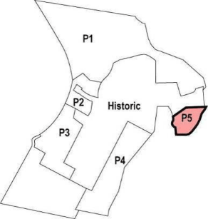
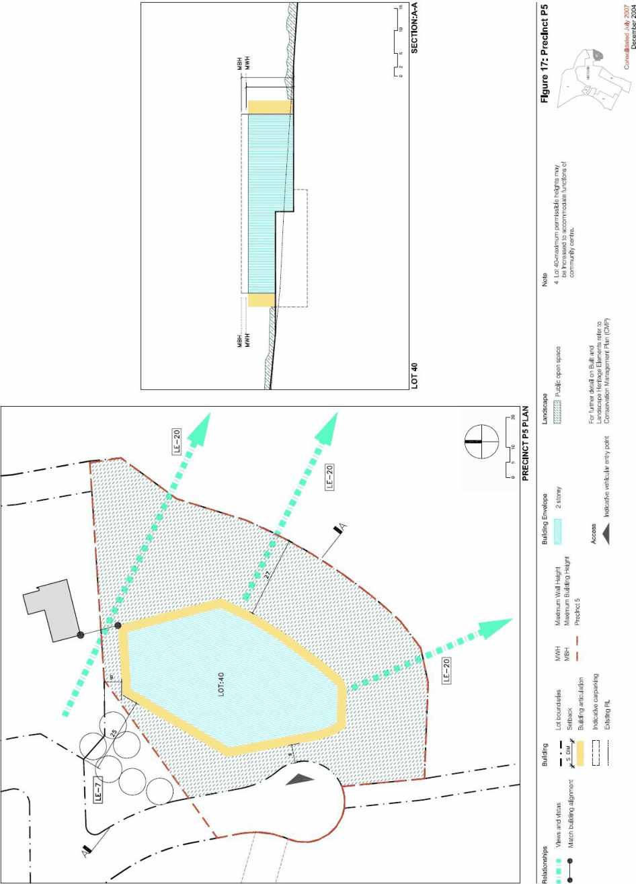

### 7.5. Precinct P5

Precinct P5 is located on the eastern side of the DCP area at the end of Pine Avenue. It is bound by the Historic Precinct to the north and the Coast Golf Course to the east, south and west. This precinct will contain a community centre (Prince Henry Centre), to serve the needs of residents and the surrounding suburbs, as well as specific needs such as cultural facilities, as part of Council’s program for integrated, multi -purpose community facilities across Randwick City. This precinct has a close visual relationship with the Chapel (within the adjoining Historic Precinct) and the coast.

Precinct Objectives

> [Picture on page 73: a picture, saved as a picture (images/part-d11-prince-henry-site-little-bay-page-73-13.gif, 150 dpi).]

1\. To provide for a multi-purpose community centre for the residents of the Prince Henry site and beyond

2\. To ensure that the community facility becomes a model development in terms of sustainable development

3\. To ensure that new development sits within the landscape and that the visual prominence of the Chapel is retained

4\. To retain the open landscape character of the Prince Henry site.

Desired Character This precinct will contain a new multi-purpose community centre (Prince Henry Centre). The design emphasis will be on enhancing the existing landscaping along access roads and the golf course edges and to soften the appearance of the proposed community building. The community and recreation uses of this building may require a building form that differs quite substantially from other buildings (new and existing) on the Prince Henry Site. The new building must not however dominate the landscape or compete with the nearby Chapel when viewed from within the site or from the coastline, nor should it block significant views to the coastline. Accordingly, the built form will comprise a combination of indoor and outdoor spaces that relate to the topography of this part of the site, and which offer opportunities for enhancing the existing landscaping. This may result in a single building, but may also result in a number of linked buildings and/or ancillary buildings. The building will incorporate a range of measures, which set the highest benchmark in terms of sustainable development, all of which are suitably integrated into its design. Landscaping will retain the open grassy character of the site, with local, drought-tolerant native plant species.

Controls In addition to the general controls contained in this Section the following controls also apply to development within this precinct:

Built Form

a) Building heights, FSR and landscaped open space are to comply with the Built Form Control Table (Figures 6 and 7)

Note: Maximum height and FSR may not be able to be achieved in all instances; however, the requirements for minimum landscaped open space must be achieved in all instances.

b) Development is to comply with the minimum setbacks and alignments shown in Figure 17 Precinct P5

c) The building envelope in Figure 17 is indicative only, and may vary subject to compliance with these controls at DA stage

d) Building frontages are to be aligned with street frontages

e) New buildings should be of a scale that does not dominate the landscape or visually compete with the Australian Nurses War Memorial Chapel. Refer to Figure 17 for building alignment requirements

f) A full range of passive and active sustainable design measures are to be incorporated into the community facility building to maximise opportunities for renewable energy use and minimise demand for water and other finite resources

g) The development of the Community Centre is to be in accordance with the Developer Agreement.

Landscaping

a) Significant landscape elements such as cultural plantings are to be conserved. Landscaping in this precinct should complement that in the adjoining Historic Precinct.

Heritage

a) All development must be in accordance with the Conservation Management Plan, Archaeological Management Plan and any relevant Specific Elements Conservation Policy and must demonstrate that:

i. the new building(s) maintain an appropriate setting for the Historic Precinct including significant buildings and landscape features in the vicinity, including the Interdenominational Nurses War Memorial Chapel, and Pine Avenue

ii. excavation in the possible extent of the palaeovalley area should not go below RL 26 unless endorsed by Randwick Council and the NSW Office of Environment and Heritage.

Figure 17: Precinct P5

> [Picture on page 75: a picture, saved as a picture (images/part-d11-prince-henry-site-little-bay-page-75-2.gif, 150 dpi).]
