### 7.6. Historic Precinct

The Historic Precinct comprises the centre of the DCP area and contains most of the existing built and landscape heritage elements that contribute to the heritage significance of the Prince Henry Site, representing the key elements of the former Coast Hospital and Prince Henry Hospital.

Precinct Objectives

1\. To conserve the heritage significance of the Historic Precinct and it’s setting

2\. To conserve significant built and landscape elements while adapting them to suitable new uses

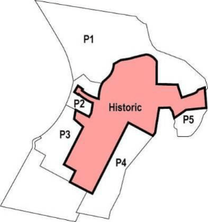

> [Picture on page 76: a picture, saved as a picture (images/part-d11-prince-henry-site-little-bay-page-76-12.gif, 150 dpi).]

3\. To ensure that new development respects the historic structure and layout of the precinct and relates sympathetically to significant built and landscape elements within the precinct.

Desired Character This precinct will accommodate a variety of residential development, community uses, and housing for older people. This will be achieved largely by appropriate adaptation of existing significant buildings, areas of sensitive ‘infill’ development, complemen ted by areas of open space. Significant built and landscape heritage elements within the Historic Precinct will be conserved. Aboriginal and Historical archaeological relics and sites within the precinct will be managed, recorded and conserved as appropriate. The streetscape of the Historic Precinct will continue to be strongly influenced by the many retained built and landscape heritage elements as well as the existing road structure and layout. Pine Avenue and its Norfolk Island pine trees will continue to be the dominant landscape element. The structure and general layout of the precinct will be retained, together with the open character of the landscape. Development within the Historic Precinct will primarily comprise conservation and adaptation of existing heritage buildings on site (for residential, community and small-scale local retail uses), with small pockets of new development. New development within the northern part of the Historic Precinct will comprise a single storey detached dwelling (Lot 12) at the south-western end of the existing Artisans Cottages, and 3-4 storey apartment buildings along the northern side of Pine Avenue (Lots 9 and 10), adjacent to former hospital buildings of similar scale. A 2 storey multi-unit building will be located to the north of Flowers Ward 5 on the site of a demolished hospital building. The building will be of a form and scale that is sympathetic to the adjacent Flowers Ward. At the southern end of the Historic Precinct, the DCP makes provision for an extension to the Delaney Building (Lot 32). This site (Lot 32) has been amalgamated with the adjoining Lot 31in Precinct P3 to make more effective use of floor space and to facilitate a shared parking arrangement. The minimum landscaped open space requirements for this lot are lower due to its proximity to Bob-A-Day Park and the remnant bushland at the southern end of the DCP area. The remnant bushland will provide a “green outlook” for residential development on this Lot, giving the perception of substantial open space, while Bob-A-Day Park will provide accessible open space for passive and small-scale active recreation. The existing Delaney building influences the south- facing location of the extension allowed and the location of open space on this lot, which is atypical and does not establish a precedent for other lots.

It is important that new development complements the established character of the precinct by having a compatible scale and architectural character, and through careful consideration of the spaces between buildings.

Controls In addition to the general controls contained in this Section the following controls also apply to development within this precinct:

Built Form

a) Building height, FSR and landscaped open space for all lots in the Historic Precinct are to comply with the controls set out in the Built Form Control Table (Figures 6 and 7)

Note: Maximum height and FSR may not be able to be achieved in all instances; however, the requirements for minimum landscaped open space must be achieved in all instances.

b) The maximum height of the extension to the Delaney Building (Lot 32) must not exceed the existing ridge height of the Delaney Building (see Figure 20), with a minimum floor to ceiling height of 2.7 metres for all floors

c) New developments are to be in accordance with the policies contained within the Conservation Management Plan (CMP), Archaeological Management Plan (AMP), and any relevant Specific Elements Conservation Policies (SECP)

d) Development is to comply with the setbacks and ‘match building alignment’ controls identified on Figures 18-19

e) Development is to demonstrate that views (both from the private and public domain) identified on Figures 18-19 are maintained. Details of the view analysis are to be included at DA stage

f) New buildings should respect the blocky rectilinear form of the most significant buildings such as the Flowers Wards and the Matron Dickson Nurses Home without mimicking their character or appearance

g) New buildings should be designed so they are appropriate in terms of their character, scale, massing, materials and details, setback and orientation to the existing buildings and spaces within the Historic Precinct.

Landscaping

a) Landscape planting is to complement and not compete with the highly significant plantings of Norfolk Island Pine trees along Pine Avenue

b) The historically open character of the landscape in the precinct should be retained

c) New planting should be in accordance with the suggested species list included as Appendix A.

Heritage

a) All development must be in accordance with the Conservation Management Plan (CMP), Archaeological Management Plan (AMP), and any relevant Specific Elements Conservation Policy (SECP), and must demonstrate that:

i. historic and visual relationships of buildings and groupings of buildings are retained

ii. the symmetry and axial siting of the Flowers Wards and Heffron and Delaney buildings are respected and reinforced

iii. view corridors from the Flowers Wards and the visual link from the Avenue of Coral Trees to the former Matron Dickson Nurses Home are opened (Figure 4)

iv. the visual prominence of the Clock Tower and the Chapel as viewed from Pine Avenue is maintained

v. new buildings along Pine Avenue follow the road alignment and the alignment of the early road from Pine Avenue to the former Institute of Tropical Medicine

vi. that adequate curtilages and settings are defined, protected and maintained around significant buildings, groups of buildings and spaces

vii. that a consistent approach to the conservation of the Flowers Wards and their settings is maintained

viii. excavation of the palaeovalley should not go below RL 26 unless endorsed by Randwick City Council and the NSW Office of Environment and Heritage.

Parking

a) Where surface parking is provided within private lots within this precinct, it is not to detract from the setting of significant buildings.

Figure 18: Precinct Historic-1

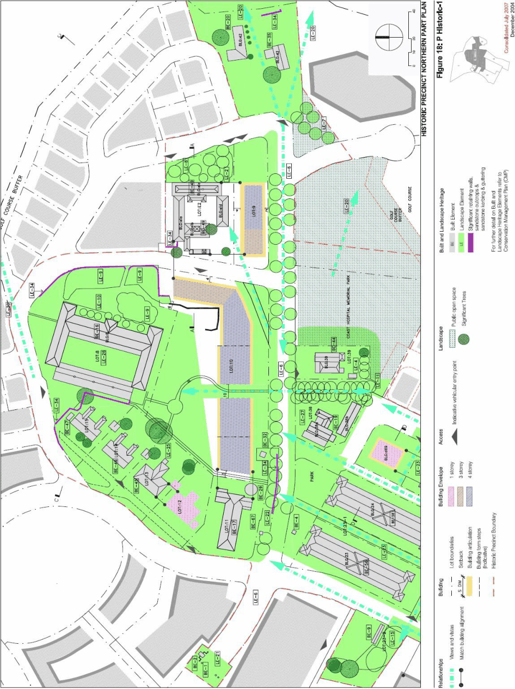

> [Picture on page 79: a picture, saved as a picture (images/part-d11-prince-henry-site-little-bay-page-79-2.gif, 150 dpi).]

Note: The lot numbers and boundaries may be superseded as subdivision continues across the site.

Figure 19: Precinct Historic-2

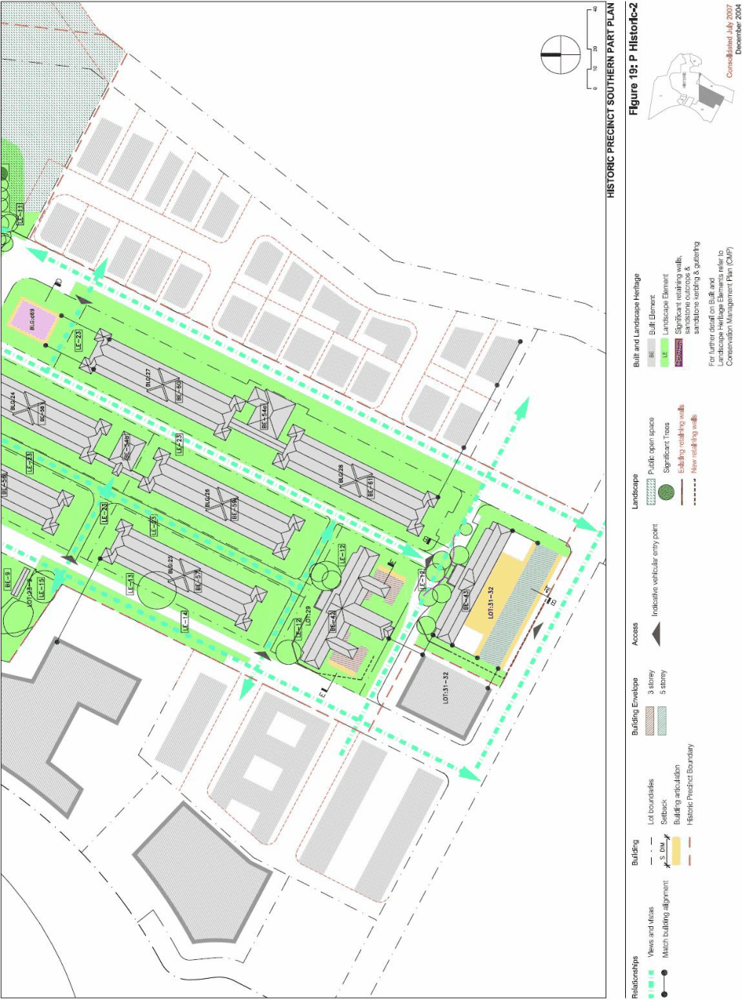

> [Picture on page 80: a picture, saved as a picture (images/part-d11-prince-henry-site-little-bay-page-80-2.gif, 150 dpi).]

Note: The lot numbers and boundaries may be superseded as subdivision continues across the site.

Figure 20: Precinct Historic-3

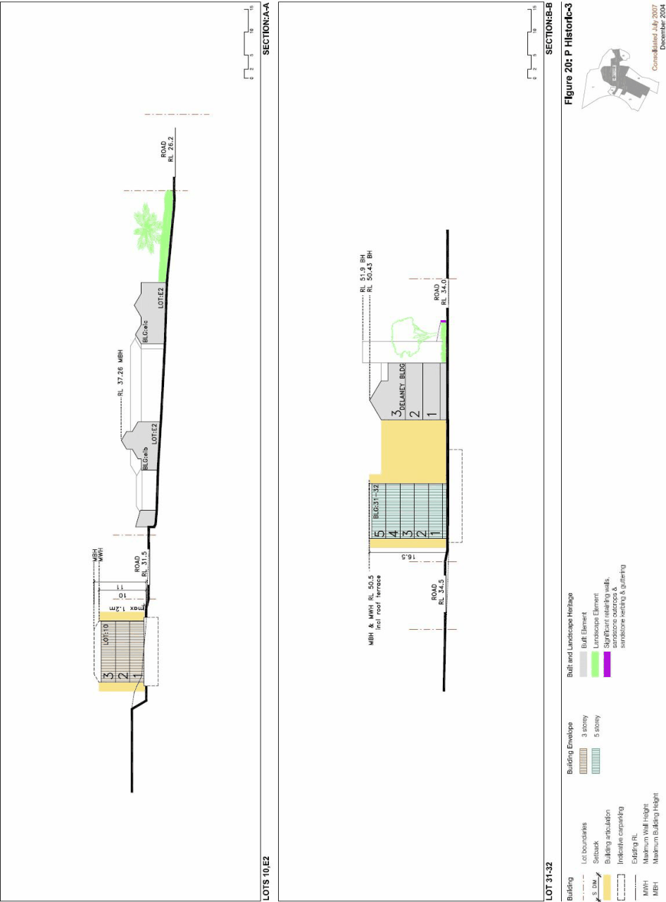

> [Picture on page 81: a picture, saved as a picture (images/part-d11-prince-henry-site-little-bay-page-81-2.gif, 150 dpi).]

Note: The lot numbers and boundaries may be superseded as subdivision continues across the site.

Figure 21: Precinct Historic-4

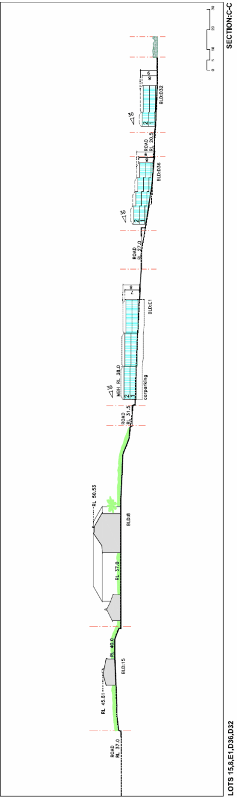

> [Picture on page 82: a picture, saved as a picture (images/part-d11-prince-henry-site-little-bay-page-82-2.gif, 150 dpi).]

Note:

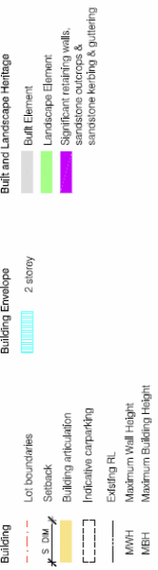

> [Picture on page 82: a picture, saved as a picture (images/part-d11-prince-henry-site-little-bay-page-82-4.gif, 150 dpi).]

The lot numbers and boundaries may be superseded as subdivision continues across the site.

Figure 22: Precinct Historic-5

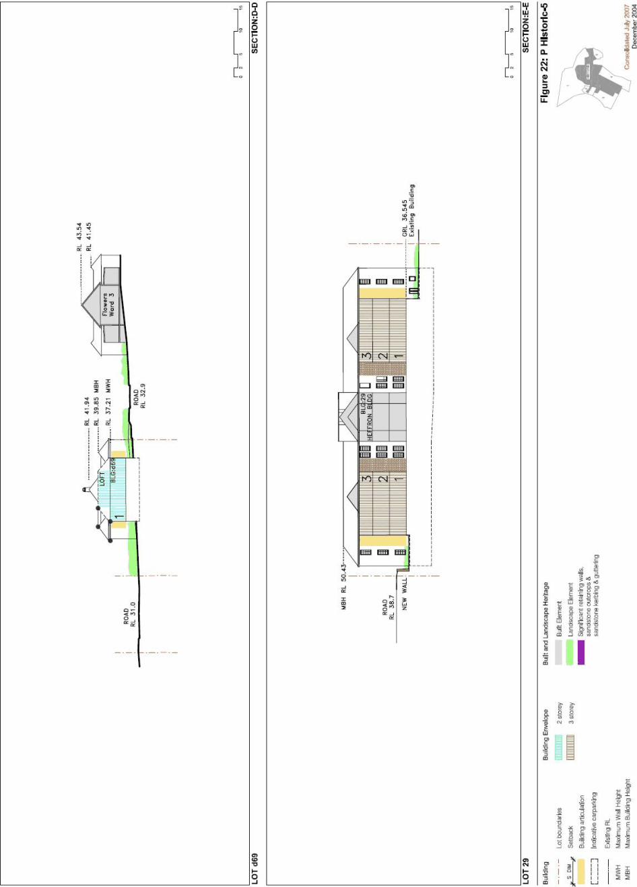

> [Picture on page 83: a picture, saved as a picture (images/part-d11-prince-henry-site-little-bay-page-83-2.gif, 150 dpi).]

### Part C - Appendices

### Part C Appendices

Appendix A: Recommended List of Suitable Native Species for the Prince Henry Hospital Redevelopment Site

Trees:

• Banksia integrifolia

• Casuarina glauca

• Eucalyptus piperita

• Eucalyptus robusta

• Eucalyptus sieberi

• Eucalyptus obstans

• Angophora costata

• Melalueca armillaris

Shrubs:

• Baeckea imbricata

• Banksia marginata

• Banksia spinulosa

• Callistemon hybrids

• Correa alba

• Grevillea hybrids

• Westringia fruticosa

• Hakea gibbosa

Groundcovers:

• Carpobrotus glaucescens

• Chrysocephalum apiculatum

• Dianella congesta

• Grevillea hybrids

• Isolepis nodosa

• Themeda australis

• Brachychome multifida

• Lomandra tanika

• Hibbertia scandens

The species in this list are suitable for dry, windy, coastal sites with nutrient-poor soils. They require relatively little maintenance. The trees and shrubs do not have fleshy fruits, so as not to promote the spread of larger, more aggressive birds, which may result in the loss of smaller native species. The list has also been compiled to address the provenance issue, as it relates to loss of genetic biodiversity, due to use of non-local provenance planting material. Hence, only a few native species present in bushland in the vicinity of the Prince Henry site have been chosen for this list.

### Appendix B: Bushfire Risk Management Report (2001) NSW Fire Brigades (currently Fire and Rescue

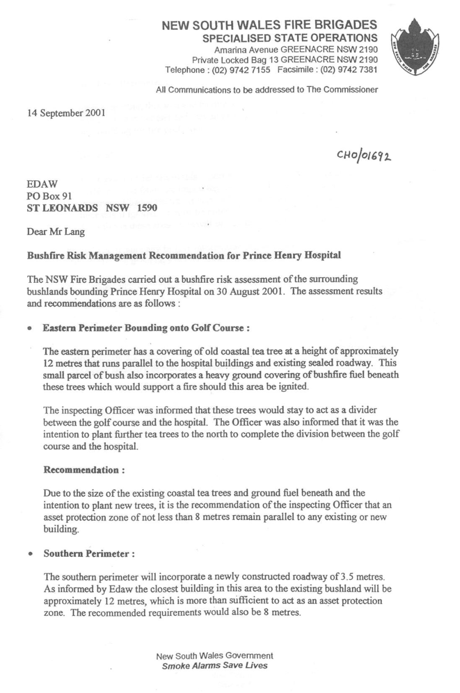

> [Picture on page 86: a picture, saved as a picture (images/part-d11-prince-henry-site-little-bay-page-86-3.gif, 150 dpi).]

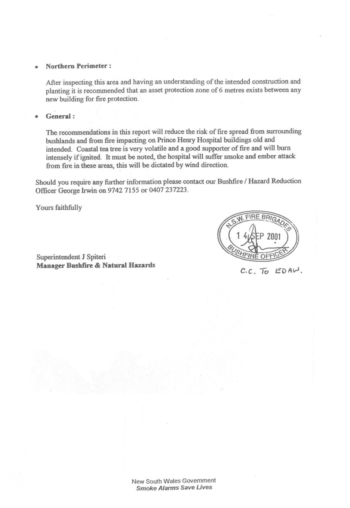

> [Picture on page 87: a picture, saved as a picture (images/part-d11-prince-henry-site-little-bay-page-87-1.gif, 150 dpi).]

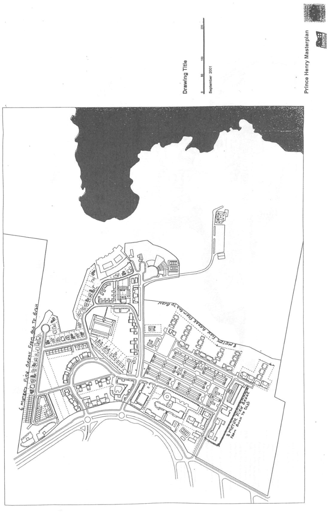

> [Picture on page 88: a picture, saved as a picture (images/part-d11-prince-henry-site-little-bay-page-88-1.gif, 150 dpi).]

Appendix C: Map Extracts from the Archaeological Management Plan (AMP) and the Conservation Management Plan (CMP)

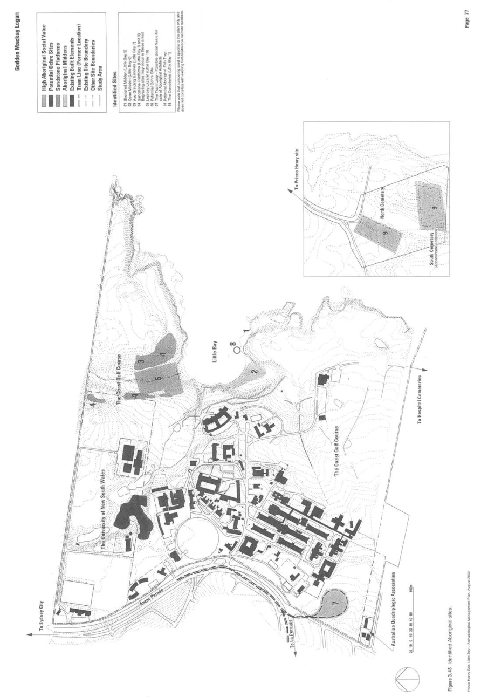

> [Picture on page 89: a picture, saved as a picture (images/part-d11-prince-henry-site-little-bay-page-89-4.gif, 150 dpi).]

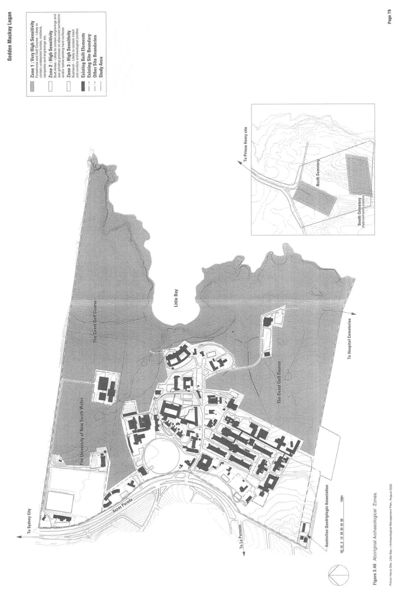

> [Picture on page 90: a picture, saved as a picture (images/part-d11-prince-henry-site-little-bay-page-90-1.gif, 150 dpi).]

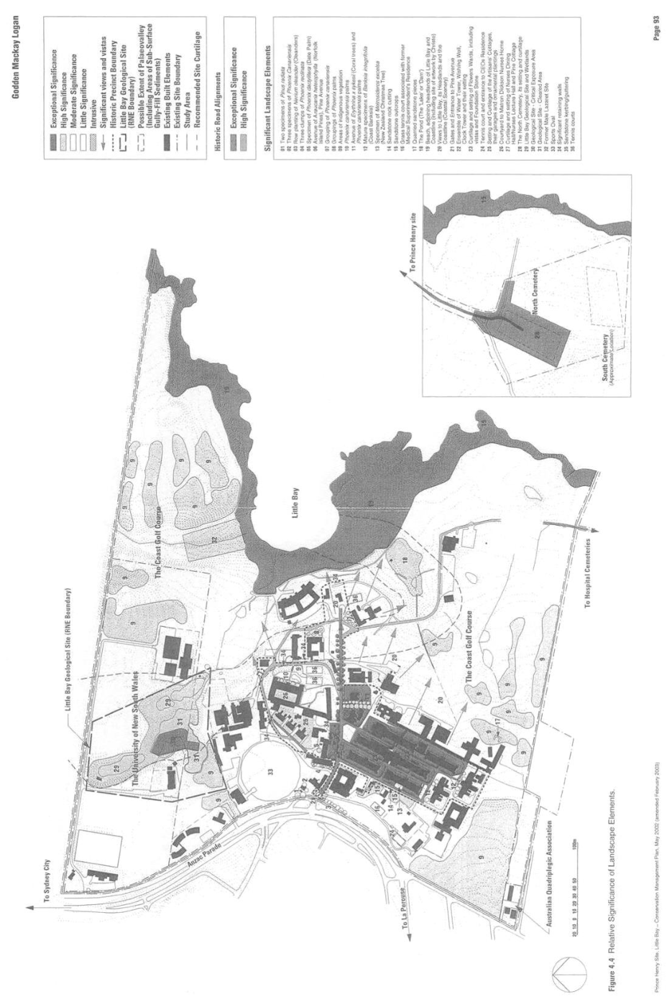

> [Picture on page 91: a picture, saved as a picture (images/part-d11-prince-henry-site-little-bay-page-91-1.gif, 150 dpi).]

### Appendix D: Total Water Cycle Strategy – Prince Henry Site

Background Stormwater from the site drains to 3 major discharge points: Anzac Parade sub-catchment, Wetlands sub-catchment and the Golf course sub catchment (refer to Figure 1).

Overview Harvested rainwater re-use will be shared amongst several users for a range of purposes. It will be re-used within the Prince Henry DCP area for irrigation of parks and the public domain and will also be re-used by the Coast Golf Course for irrigation of their greens. The irrigation of parks and the golf course greens may need to be supplemented by mains water during summer months, however, the volume of mains water used to supplement recycled water use (particularly for irrigation of public open spaces within the Prince Henry DCP area) is to be minimised. A substantial proportion of stormwater from the Prince Henry site will run off to the Coast Golf Course, passing through swales, which will provide a level of water quality treatment.

Key Elements Key elements of the total water cycle strategy for the site include:

• Water storage facilities must be provided in conjunction with the Prince Henry development to allow storage of stormwater for reuse in irrigation of public open spaces (within the Prince Henry DCP area). Water storage facilities shall be provided to the satisfaction of Council.

• High efficiency irrigation techniques and practices are to be installed and implemented in all parks within the Prince Henry site.

• Drought tolerant local native species are to be used in parks and the public domain.

• Water quality treatment measures and devices shall be provided in conjunction with the Prince Henry development. Such measures are to include, but not be limited to, bio-retention swales and gross pollutant traps (GPTs). Swales are to be dedicated to Council a minimum of 36 months post construction (or such time as agreed to by Council) to allow them to be properly established, and to ensure protection during the construction phase.

• Where pumps are required, high energy efficient pumps are to be used. Consideration shall be given to the use of solar power pumps (details to be provided at DA stage).

• Where possible, permeable paving is to be used in at-grade car parks and private lots, Car parks are to maximise opportunities for water sensitive urban design through the use of techniques such as (but not limited to) swales, rainwater planter boxes etc, suited to the scale and location of the car park. It is envisaged that these techniques will perform dual roles of water sensitive urban design and maximising the amenity and appearance of the car parks through substantial landscaping.

• Deep soil areas throughout the Prince Henry DCP area are to be maximised.

• Water efficient plumbing fixtures are to be incorporated in building and public domain design (i.e. public toilets etc).

The detailed design for the Total Water Cycle Strategy must be approved by Council prior to the lodgement of the DA/s for the open space areas across the site).

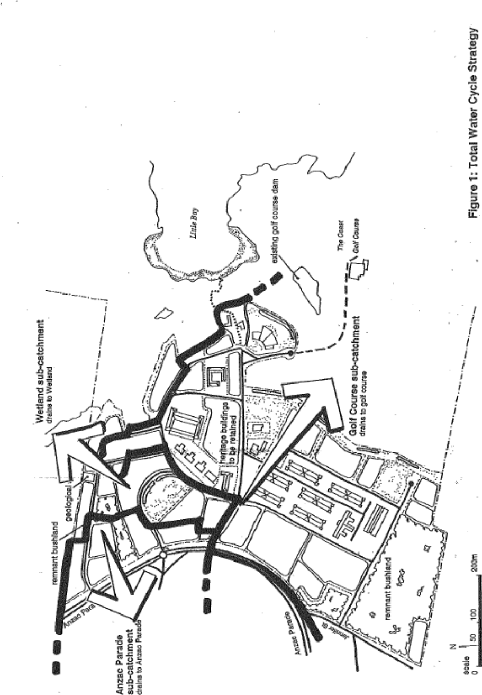

> [Picture on page 93: a picture, saved as a picture (images/part-d11-prince-henry-site-little-bay-page-93-1.gif, 150 dpi).]

### Appendix E: Watercourse Categories and Riparian Land Widths

There are 4 watercourses within the Coast Golf Course, adjacent to the Prince Henry DCP area, known as:

• The northern watercourse

• The central watercourses (comprises 2 watercourses / arms)

• The southern watercourse The Department of Planning and Infrastructure has identified two watercourse categories on the Coast Golf Course as follows:

• the northern and southern watercourses: Category 2

• the central watercourses:

Category 3

The riparian land widths for these categories are as follows: Category 2 watercourse: a minimum riparian land width of 20 metres on each side of the bank (measured from top of bank), or to the extent of significant remnant native vegetation whichever is the widest, to provide terrestrial and aquatic habitat, bank stability and to protect water quality Category 3 watercourse: a minimum riparian land width of 10 metres on each side of the bank (measured from top of bank), to provide terrestrial and aquatic habitat, bank stability and to protect water quality

### Appendix F: Specific Elements Conservation Policies (SECP)

| Specific Elements Conservation Policies (SECP) |  |  |
|---|---|---|
| No. | Specific Elements Conservation Policy | Notes |
| B-01 B-02 | Entrance Group Entrance Gates and Gateposts Entrance Gatehouse | SECP completed in November 2004. |
| B-04 B-29 B-32 B-67 | Pine Avenue Group War Memorial Clock Tower Former Water Reservoir Former Water Tower Wishing Well | SECP completed in May 2006. |
| B-09 | Henry’s Trading Post | SECP completed in August 2003. |
| B-16 | Matron Dickson Nurses Home | SECP completed in May 2006. |
| B-17 B-29 | Pathology Department Building and Water Reservoir Former Pathology Department Building Former Water Reservoir | SECP completed in April 2005. |
| B-19 | Former Nurses Lecture Hall Store and Social Work Department (Former Nurses Dining Hall/Lecture Hall) | SECP completed in August 2004. |
| B-20 L-34 | Former Motor Garage and Retaining Walls Storage Shed/Former Motor Garage Significant Retaining Walls | SECP completed in April 2004. |
| B-35 | Interdenominational Australian Nurses War Memorial Chapel | SECP completed in October 2006. |
| B-37 | Coast Golf Course Clubhouse (Former Coast Hospital Laundry) | Outside DCP area. |
| B-42 | BJ Heffron House (A Block) | SECP completed in June 2008. |
| B-43 | Delaney Building (B Block) | SECP completed in June 2008. |
| B-44 | Pine Cottage | SECP completed in July 2007. |
| B-45 | Artisans’ Cottages No 4 and No 5 | SECP completed in April 2005. |
| B-46 | Artisans’ Cottages No 6 and No 7 | SECP completed in April 2005. |
| B-47 | Artisans’ Cottages No 8 and No 9 | Demolished. |
| B-49 | Institute of Tropical Medicine Complex | SECP completed in June 2007. |
| B-54a | ‘Hill Theatres’ (Operating Theatre No 3) |  |
| B-54b | ‘Hill Theatres’ (Operating Theatre No 2) | SECP completed in March 2006. |
| B-66 | Flowers Wards Group Foundation Stone | SECP completed in May 2003. |

| B-56 | Flowers Ward 1 | SECP completed in May 2002 as part of the May 2002 CMP (amended February 2003). |
|---|---|---|
| B-57 | Flowers Ward 2 | SECP completed March 2006 |
| B-58 | Flowers Ward 3 and ‘Hill Theatres’ (Operating Theatre No 1) | SECP completed in November 2004. |
| B-59 | Flowers Ward 4 | SECP completed in March 2006. |
| B-60 | Flowers Ward 5 | SECP completed in March 2006. |
| B-61 | Flowers Ward 6 | SECP completed in March 2006. |
| B-70 | Former Coast Hospital Water Tower | Outside DCP Area. |
| L-28 | Setting and Curtilage of North Cemetery | Outside DCP Area. |
| L-30 L-31 | Little Bay Geological Site Critical Exposure Area Cleared Area | SECP completed in November 2003. |
| L-34 | Significant Retaining Walls | Some retaining walls are outside the DCP Area. Most retaining walls are now covered by the Road Network SECP and Motor garage SECP. Others to be incorporated into SECPs for significant buildings to be sold or are outside the DCP area and may need to be prepared as separate SECPs. |
| L-34 L-35 | Road Network SECP Significant Retaining Walls Sandstone Kerbing/Guttering and Historic Road Alignment | Preliminary SECP completed in July 2003. |

Randwick City Council 30 Frances Street Randwick NSW 2031

1300 722 542 council@randwick.nsw.gov.au www.randwick.nsw.gov.au
