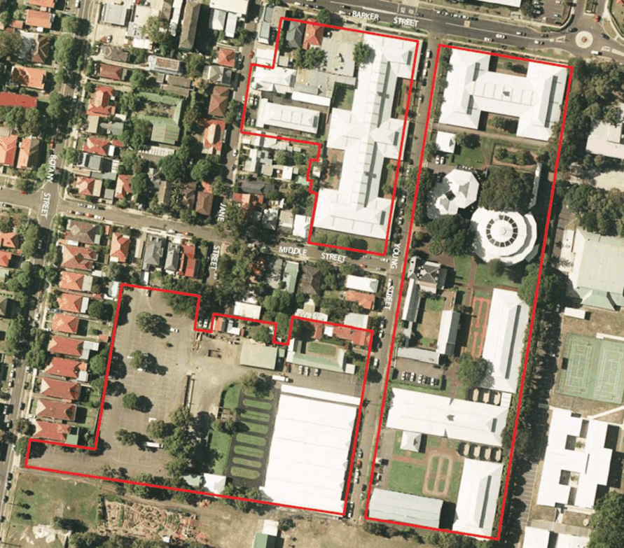

### 1.2. Land to which this DCP applies

The provisions of this chapter apply to development within the Newmarket Green site as shown in Figure 1. The site is generally bounded by Barker, Jane, Young, Middle and Botany Streets. Young Street and Middle Street dissect the site in a north-south and east-west direction respectively.

Figure 1: Land to which this DCP applies

> [Picture on page 4: a picture, saved as a picture (images/part-d12-newmarket-green-page-4-16.gif, 150 dpi).]

Source: Randwick City Council
