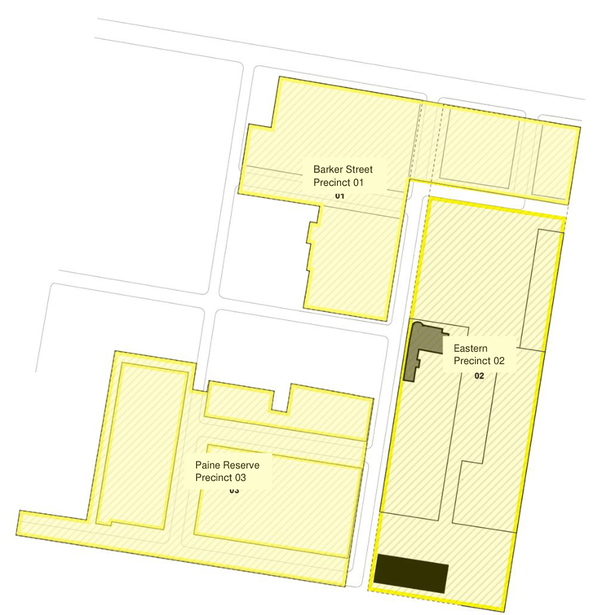

### 2.3. Desired future character

Newmarket Green is defined by three distinct precincts. Each precinct has a distinct desired future character that is to be reflected in the design of built form and public domain. All development at Newmarket Green is to contribute to achieving the desired future character within each precinct. The three precincts are shown in Figure 2 and are described below.

Barker Street Precinct This is the most urban precinct reflecting the growth and scale of the Randwick Education and Health Specialised Centre. Focused on Barker Street, non-residential uses at the ground floor should create an active and vibrant interface along the street frontage. Active uses, with shopfronts and outdoor seating, are encouraged on the ground floor. A generous building setback (5m) to Barker Street will create a comfortable pedestrian environment, protected by awnings and street trees. The public domain along Barker Street will enhance the pedestrian experience by providing:

• Street trees planted at regular intervals

• High quality block style pavers within the 5m setback

• Consistent awning and pedestrian scale lighting. The balance of the Barker Street buildings will accommodate a range of uses to meet market demand and contribute to the Specialised Centre. This may include medical offices associated with the hospital, and/or research or office space associated with the University of NSW, mixed with housing that will appeal to workers and users of the Specialised Centre – such as students and key hospital workers. Opportunities for partnerships with the adjacent hospital and/or university should be encouraged, where possible. Buildings range in height to respond to surrounding character. Close to Struggletown, buildings scale down in height to a maximum of 10m and are set back from the west boundary. Along Barker Street, buildings to a maximum height of 25m will provide a balance to the adjacent hospital and create a prominent building alignment along Barker Street. Transition of building height will occur between the lower scale existing residences adjacent to the site. Setbacks along Young Street are also encouraged, to allow for soft landscaping along the building edge and opening up of view corridors to Newmarket House. Significant trees along the east boundary (adjoining Randwick High School) and along Middle Street should be retained and building setbacks and footprints (including basements) designed to protect these trees and their root systems. In the block on the western side of Young Street, south of the E1 Local Centre zone, residential development will be integrated with the character of the surrounding residential properties in Struggletown Heritage Conservation Area. Built form in this block is designed to provide a fine grain element to Newmarket Green that responds to the low-scale character of Struggletown. Building heights will transition from lower scale along Middle Street, up to a higher scale at Young Street. Buildings along Middle Street will incorporate setbacks to allow for the retention of significant trees. The setbacks will complement the transition in building heights to Struggletown, with a two storey building height at the street edge, stepping up and back to a height of 21m. This will create a transition to lower scale residences to the west along Middle Street. Adjacent to Newmarket House on the opposite side of Young Street, the east façade will incorporate a specific architectural response to ensure a high-quality outlook from the park that complements Newmarket House and gardens in the design, massing and selection of building materials and colours.

Eastern Precinct This is the largest and most prominent space in Newmarket Green. It is characterised by the heritage listed buildings and landscapes that reflect the history of Newmarket Green, and which are to be celebrated through new open space and public domain areas.

A new public open space is located alongside Newmarket House and gardens, which incorporates the Sales Ring precinct. The focus of this open space will be the central Moreton Bay Fig Tree, as well as opportunities to celebrate the historic significance of the site through public art and interpretive features. A second prominent public domain area will be the Big Stable and its curtilage at the south end. An area of open space outside the Big Stable

– known as Big Stable Square

– will be defined by

a formal shape to encourage public gathering and activity. Durable ground treatments, such as crushed gravel and porous paving, are encouraged to enable markets and other active uses in the Square. Pedestrian connectivity and views between open spaces and public domain areas is to be encouraged through a north-south pedestrian link. Buildings in this precinct will range from 12m up to 25m, with low-rise elements adjacent to the retained heritage buildings and upper storeys set back. The following building envelopes shall be incorporated:

• Big Stable

– Buildings should generally be set outside of the curtilage to create an

outdoor civic space, to respect the scale of the Big Stable. Upper building elements to the north will be setback by at least 12m from the Big Stable, or so that the upper levels are entirely outside of the curtilage.

• Newmarket House and Garden – Building elements immediately adjacent to Newmarket House will be limited to four storeys within a transition zone. Upper storeys (up to 25m) will be setback from the heritage item, and focused in the centre of the site or along the east boundary.

Paine Reserve Precinct Adjacent to the south boundary of Newmarket Green, the focus is to maximise opportunities for passive surveillance of Paine Reserve whilst maintaining a transition of building heights to adjacent lower scale residential areas to the north and west. Streets will be used to create view corridors, new access points to the site and to provide additional amenity to adjacent properties. A new street along the south boundary will open up a new view corridor to the Big Stable from the west. A rear laneway along the west boundary abutting neighbouring properties fronting Botany Street, will provide a significant building separation to future development, benefiting the neighbouring properties to the west. Built form and building heights in this precinct will be carefully considered to achieve good amenity and respond to surrounding heritage items, Paine Reserve and neighbouring sites:

• Mid to high-rise buildings (up to 25m) will be located along the south boundary to create a prominent south edge to the site and opportunities for passive surveillance of the neighbouring park. An articulated façade along the park edge will provide a high quality architectural finish when viewed from Paine Reserve. The north edge of the building – facing terrace houses to the north

– is to be set back by at least 2m from the street edge

and has a reduced building height at the street edge (approximately five storeys). Upper floors are to be setback from the building edge.

• Building heights along the Young Street frontage will be scaled down (to approximately four-to-five storeys) to create a balance to the Big Stable. Upper storeys to 25m will be set back from Young Street. An architectural response will be required along the east facade of this building (Young Street frontage) that responds to, and provides an attractive view from, the Big Stable Square.

• Buildings along the west edge adjoining properties fronting Botany and Middle Streets will be a maximum of 10m so as to not dominate adjacent smaller scale dwellings. A two-storey difference in the relative ground level of the site and neighbouring properties

to the west means the scale of buildings in this precinct will naturally appear reduced. On its east frontage along the Jane Street extension, the building will transition up to 18m, providing a balance to buildings on the opposite side of the street.

There is an opportunity to position a specific architectural or massing feature (two storeys) on the building at the southwest corner of the site to terminate views from Young Street / Big Stable Square down the new southern thoroughfare. The development block is set back from the new southern street to enhance this view. Figure 2: Character precincts

> [Picture on page 10: a picture, saved as a picture (images/part-d12-newmarket-green-page-10-9.gif, 150 dpi).]
> Words printed on the picture (title and legend, copied from the PDF):
> Barker Street
> Precinct 01
> Eastern
> Precinct 02
> Paine Reserve
> Precinct 03

PRECINCT BOUNDARY

NEWMARKET HOUSE

BIG STABLE BUILDING

SITE BOUNDARY

Source: Randwick City Council
