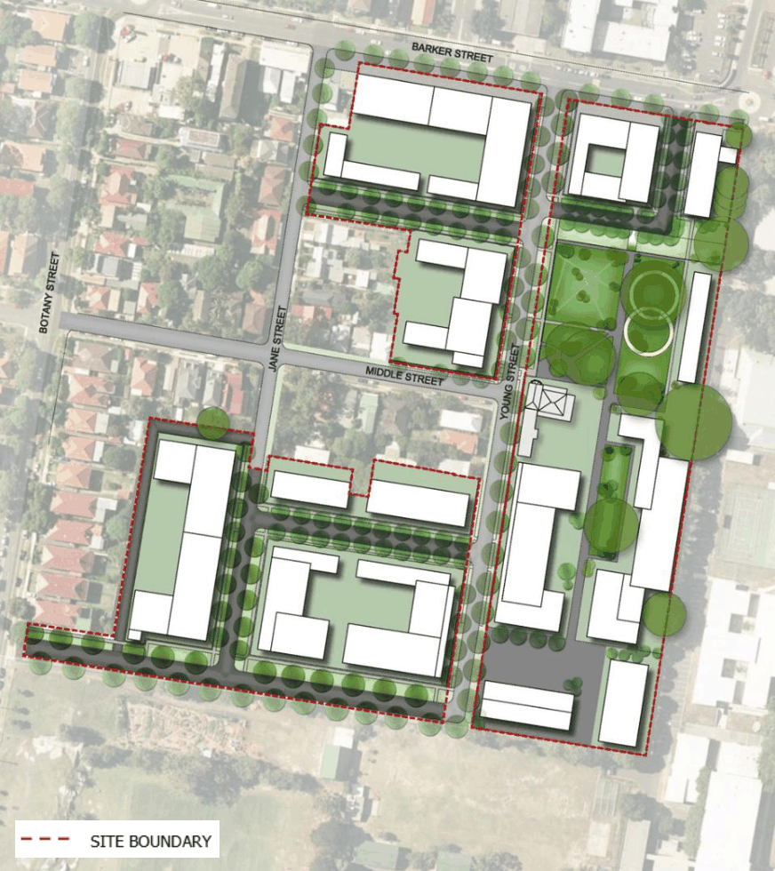

### 2.4. Indicative concept plan

Objectives The objectives for the concept plan are to:

1\. Ensure that development of Newmarket Green occurs in a coordinated manner consistent with the vision and development principles for the site

2\. Ensure the key elements of the site are delivered, whilst providing a degree of flexibility as to the final layout and design of the site

3\. Ensure that the overall development complies with the maximum height and floor space ratio development standards for the whole site contained in Randwick LEP 2012.

Controls

a) Development is to be generally consistent with the indicative concept plan in Figure 3 and key elements described in Table A. Where variations are proposed, a DA shall demonstrate how the vision, development principles, key elements and relevant objectives are still able to be achieved.

Table A

– Key elements

| Element | Description |
|---|---|
| Residential community | • A transition from low to medium density residential development in the R1 General Residential zone ensuring each block complies with the maximum 1.3:1 FSR across the whole site • A range of housing types to broaden housing choice in the area, including more affordable options to meet market demand and accommodate key workers, students and other emerging demographic groups in the locality • A mix of uses within the E1 Local Centre zone at Barker Street that will attract pedestrian activity, vitality and contribute to the creation of a vibrant place that serves the needs of the local community. |
| Open space | • A new public open space with a minimum area of 5,000m2 • New open space around key heritage items – the Big Stable and Newmarket House • Design of landscaping and public domain areas to soften the appearance of the built form, create high levels of amenity and provide focal points for passive recreation for the local community and respite for hospital workers and visitors. |
| Heritage | • Adaptive reuse of the Big Stable building and Newmarket House to encourage activities, including retail, cafes or restaurants, and the like • Retention, celebration and interpretation of the historic Sales Ring within the new public open space • Retention of significant trees that contribute to the site’s cultural significance • Building and landscape design that complements on-site heritage items and the Struggletown Heritage Conservation Area. |
| Built form | • Building heights ranging from 10m to 25m |

|  | • Low rise (10m – 12m) adjacent to Struggletown, the Big Stable, along Middle Street, and in response to the level change between Botany Street and the site • Midrise (18m – 25m) in transition areas outside of significant views, along Barker Street, the east boundary, Paine Reserve and set back from key roads (Young Street) and open space • Varied and dispersed building heights and setbacks to create an interesting, dynamic urban form that respects the scale of heritage items and adjacent properties. |
|---|---|
| Movement network | • A series of new local streets and lanes to enhance connectivity, and provide views to key heritage items and open space • A new southern thoroughfare adjacent to Paine Reserve to create a new access option through the site • Extension of the existing Jane Street to the new southern thoroughfare to complete the original grid pattern of the locality • A series of pedestrian and cyclist thoroughfares to enhance connectivity to surrounding areas, including the Prince of Wales Hospital and Paine Reserve. |
| Sustainable design | • Incorporate waste management and environmentally sustainable development • Minimise greenhouse gas emissions • Minimise water use and encourage water re-use on the site • Encourage less car dependency. |

Figure 3: Indicative concept plan

> [Picture on page 13: a picture, saved as a picture (images/part-d12-newmarket-green-page-13-2.gif, 150 dpi).]

Source: Randwick City Council
