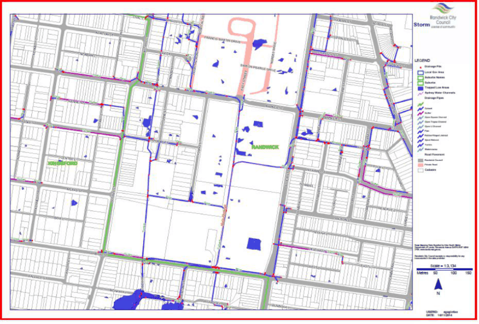

## 3. Public domain

### 3.1. Infrastructure

Any Stage 1 or concept development application submitted for the whole site must address all new infrastructure necessary for redevelopment of the site and changes to the existing infrastructure. The Stage 1 DA shall include sufficient documentation/evidence demonstrating compliance with DCP Part B8

Water Management and Council’s Private Stormwater Code. The

following matters shall also be addressed:

1\. The critical 1% AEP flood level must be established for all areas across the development

site. Council has not undertaken any flood modelling for the subject catchment. The impact of a 1% AEP storm event on the proposed development will need to be fully assessed.

2\. Sufficient documentation/evidence indicating that the proposed development will not increase the depth of overland flow in areas outside the development site and that no property downstream of the development site will be adversely affected as a result of the proposed development for storm events up to the 1 in 100 year ARI event.

3\. In relation to the proposed site stormwater drainage system, sufficient documentation/evidence that the new system will not increase the depth of overland flow in areas outside the development site, will not adversely impact on Council’s stormwater drainage infrastructure and that no property downstream or upstream of the development site will be adversely affected as a result of the proposed development for storm events up to the 1 in 100 year ARI / 1% AEP event.

4\. The proposed internal roadways, any drainage easements and overland flow routes will drain the 1 in 100 year storm event and to consider personal and structure safety and the hazard factor, (product of velocity and depth of flow). This safety factor shall not exceed a value of 0.4 at any location. (i.e. VD< 0.4).

5\. The internal pipe system shall cater for the critical 1 in 20 year ARI / 5% AEP storm event with overland flows contained within the roadways or other suitable flow paths for up to the 1 in 100 year / 1% AEP storm event.

6\. Details showing indicative pipe sizes, pit locations, pipe locations and any associated drainage easements, inter-allotment drainage pipelines and associated inter-allotment drainage easements. Plans must identify the road network, pipe/pit network, catchments draining to the various pipes/drainage pits, location of potential overland flow paths, levels of properties adjacent to overland flow paths and level information on the roads in general.

7\. Diagrams showing the relocation of any existing drainage infrastructure. In circumstances where relocation of infrastructure is not possible, alternative approaches such as identifying necessary easements and overland flow paths should be submitted.

The existing stormwater system is shown in Figure 4 below:

Figure 4: Stormwater system

> [Picture on page 15: a picture, saved as a picture (images/part-d12-newmarket-green-page-15-2.gif, 150 dpi).]

Source: Randwick City Council
