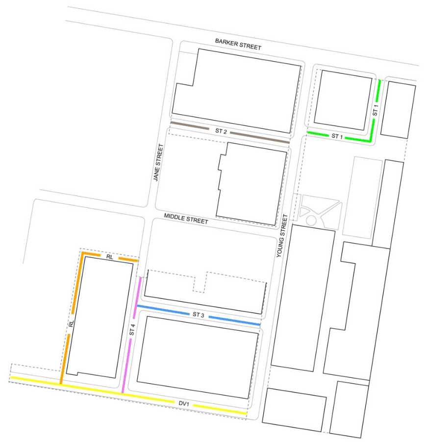

### 3.3. Street network and design

Objectives The objectives for street network and design are to:

1\. Provide safe, efficient and legible movement of pedestrians, cyclists and vehicles

2\. Design streets as spaces for people to enjoy, as well as move through incorporating high quality materials

3\. Create a hierarchy of streets that promotes good connectivity with the existing street network

4\. Promote direct vehicle access to the site from Young Street and Botany Street, and direct new vehicle movements away from Jane Street and Middle Street

5\. Create a slow speed environment and naturally calm traffic through street design

6\. Provide new on-street parking

7\. Make adequate provision for footpaths, street trees, services and drainage

8\. Enhance the current width and ‘local street’ function of Young Street.

Controls

a) The street network including pedestrian and cycle infrastructure must be constructed in accordance with Council’s requirements prior to the issue of the first occupation certificate and the layout is to be generally consistent with Figure 5

b) New streets are to be generally consistent with the parameters in Table B

c) Variations may be considered to the requirements in controls 1 and 2 above, where the above objectives and the following essential thoroughfare connections are satisfied:

i. A new thoroughfare along the southern boundary of the site connecting Botany Street to Young Street

ii. Extension of Jane Street connecting to a new southern thoroughfare

iii. A rear laneway along the western boundary of the site (where the site adjoins properties fronting Barker Street) to create additional building separation

iv. New east-west streets connecting Young Street and Jane Street

d) To cater for safe pedestrian movements across Barker Street, a pedestrian crossing shall be constructed across Barker Street to the satisfaction of Randwick City Council and Transport for NSW. Any signalisation of the pedestrian crossing shall meet the warrants for signals in accordance with the TfNSW

document titled “Traffic Signal

Design: Section 2-

Warrants”

e) The applicant shall consult with Sydney Buses in relation to any temporary relocation of the bus stop along Barker Street (near the intersection with Young Street) that may be required during construction. The applicant shall reinstate the bus stop on Barker Street to the satisfaction of Sydney Buses

f) New streets as shown in Figure 4 including pedestrian paths and cycleways within the public domain shall be dedicated to Council

g) Provide for a continuous pedestrian and cycling network through the site to connect to the broader street network.

Figure 5: Street network

> [Picture on page 17: a picture, saved as a picture (images/part-d12-newmarket-green-page-17-10.gif, 150 dpi).]

DRIVE 1 (DV1) SOUTHERN PARK EDGE STREET 1 (ST1) BARKER STREET ENTRY STREET 2 (ST2) EAST - WEST LINK STREET 3 (ST3) EAST - WEST LINK STREET 4 (ST4) JANE STREET EXTENSION REAR LANE (RL)

Source: Randwick City Council

Table B

– Indicative street dimensions

| Street Type | Reserve(1) (min) | Carriageway | Parking | Verge (min) | Footpaths | Traffic Lanes | Movement Type |
|---|---|---|---|---|---|---|---|
| DV1 Southern park edge Botany Street to Young Street | 14.0m | 8.7m | 1 x 2.3 | 3.0m | 1 x 1.5m | Two travel lanes (3.2m), one in each direction | Slow, reduced speed (30km/hr design speed) |
| ST1 Barker Street entry Barker Street to Young Street | 17m | 11.0m | 2 x 2.3m | 6.0m | 2 x 1.5m | One travel lane (3.2m), with two way traffic and passing opportunities | Yield*, reduced speed (15km/hr design speed) |
| ST2 East - west link Jane Street to Young Street (north of Middle St) | 13.8m | 7.8m | 2 x 2.3m | 6.0m | 2 x 1.5m | One travel lane (3.2m), with two way traffic and passing opportunities | Yield*, reduced speed (15km/hr design speed) |
| ST3 East - west link Jane Street to Young Street (south of Middle St) | 13.8m | 7.8m | 2 x 2.3m | 6.0m | 2 x 1.5m | One travel lane (3.2m), with two way traffic and passing opportunities | Yield*, reduced speed (15km/hr design speed) |
| ST4 Jane Street extension Jane Street to DV1 | 13.8m | 7.8m | 2 x 2.3m | 6.0m | 2 x 1.5m | One travel lane (3.2m), with two way traffic and passing opportunities | Yield*, reduced speed (15km/hr design speed) |
| RL Rear laneway DV1 to Jane Street | 6.0m | 5.0m | None | 1.0m | None | Two travel lanes (min 3m), one in each direction | Slow, reduced speed (15km/hr design speed) |

(1) The reserve width / verge width varies in some locations where specific building setbacks are to be achieved, or where building elements protrude into the setback to achieve a specific architectural response.

(2) At the entry to the site from Botany Street, the fixed position of existing properties to the north fronting Botany Street will require a reduction of the road reserve of 1 metre.

\* Yield = single travel lanes require opposing vehicles to yield and utilise spaces between parked cars and driveways, etc.
