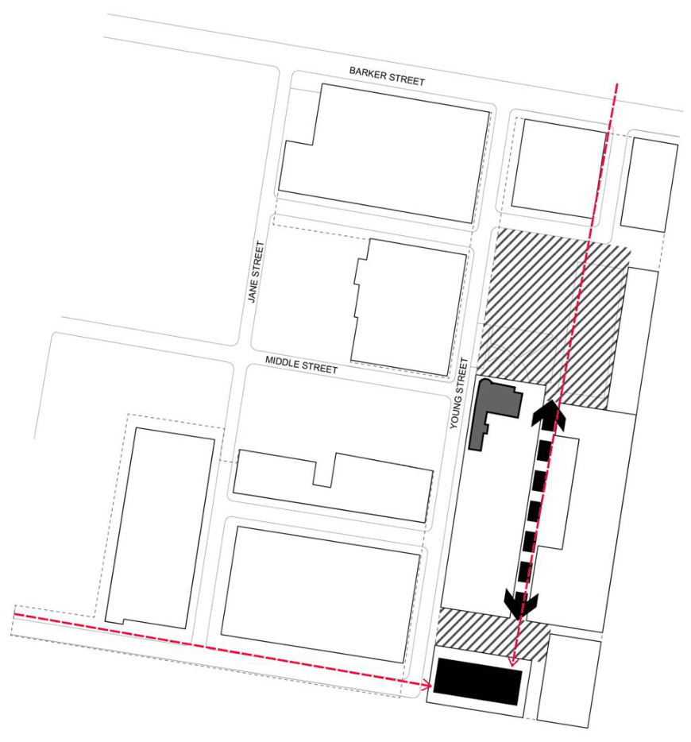
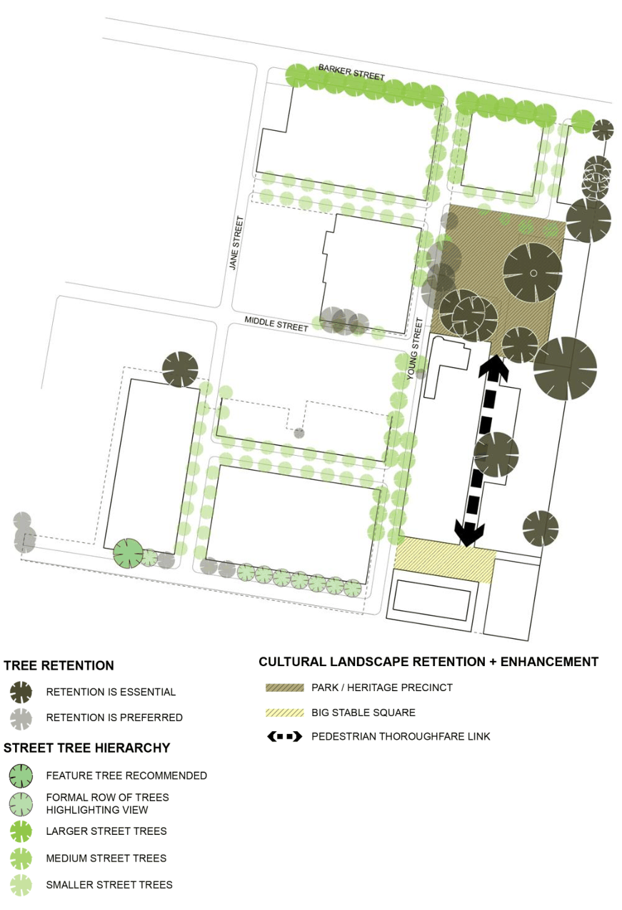

### 3.4. Open space network and landscaping

Objectives The objectives for open space network and landscaping are to:

1\. Create distinctive open space and public domain areas that respond to, and celebrate, the site’s cultural values, heritage items and significant streets

2\. Provide a network of connected open spaces that are safe and secure for all users.

3\. Create and maintain significant view corridors to, and through, the site

4\. Ensure high quality open space and public domain areas adjoin Newmarket House and the Big Stable

5\. Design open space and public domain areas in a manner that promotes a range of passive activities and different degrees of social interaction

6\. Ensure that landscaping adjacent to Newmarket House displays the qualities of elegance and simplicity

7\. Facilitate pedestrian and cyclist connectivity through the site

8\. Encourage landscape design that provides for increases in ecological and cultural value through natural, endemic vegetation and existing heritage landscapes

9\. Maximise the interface between development and public open space to provide enhanced levels of residential amenity and casual surveillance of the surrounding public open space.

Controls

a) Open space is to be provided generally in accordance with Figure 6

b) Public open space shall incorporate native vegetation and, where appropriate, shall meet the requirements of Part B4- Landscaping and Biodiversity of the DCP

c) Ensure buildings fronting the public open space are designed at ground level to provide adequate separation between units and the public domain to ensure the public nature/function of the public open space is not compromised. This may include raising of ground level apartments, setbacks and appropriate landscaping

d) All development is to be designed to retain significant views and allow for pedestrian connectivity identified in Figure 6

e) A view analysis is to be submitted with Development Applications that impact, or have the potential to impact, on significant views

f) Landscaping and public domain design, including retention of significant trees, shall generally be in accordance with Figure 7

g) A landscape and public domain plan shall be submitted with all Development Applications proposing open space or public domain areas, and shall address the following (where appropriate):

i. The retention of significant trees accompanied by an arborist’s report for any pruning

ii. Appropriate street tree planting spaced at regular intervals, on new streets

iii. Appropriate lighting in the public domain

iv. An appropriate response to the cultural landscape and heritage items, which investigates opportunities for the retention of existing timber benches, plaques, sandstone elements and gardens.

v. Rainwater infiltration to minimise run-off and minimal amount of hard surface area

vi. Water efficient irrigation systems and use of non-potable water sources

vii. Details of planting, paving, fencing, soil depth

viii. Appropriate sunlight access

ix. Provision of overland flow paths from north to south through the site

x. High quality materials and finishes including paving, stone, stainless streel and pre-cast concrete.

Figure 6: Open space network

> [Picture on page 20: a picture, saved as a picture (images/part-d12-newmarket-green-page-20-10.gif, 150 dpi).]

OPEN SPACE AREAS NEWMARKET HOUSE BIG STABLE BUILDING PEDESTRIAN THOROUGHFARE VIEW CORRIDOR

Source: Randwick City Council

Figure 7: Landscaping and public domain

> [Picture on page 21: a picture, saved as a picture (images/part-d12-newmarket-green-page-21-2.gif, 150 dpi).]

Source: Randwick City Council
