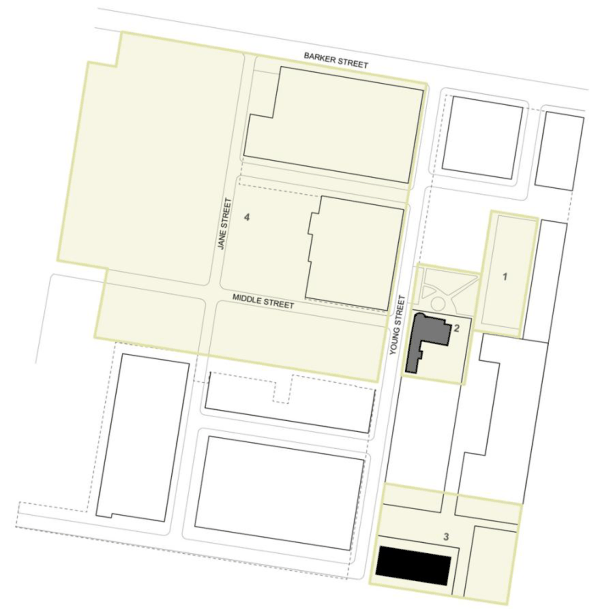
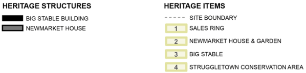
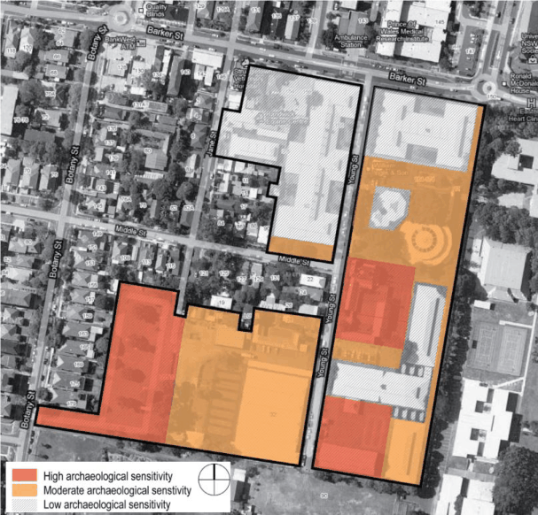
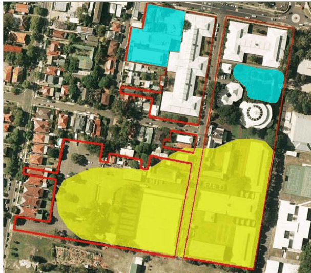

### 3.5. Heritage

Statement of Significance Big Stable A building of unusual function, high architectural quality and historic importance. It is an integral part of the Newmarket precinct, associated with the State’s racing industry for over one hundred years. Newmarket House Part of the historic Newmarket complex, a continuing focus of the State’s racing industry. Also, of interest for its long association with Struggletown, on land originally purchased by Simeon Pearce and his brother. A fine example of a Grand Victorian house in good condition. Refer to State Heritage Register for further information.

Objectives The objectives for heritage are to:

1\. Ensure the heritage significance of the site is conserved, appropriately managed and respected by all new development

2\. Celebrate and interpret the heritage significance of the site in the design of buildings and open space

3\. Provide opportunities for public access to, and appreciation of, retained heritage items.

4\. Create opportunities for adaptive reuse of Newmarket House and the Big Stable building

5\. Ensure new development is designed to respond to the heritage character of the Struggletown Conservation Area

6\. Ensure Aboriginal heritage is appropriately considered and managed through the development process.

Controls

a) The Big Stable building and Newmarket House are to be retained. Adaptive reuse of these buildings must be in accordance with a Conservation Management Plan submitted with any Development Application that proposes development (including a new use) of these buildings. The Conservation Management Plan must demonstrate:

i. The proposed use is compatible with the significance of the heritage item

ii. Provision for on-site interpretation has, or will, be made

iii. That curtilage areas in Figure 8 are maintained and any development within the curtilage (including landscaping) is appropriately sited and designed to respond to the heritage items

iv. That development, including alterations and additions, will maintain significant building fabric and building elements and allows for the appreciation of their significance

v. That consultation with relevant authorities has been carried out in accordance with the relevant legislation.

b) The Moreton Bay Fig Tree within the Sales Ring precinct is to be retained within the public open space and incorporated into a landscape plan for the land in zone RE1. An arborist report shall be submitted prior to any development directly adjacent to the Moreton Bay Fig Tree to advise on development setbacks in order to ensure protection of the root system and viability of the Moreton Bay Fig Tree and any proposed pruning

c) All development within the Sales Ring precinct must be in accordance with an Interpretation Plan and conservation management plan prepared as part of a Development Application for that land. The Interpretation Plan shall outline the proposed method of interpretation of the Sales Ring through landscaping and design features that respond to its historic geometry and use (and may be incorporated with a landscape plan prepared)

d) Public domain features, such as the stone kerbing in the Struggletown Conservation Area, are to be retained where they contribute to the heritage significance of the Conservation Area

e) Development in areas identified as having High or Moderate Archaeological Sensitivity in Figure 9 will require an Archaeological Assessment to be carried out in accordance with relevant legislation and guidelines, as part of a Development Application

f) Development in areas identified as requiring further archaeological investigation or monitoring in Figure 10 will require appropriate assessments to be carried out in accordance with the relevant legislation and guidelines, as part of a Development Application.

Note Refer to heritage requirements of Clause 5.10 of Randwick LEP.

Figure 8: Heritage plan (and curtilage areas)

> [Picture on page 23: a picture, saved as a picture (images/part-d12-newmarket-green-page-23-20.gif, 150 dpi).]

> [Picture on page 23: a picture, saved as a picture (images/part-d12-newmarket-green-page-23-21.gif, 150 dpi).]

Source: Randwick City Council

Figure 9: Areas of Archaeological Sensitivity

> [Picture on page 24: a picture, saved as a picture (images/part-d12-newmarket-green-page-24-2.gif, 150 dpi).]

Source: Randwick City Council

Figure 10: Aboriginal archaeological heritage

> [Picture on page 24: a picture, saved as a picture (images/part-d12-newmarket-green-page-24-5.gif, 150 dpi).]

FURTHER INVESTIGATION MAY BE REQUIRED POST DEMOLITION MONITORING MAY BE REQUIRED

Source: Randwick City Council
