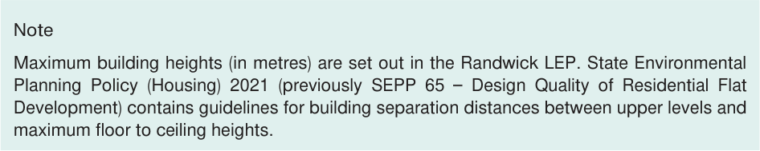
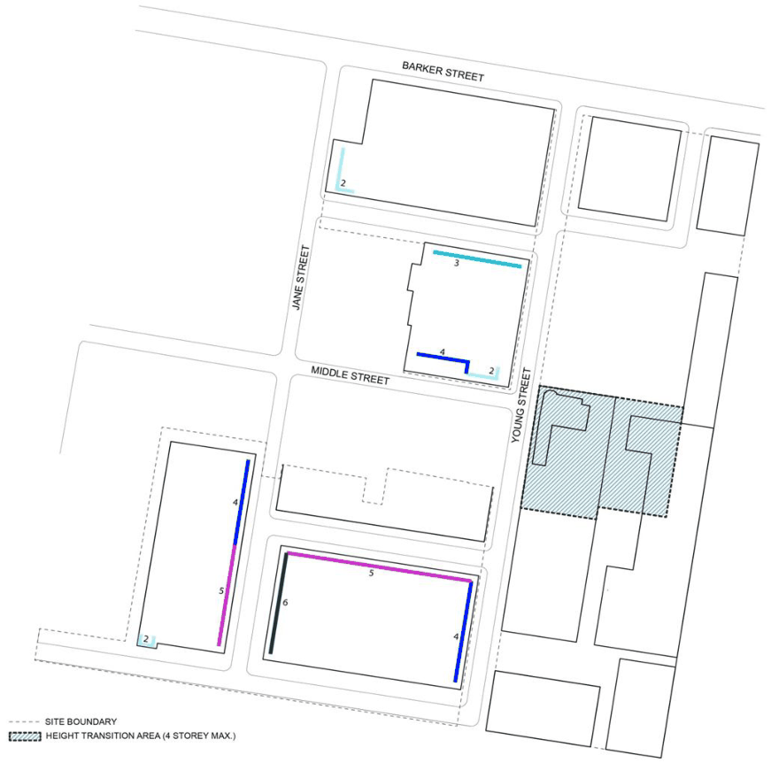

## 4. Design controls

### 4.1. Building height

Objectives The objectives for building height are to:

1\. Ensure buildings transition in height to complement the scale of adjacent development.

2\. To consider solar access to the adjoining community garden, adjoining properties and on-site open space.

3\. Ensure building heights contribute to the creation of high quality and comfortable open spaces.

4\. Minimise the impact of development on heritage items on site.

5\. Ensure building heights in the immediate vicinity of the Struggletown Conservation Area and surrounding residential areas reflect the lower scale of development.

6\. Facilitate passive surveillance of streets and open space, including off-site open space at Paine Reserve.

7\. Allow for variation in massing and building heights to create visual interest, distribute the bulk of the building and minimise amenity impacts on adjoining properties and the streetscape.

8\. Allow for flood mitigation measures to be incorporated into the design of new buildings.

Controls

i) To provide a height transition to key areas such as heritage items, the Heritage Conservation Area of Struggletown and on-site public open space, building heights at the street edge are to be generally consistent with Figure 11

ii) Buildings directly adjacent to Newmarket House, which are located within the height transition area in Figure 11, are to be a maximum of 4 storeys. Upper levels (above 4 storeys) are to be set back outside the height transition area

iii) Roof forms, plant rooms and lift overruns are to be designed to be simple compact forms that are visually unobtrusive.

> [Picture on page 25: a picture, saved as a picture (images/part-d12-newmarket-green-page-25-28.gif, 150 dpi).]

Note Maximum building heights (in metres) are set out in the Randwick LEP. State Environmental Planning Policy (Housing) 2021 (previously SEPP 65 – Design Quality of Residential Flat Development) contains guidelines for building separation distances between upper levels and maximum floor to ceiling heights.

Figure 11: Indicative building edge heights in key areas

> [Picture on page 26: a picture, saved as a picture (images/part-d12-newmarket-green-page-26-2.gif, 150 dpi).]

#### MAXIMUM BUILDING EDGE HEIGHTS (STREET WALL)

2 STOREY 3 STOREY 4 STOREY 5 STOREY 6 STOREY

Source: Randwick City Council
