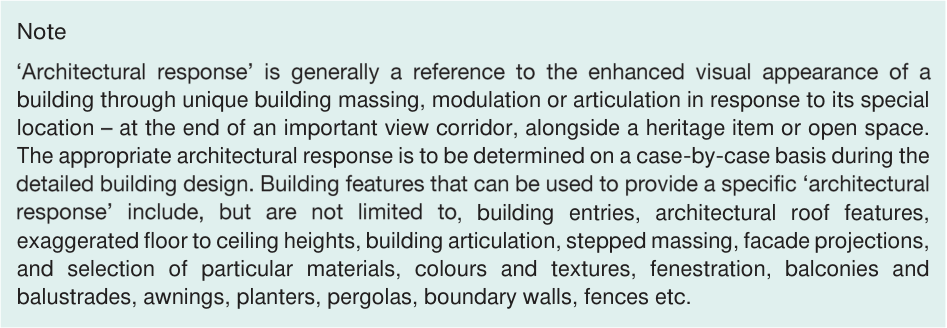
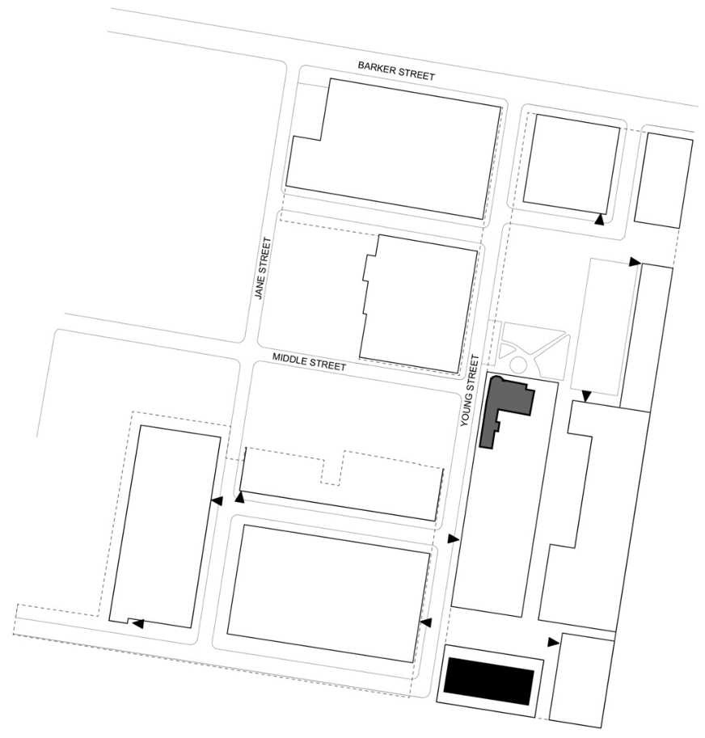

### 4.4. Building design and materials

Objectives The objectives for building design and materials are to:

1\. Provide quality architecture through articulation and modulation to building facades, particularly buildings facing streets, parks and open space areas

2\. Promote building design that makes a positive contribution to the urban character of the public domain

3\. Ensure buildings respond to, and respect, heritage items through appropriate articulation, massing and the selection of colours and materials

4\. Provide high quality architectural response in special areas that will enhance major view corridors

5\. Ensure new residential development is designed to provide all occupants with visual and acoustic privacy

6\. Ensure new development respects the privacy of adjoining properties

7\. Allow for adaptable dwellings that can suit a range of residents including the elderly and people with a disability

8\. Encourage the use of building materials that can withstand climatic extremes, are recycled and environmentally responsible Encourage opportunities to incorporate sustainable design elements such as “green

9\. roofs” and “green walls” to improve amenity, air quality, ambient air temperature and building insulation, while maintaining aesthetic considerations and development feasibility.

Controls

a) New buildings in the immediate vicinity of on-site heritage items, and new buildings adjoining the Struggletown Heritage Conservation Area, are to be designed to be compatible with, and respond to, the urban pattern and character of adjacent heritage items

b) Buildings shall include articulation to reduce bulkiness of buildings. Articulation may also

Buildings are to be enhanced through a specific ‘architectural response’ at locations

occur on upper levels to provide visual relief and good design outcomes c) identified in Figure 12. Where a specific ‘architectural response’ is required, the building design is to incorporate special building massing, modulation and articulation. Where a specific ‘architectural response’ is required for a building adjacent to, or in view of, a heritage item, the building design should respond to, and enhance, the heritage character of the adjacent heritage item

d) The selection of materials and finishes of buildings directly adjacent to the Big Stable should respect, and respond to, the heritage item

e) The Barker Street frontage shall provide a strong street address with at least 70% of the façade as glass or another permeable material

f) Direct overlooking into the habitable rooms and private open space of other dwellings is to be minimised through building layout, and the location and design treatment of windows, balconies, screening devices and/or landscape elements

g) Windows of habitable rooms with a direct outlook to the window of a habitable room of another dwellings within 12m shall:

i. Be offset from the edge of one window to the edge of the other by a distance that is sufficient to limit view into adjacent windows, or

ii. Have permanent screening along the windows, or

iii. Have a minimum sill height of 1.7m above floor level, or

iv. Have fixed obscure glazing on windows up to 1.7m above floor level, or

v. A combination of the above.

h) Screens used to obscure views are to be:

i. Perforated panels or trellis with maximum 25% openings or solid translucent panels,

ii. Permanent, fixed and durable, and

iii. Designed and coloured to blend in with the development.

i) Large windows shall be located on the north side of buildings, where possible, to allow for sun access. Large north-facing windows shall be shaded from summer sun by veranda’s , balconies or roof eaves

j) A sample board or schedule of colours, materials and finishes, is to be submitted with a development application for a residential or mixed-use development (new or major alterations and additions)

k) Changes of colour and texture should be used to complement façade articulation.

l) Building design and layout shall minimise the transmission of noise by separating quiet areas such as habitable rooms from common areas, parking areas, vehicle driveways and other noise generating development

m) Building design is to consider the provisions of the ADG, and in particular, achieve a minimum of 2 hours direct sunlight between 9 am and 3 pm in mid-winter to living rooms and private open spaces for at least 70% of apartments

n) Buildings along the eastern boundary which do not have a direct street address shall have a clear ‘pedestrian address’ and be designed to have windows and doors fronting on to the public realm. Building design shall be integrated with a way-finding strategy to ensure it is easy to locate buildings that do not have direct street address

o) Each development block shall incorporate adequate design variation so that the site is not interpreted as a single development or community. The architectural response for each development block shall demonstrate variability from other development blocks at the site including the design of the public domain

p) Buildings shall incorporate the following principles to allow for adaptive use over time:

i. Internal walls that can be easily removed or adjusted

ii. Locating services so that they do not impede future conversion to different configurations

iii. Ability to provide separate occupation of parts of units e.g. dual key access from a shared private lobby.

> [Picture on page 32: a picture, saved as a picture (images/part-d12-newmarket-green-page-32-1.gif, 150 dpi).]
> Words printed on the picture (title and legend, copied from the PDF):
> Note
> ‘Architectural response’ is generally a reference to the enhanced visual appearance of a
> detailed building design. Building features that can be used to provide a specific ‘architectural
> response’ include, but are not limited to , building entries, architectural roof features,

building through unique building massing, modulation or articulation in response to its special location – at the end of an important view corridor, alongside a heritage item or open space. The appropriate architectural response is to be determined on a case-by-case basis during the

exaggerated floor to ceiling heights, building articulation, stepped massing, facade projections, and selection of particular materials, colours and textures, fenestration, balconies and balustrades, awnings, planters, pergolas, boundary walls, fences etc.

Figure 12: Specific architectural response

> [Picture on page 33: a picture, saved as a picture (images/part-d12-newmarket-green-page-33-2.gif, 150 dpi).]
