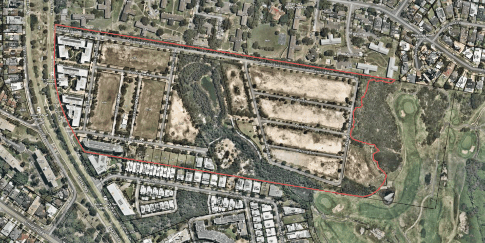

### 1.1. Alignment with other planning instruments

This site specific DCP applies to all new development, and significant alterations and additions to existing development on land situated on the subject site illustrated in Figure 1. These controls supplement the provisions of the Randwick Local Environmental Plan (RLEP 2012 which sets out the height and density and uses for the location and any other local planning statutory requirements outside this DCP. In addition to the RLEP, several State Environmental Planning Policies (SEPPs) apply to certain types of development within on the site, depending on the nature of the proposal. The key SEPPs include:

• Housing SEPP 2021 (including the supplementary Apartment Design Guide (ADG)

• Transport and Infrastructure SEPP 2021

• Sustainable Buildings SEPP 2023 This DCP should also be read in conjunction with:

• Part A - Introduction

• Part B - General Controls

• Other Parts of the DCP for specific development types, locations or sites, if relevant to the Development Application (DA).

To the extent of any inconsistency between this DCP and any other sections of Randwick DCP 2025, this DCP will prevail.

Figure 1: Land to which this plan applies – Little Bay Cove Site

> [Picture on page 7: a picture, saved as a picture (images/part-d13-little-bay-cove-page-7-2.gif, 150 dpi).]

Source: Randwick Council

Objectives The objectives for Little Bay Cove are to:

1\. Create a sustainable neighbourhood that integrates new development

2\. To protect remnant bushland and the cultural significance of the Little Bay Miocene Geological site and Ochre site

3\. E nsure design reflects the site’s unique location and characteristics

4\. Permeate the existing urban landscape and facilitate a new urban connection to the water and its adjacent landscape

5\. Protect the visual amenity and scenic value of the coastline

6\. Ensure development reflects the principles of the adopted master plan for the site

7\. Create a diverse range of passive and active spaces useable by future residents and the wider community

8\. Ensure development demonstrates architectural merit and incorporates high quality materials and finishes

9\. Ensure development promotes and incorporates the principles of Ecologically Sustainable Development (ESD)

10\. Provide for a mix of land uses and dwelling types

11\. Provide for housing choice to accommodate the needs of current and future households and affordability

12\. Protect and enhance remnant native vegetation, habitat corridors, riparian buffers and wetland area.

Note The Little Bay Cove Masterplan (2009) contains the relevant development controls in effect for the Little Bay Cove site and has been implemented into this DCP.

This DCP should be read in conjunction with the Little Bay Cove Masterplan and relevant documents outlined in Section 1: Introduction.
