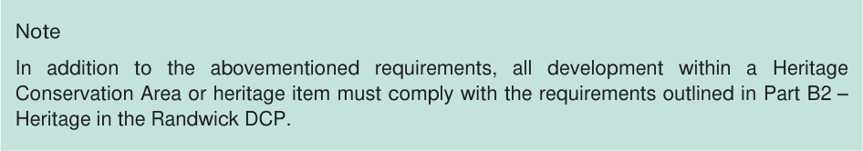

### 1.2. Heritage requirements

Part of the Little Bay Cove Site lies within the Prince Henry Hospital Heritage Conservation Area and partly within the State Heritage Register curtilage. Development Applications (DA) that incorporate development within the NSW State Heritage Register curtilage may constitute Integrated Development. Applicants should check with Council to determine Integrated Development requirements prior to lodging any DA. A Heritage Impact Statement (HIS) prepared by a suitably qualified professional must be included with any DA, together with a Specific Elements Conservation Policy (SECP) (where applicable). Applicants should refer to the Conservation Management Plan (CMP), the Archaeological Management Plan (AMP) and any relevant Specific Elements Conservation Management Policy (SECP) when preparing a DA.

Built and landscape elements

a) Significant built and landscape items and elements should be retained, conserved, managed and interpreted in accordance with the detailed policies in the Conservation Management Plan (CMP) and any relevant Specific Elements Conservation Policy (SECP) as well as the requirements of the NSW Heritage Act 1977

Aboriginal archaeology

b) Identified and potential Aboriginal archaeological objects and sites are to be conserved and managed in accordance with the Archaeological Management Plan (AMP) and the requirements of the NSW National Parks and Wildlife Act 1974

c) Damage or destruction of any Aboriginal object or place is only permitted where a permit or consent has been issued by the Director of the National Parks and Wildlife Service (NPWS), Office of Environment and Heritage

d) Any proposals affecting known or discovered Aboriginal objects or places on the Little Bay Cove site or proposals that will disturb the ground within identified Aboriginal Archaeological Zones must be referred to the La Perouse Local Aboriginal Land Council (LPLALC)

e) Prepare an Aboriginal Heritage assessment if required

Historical archaeology

f) Identified and potential archaeological relics and sites are to be conserved and managed in accordance with the Archaeological Management Plan (AMP) and the requirements of the NSW Heritage Act 1977

g) Where the archaeological assessment determines that the development would disturb a potential historical archaeological resource, an application for an excavation permit issued under the NSW Heritage Act 1977 is required

Geological Heritage

h) The Little Bay Miocene Geological and Ochre Site, including the Critical Exposure Area, Cleared Area, and Paleovalley, is of exceptional scientific, cultural, and heritage significance and must be protected from adverse impacts arising from development

i) Development Applications (DAs) must identify the extent of the Miocene site on all plans and documentation, including mapping of the Critical Exposure Area, Cleared Area, and Paleovalley

j) A minimum buffer of 20 metres must be maintained around the Critical Exposure Area

and Cleared Area. No excavation, construction, or landscaping works are permitted within this buffer unless approved by the NSW Heritage Council

k) Any excavation within 30 metres of the Little Bay Miocene Geological and Ochre Site must be supported by:

i. A Geotechnical Impact Assessment prepared by a certified geologist

ii. A Heritage Impact Statement referencing the CMP and SECP

iii. Evidence of consultation with the NSW Heritage Council and the La Perouse Local Aboriginal Land Council (LPLALC), where Aboriginal ochre deposits may be affected

l) Endorsement of Randwick City Council and Heritage NSW is required for excavation within the possible extent of the Palaeovalley Area below RL 26

m) All development must comply with the Little Bay Geological Reserve Plan of Management, the Prince Henry Conservation Management Plan (CMP), and any relevant Specific Elements Conservation Policy (SECP).

Note Geological heritage conservation controls are informed by the International Union for Conservation of Nature

’s - Guidelines for geoconservation in protected and conserved areas.

> [Picture on page 9: a picture, saved as a picture (images/part-d13-little-bay-cove-page-9-19.gif, 150 dpi).]

Note In addition to the abovementioned requirements, all development within a Heritage Conservation Area or heritage item must comply with the requirements outlined in Part B2 – Heritage in the Randwick DCP.
