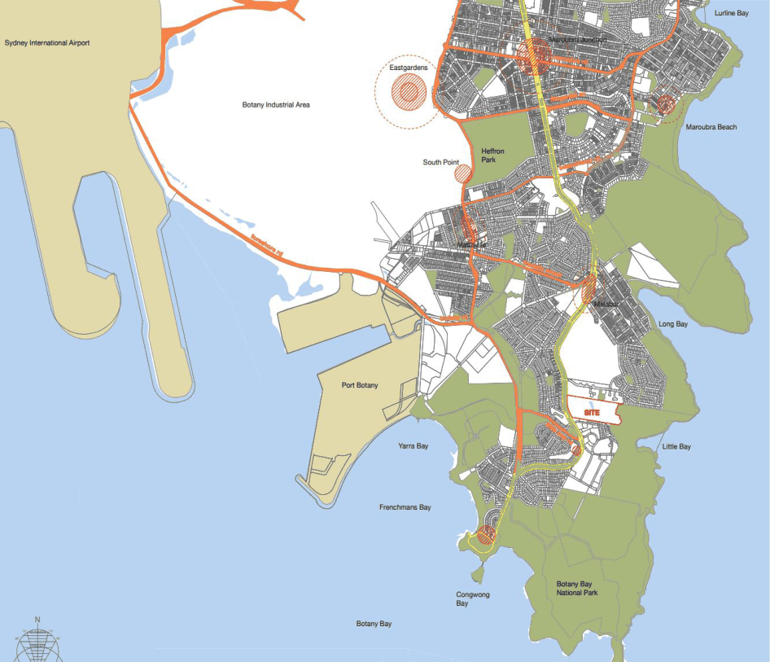

### 2.1. Regional and local context

The subject site is located at the southern end of the Randwick Local Government Area (LGA). The site is bound by the Coast Golf Course to the east, Anzac Parade to the west, Housing NSW land to the north and the Prince Henry Site to the south. The Site originally formed part of the grounds of the Coast Hospital, subsequently known as the Prince Henry Hospital Site. The Site is one of several large parcels situated on the Anzac Parade corridor that has been redeveloped. The site is serviced by buses to important local centres such as Maroubra Junction, Kingsford and Kensington as well as various regional and recreational facilities including the University of New South Wales (UNSW), Prince of Wales Hospital Campus and Centennial and Moore Parks.

Figure 2: Regional context

> [Picture on page 10: a picture, saved as a picture (images/part-d13-little-bay-cove-page-10-14.gif, 150 dpi).]

Source: Little Bay Cove Masterplan
