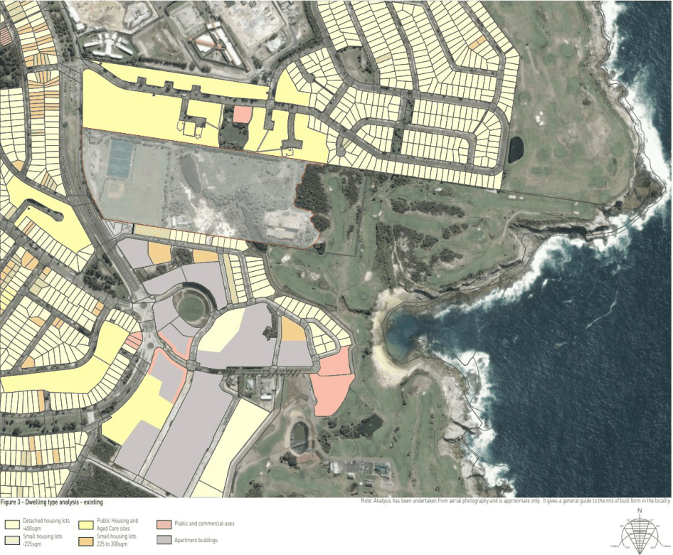
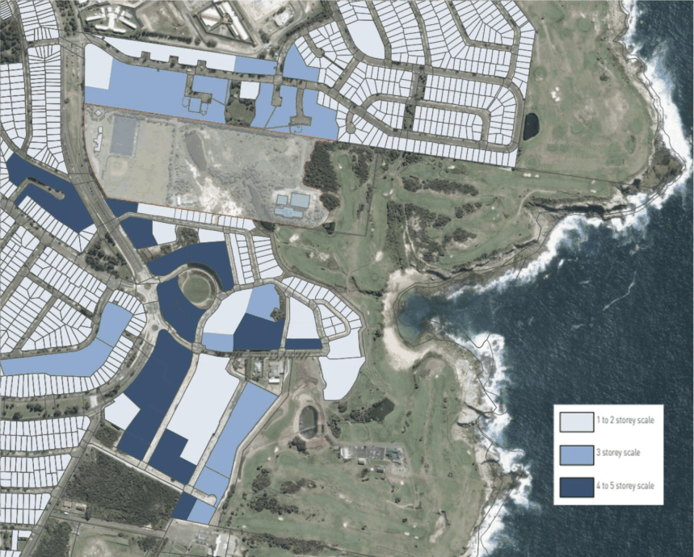

### 2.2. Local urban conditions

The existing residential setting is predominantly detached dwelling housing (1-2 storeys), with some dual occupancy and townhouse developments. Multi-unit residential apartment buildings (ranging from 2-5 storeys) are also located in the vicinity as part of Housing NSW land and the neighbouring Prince Henry Site which has contributed to a diverse housing mix in the locality through the provision of multi-unit residential apartments, town houses, row houses and refurbishments of heritage buildings. Part of the Little Bay Cove Site has also been developed since the adoption of the Little Bay Cove Masterplan with 4-5 storey multi dwelling residential buildings fronting Anzac Parade in the west of the site.

Figure 3: Dwelling type analysis

> [Picture on page 11: a picture, saved as a picture (images/part-d13-little-bay-cove-page-11-11.gif, 150 dpi).]

Source: Little Bay Cove Masterplan

Figure 4: Local building heights

> [Picture on page 12: a picture, saved as a picture (images/part-d13-little-bay-cove-page-12-2.gif, 150 dpi).]

Source: Little Bay Cove Masterplan
