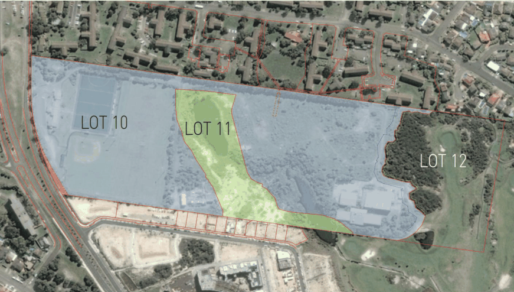
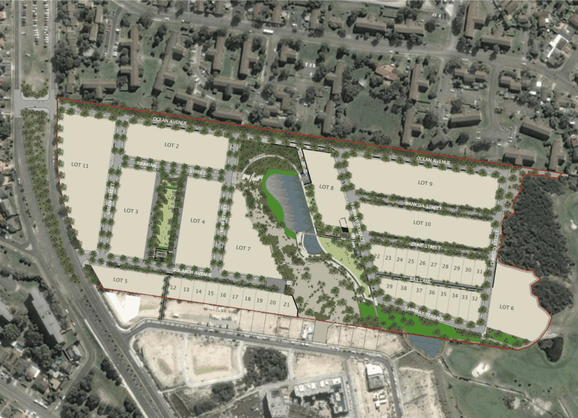

### 2.3. Historical context

Prior to the European settlement of Little Bay, a vibrant and rich Aboriginal life thrived in the local

area. Evidence of this can be seen in the numerous middens, rock engravings and ochre sites present in the local area. The present-day Aboriginal community, represented by the La Perouse Local Aboriginal Land Council maintain a close association with these sites, and actively participate in their ongoing protection and maintenance. From 1881

– 1934 the site was part of the grounds of the Coast Hospital, built originally as a

quarantine hospital for infectious diseases. In 1934 the hospital was renamed as the Prince Henry Hospital. When the hospital uses vacated the site, it was quarried for sand, during which time Miocene and ochre deposits were exposed. The Miocene deposits are common in the Sydney region but rarely exposed, and the site is listed on the Register of the National Estate. The ochre deposits are significant to the local Aboriginal community. Quarrying activity resulted in the formation of the existing dams in the centre of the site. The sand mining also exposed acid generating shales within the drainage corridor. The Southern basin is currently used for water storage for the adjacent golf course irrigation system. Despite the disturbance of mining, a remnant band of Eastern Suburbs Banksia Scrub (ESBS) adjoins the Eastern boundary of the site on land owned by the University of NSW. This is a Critically Endangered Ecological Community as listed by DECC.

Research Centre, known as “Solarch” on the southern

The University of NSW acquired the site in October 1959. The west part of the site was filled with building and demolition waste to the current level to accommodate playing fields. The University also constructed a number of buildings, including structures associated with the sporting field uses, and the Solar Energy

boundary of the site between 1992 and 1995. The building was constructed by the students of the University as an exemplar of energy efficient design. Drinking water, stormwater and sewage were managed on the site, and important research on solar power was conducted during that

time. The building ceased to be actively used in 2003 and was destroyed by fire in 2007. The Eastern part of the site was also filled after mining and a biological resources facility was constructed by UNSW in the 1970’ s and operated until July 2008. A Stage 1 DA for the Community-title subdivision of the subject site into 149 residential allotments with associated building envelopes, carparking, roads and open space was approved in September 2007. In January 2008, an additional application (DA/886/2007) was approved to subdivide the land known as Lot 1 DP 164309 into three separate Torrens Title allotments. The details of the subdivided allotments are as follows:

• Lot 10

– comprising the developable portion of the subject site with a total area of 11.42

hectares

• Lot 11

– located in the centre of the subject site and containing the central corridor,

Miocene and Ochre site with a total site area of 2.171 hectares

• Lot 12

– Adjacent to the eastern side of the subject site containing the ESBS remnant

with a total area of 3.411 hectares.

A subdivision certificate application was approved under delegated authority on 13 June 2008 and the three allotments were legally referenced as Lot 10, 11 and 12 DP 1127716 (see Figure 5).

Figure 5: Subdivision of Little Bay Cove

– DA/886/2007

> [Picture on page 13: a picture, saved as a picture (images/part-d13-little-bay-cove-page-13-26.gif, 150 dpi).]

Source: DA/886/2007 – Randwick City Council

A Stage 2 DA for bulk earthworks and remediation of land and demolition of all existing buildings on site with deferred commencement was granted in November 2008; however, development never commenced. Lots 10 and 11 were later purchased by Charter Hall in 2008 and Lot 12 remains in the ownership of UNSW.

Little Bay Stage 1 Plan In December 2009, DA/81/2009 which sought consent for a Stage 1 DA including built form controls, site remediation, bulk earthworks, infrastructure and services works, demolition of all

structures on site, associated landscaping and subdivision of the site into 28 residential lots and 10 super lots was approved in the Land and Environment Court. Figure 6 outlines the Stage 1 Lot Plan that forms part of the Little Bay Cove Masterplan (2009). To date, Lot 5 and 11 have been constructed consisting of multi-unit residential development (5 storeys), the remaining sites consist of vacant lots.

Figure 6: Little Bay Cove Stage 1 lot plan

> [Picture on page 14: a picture, saved as a picture (images/part-d13-little-bay-cove-page-14-7.gif, 150 dpi).]

Source: Little Bay Cove Masterplan
