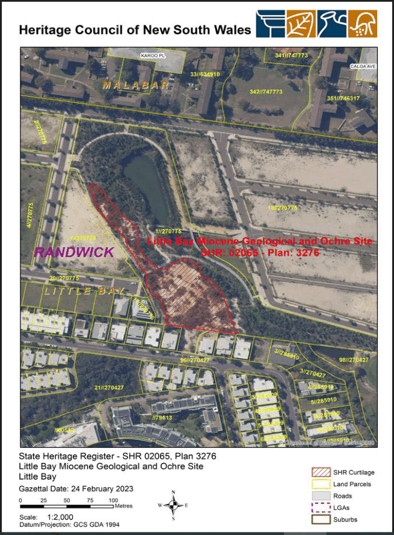

### 2.4. Heritage context

The Little Bay Cove Site is of national significance and provides evidence of topography, relative sea level, vertical land movements and coastal landscape prior to the formation of Sydney Harbour and other coastal valleys (refer to the CMP, and Little Bay Geological Site SECP and Plan of Management). In February 2023, the Little Bay Miocene Geological and Ochre Site was listed on the NSW State Heritage Register as an item of State heritage significance (see figure 7). RLEP also identifies part of the Little Bay Cove Site as a Heritage Conservation Area. Schedule 5 of RLEP contains a list of existing heritage items and archaeological sites.

Figure 7: Little Bay Miocene Geological and Ochre Site

> [Picture on page 15: a picture, saved as a picture (images/part-d13-little-bay-cove-page-15-2.gif, 150 dpi).]

Source: Heritage Council NSW

Note Refer to Part D11

– Prince Henry Site for types of elements of heritage significance occurring

within the adjacent Prince Henry Site and parts of Little Bay Cove.
