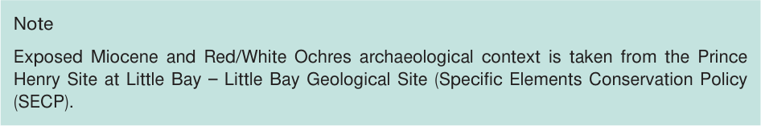
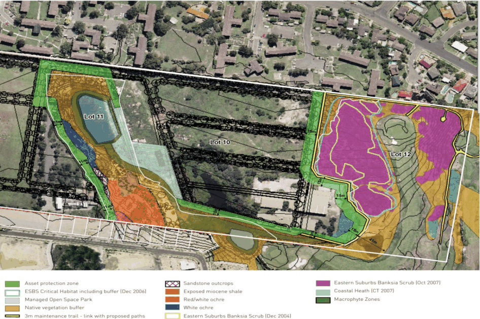

### 2.5. Constraints

Exposed miocene and red/white ochres The Central Corridor contains:

• Exposed Miocene sediments that have been revealed due to quarry operations

• Red and white ochres which have been used by local indigenous communities. The exposed areas of the Little Bay Geological site cover about two hectares of land on an irregular slope facing east towards the beach at Little Bay and comprise the Critical Exposure Area and the Cleared Area. The exposed area extends across the boundary between the Little

Bay Cove site and the adjacent Prince Henry site. The significance of the Critical Exposure Area and the Cleared Area are described as follows: The Critical Exposure Area within the Prince Henry site is the only known area where the significant relationships between outcrops of exposed Hawkesbury Sandstone and gully-fill sands can be clearly seen, providing evidence of geological processes involved in the formation of the east coast of Australia. Additionally, the critical Exposure Area within the Little Bay Cove land contains the only known exposure of estuarine peaty clay shales which have been classified as having Exceptional Significance to understanding of plan evolution in Australia and of local climate conditions around 15 million years ago. The Cleared Area represents the extent of land, once covered by wind-blown sand and heathland scrub, which has been disturbed by previous mining and subsequent erosion exposing several important geological elements and their inter-relationships. Although there is some superficial disturbance, the Cleared Area demonstrates the variation within the general soil profile and enables analysis and comparison between soil profiles in the Cleared Area and the Critical Exposure Area. The Paleovalley The Paleovalley comprises a broad band of land (that includes the Cleared Area and Critical Exposure Area) extending largely underground (without ground surface expression) through the Long Bay Gaol, Little Bay Cove and Prince Henry sites to Little Bay. The Paleovalley has been found to be of Exceptional Significance as it represents the full history of the Miocene stream channel (that ran in the area as part of a previous ancient estuarine environment to its existing sandstone state some 30m above sea level). Its overall geometry will add greatly to understanding of this unique site as well as the geological history of the east coast of Australia. It is also of Exceptional Significance for its research potential as the area is likely to contain clays and sands which contain fossil pollen and leaves, believed to be well preserved for future study.

> [Picture on page 16: a picture, saved as a picture (images/part-d13-little-bay-cove-page-16-26.gif, 150 dpi).]

Note Exposed Miocene and Red/White Ochres archaeological context is taken from the Prince Henry Site at Little Bay – Little Bay Geological Site (Specific Elements Conservation Policy (SECP).

Ochre Site Red and White Ochre Deposits within the Central Corridor have been identified and surveyed in conjunction with representatives of the La Perouse Local Aboriginal Land Council, Archaeological & Heritage Management Solutions, and Travers Environmental. The Indigenous site has been accurately surveyed and has been fully protected within a buffer of variable width of between 7-10 m. Earth works associated with the basins and drainage channel in the central corridor and the adjoining park elements have been placed outside of the validated Aboriginal

site. The red and white ochre sites will be protected within a native landscape and the current exposed faces will be retained as is, with no further revegetation works directly on the faces.

Eastern Suburbs Banksia Scrub (ESBS) The Eastern Suburbs Banksia Scrub (ESBS) vegetation is contained within the adjoining Lot 12, which is owned by the University of New South Wales. As this native vegetation asset lies outside of the subject site, this plan is limited to edge treatment and protection. The following protective measures are required under the subdivision adopted including:

• The entire area of ESBS has been set aside for conservation

• Roads and native landscaping provide a buffer against the impacts of the proposed development

• Setbacks have been provided for asset protection against bushfires in the ESBS

• Vegetation Management for the ESBS includes native revegetation works to minimise edge effects.

Figure 8: Miocene deposits and ESBS locations

> [Picture on page 17: a picture, saved as a picture (images/part-d13-little-bay-cove-page-17-7.gif, 150 dpi).]

Source: Little Bay Cove Masterplan
