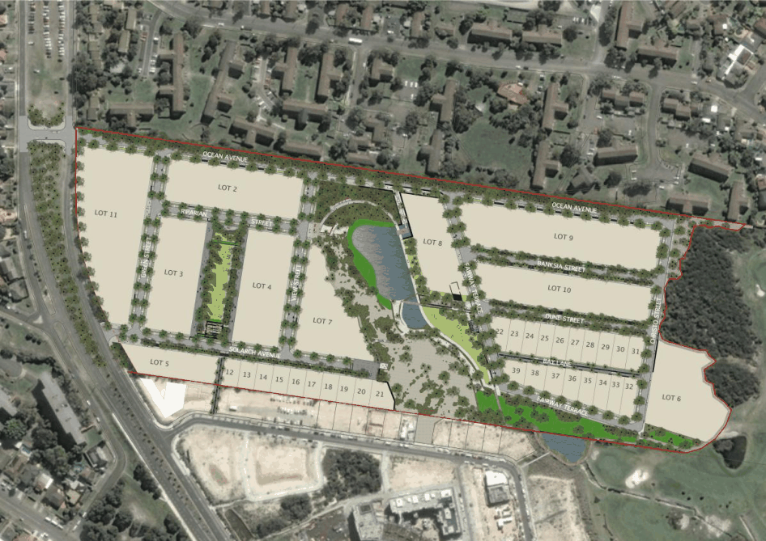

### 3.3. Stage 1 plan

Explanation The plan provides a legible street pattern that is conceived as an extension of both the existing urban grain and broader landscape systems that surround the site. It maximises connectivity with existing areas and anticipates future opportunities for connections to be established with neighbouring sites. Pedestrian connections to the adjacent Prince Henry Site are provided at all points where the neighbouring subdivision pattern will accommodate them. The Stage 1 Plan (Figure 9) is organised as a grid of east-west oriented streets that provide long vistas through the site and to the important landscape corridors that punctuate the site. Ocean Avenue forms the primary avenue on the site. It provides the Housing NSW site to the north, maximum flexibility for adjusting its street pattern and connecting into the subject site in the future. Solarch Avenue provides a secondary access point to Anzac Parade. Fairway Terrace, View Street and Christo Street provide defined public edges to the primary open space corridors in the site. A rich series of residential streets completes the urban grain between. The urban lounge park forms a lively focus for urban activity and recreation. The central Paleo Valley Park protects existing site features and utilises the existing water bodies for water treatment on the site. Its form and topography emphasise the corridor’s relationship to Little Bay. Brand Park provides landscaped recreational space on the edge of the corridor. Over 50% of the site area is provided as public domain - streets, parks, promenades and gardens for the benefit of the wider community.

Figure 9: Little Bay Cove Stage 1 lot plan

> [Picture on page 19: a picture, saved as a picture (images/part-d13-little-bay-cove-page-19-22.gif, 150 dpi).]

Source: Little Bay Cove Masterplan
