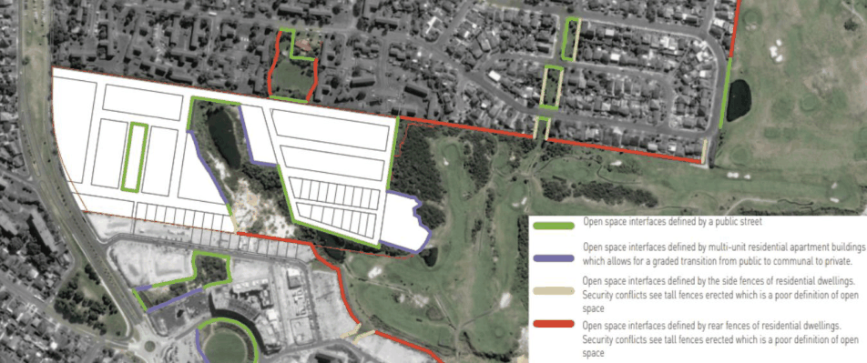

### 3.4. Urban interfaces

Explanation Existing urban interfaces to the north and south of the site are characterised by the rear fences of private allotments. Perceived security issues result in the construction of tall fences, creating a defensive edge character rather than one which encourages engagement between the public and private realm. The local area has some examples of positive urban edges where open space is defined by a public street. This enshrines public access and provides much improved definition and surveillance of open spaces - allowing a graded transition to be developed between the public and private realms. The Little Bay Stage 1 Plan aims wherever possible to define open spaces with public streets or with multi-unit residential development so that positive engagement with open spaces on the site can be explored, and appropriate surveillance incorporated. Conditions where side or rear fences define open spaces are minimised.

Figure 10: Urban interfaces

> [Picture on page 20: a picture, saved as a picture (images/part-d13-little-bay-cove-page-20-15.gif, 150 dpi).]

Source: Little Bay Cove Masterplan
