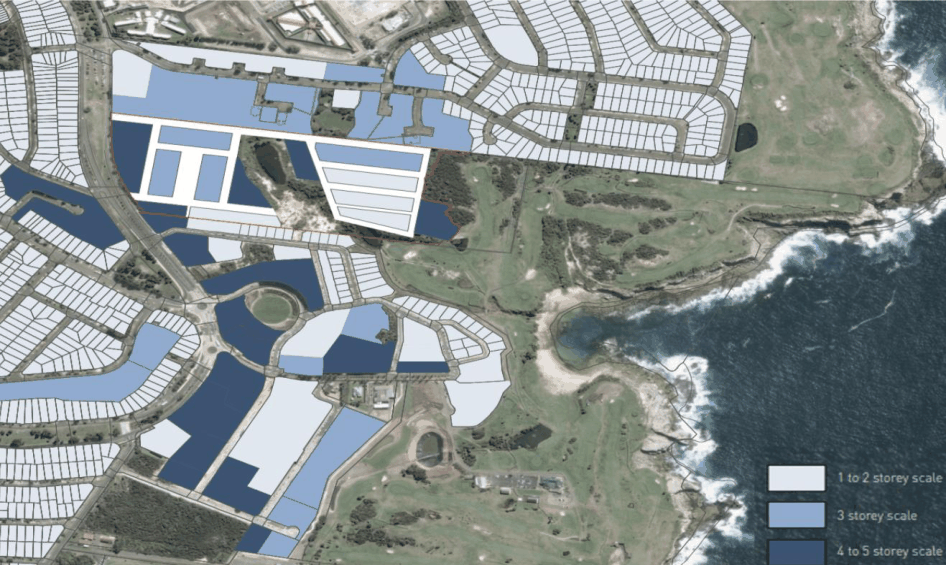

### 3.5. Height distribution

The distribution of height is based on the following design principles:

Urban design principles

• Locate appropriate heights to allow the efficient use of urban land

• Reinforce the urban pattern by locating taller buildings along regional urban frontages and important landscape frontages throughout the project

• Locate higher buildings convenient to transport routes

• Optimise casual surveillance of public open spaces

• Encourage more height aligned to smaller building footprints to allow more landscape area on individual lots.

Height in the Little Bay context

• Distribute a variety of heights across the site, that relate to the heights of buildings found in the Little Bay context

• Reinforce the existing scale of buildings along the Anzac Parade frontage

• Match like with like along the site’s southern boundary in response to the rear fence to rear fence boundary condition

• Mirror the mix of taller and lower buildings facing the Golf Course and Little Bay, as found in the Prince Henry site adjacent (the taller building at Prince Henry site is closer to the bay than proposed in this project)

• Provide building heights consistent and compatible with planned and existing adjoining development

• Provide consistency with the approach adopted in the adjoining Prince Henry site of positioning higher buildings along Anzac Parade and adjacent to public open space.

Height distribution within the site

• Distribute heights in relation to the scale of the streets and open spaces they define

• Reinforce the Urban Lounge with an appropriately strong street walled character

• Position taller buildings on open space edges to maximise potential for passive surveillance of open spaces

• Position taller buildings in locations least likely to cause impact or be incompatible with dwellings within and external to the site

• Create diversity in the urban environment, allowing for the provision of a range of differing accommodation spaces and character

• Locate higher buildings to retain important view lines to and through the site

• Position higher buildings to minimise overshadowing to sites within and external to the site

• Intersperse higher and lower building forms to avoid a concentration of taller buildings

• Decisively distribute height, rather than concentrate it as a homogenous zone, to create a varied scale and silhouette across the site (this is a characteristic of the best urban areas in Randwick Municipality such as Coogee and Clovelly).

Figure 11: Height distribution map

> [Picture on page 21: a picture, saved as a picture (images/part-d13-little-bay-cove-page-21-27.gif, 150 dpi).]

Source: Little Bay Cove Masterplan
