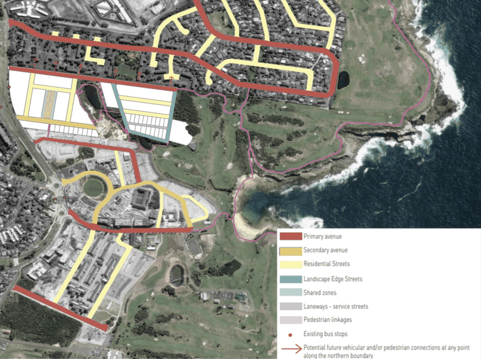

### 3.6. Street pattern

Explanation The public street pattern is laid out with a predominantly east-west alignment. This provides the site with a legible street pattern, provides long vistas to the open spaces within and beyond and integrates with the broader locality. All the streets have a strong landscape character with street tree planting, swales and raingardens that differentiate the hierarchy and character of streets within the plan. Ocean Avenue has been located to maximise potential and flexibility for the Housing NSW site to connect into the street pattern in future. It provides the major access from Anzac Parade and has been sized to accommodate future bus traffic. The street is characterised by an unimpeded vista towards the ocean at the eastern end of the street. Solarch Avenue is a secondary avenue. It provides a secondary access point to Anzac Parade and terminates in a belvedere that provides views to Little Bay and Paleo Valley at its eastern

end. Landscape edge streets provide definition to open space corridors within and adjacent the site - enshrining the right of public access and open prospect. A series of residential streets completes the street pattern between the more definitive avenues and edge streets. Laneways maximise options for future buildings to provide vehicular access on the steeper parts of the site and reduce kerb crossings in associated streets. Shared zones adjacent to the urban lounge prioritise pedestrian movement, while allowing access for emergency and service vehicles as required. Pedestrian linkages are provided to maximise connectivity with the Prince Henry site wherever possible.

Figure 12: Street pattern map

> [Picture on page 22: a picture, saved as a picture (images/part-d13-little-bay-cove-page-22-23.gif, 150 dpi).]

Source: Little Bay Cove Masterplan
