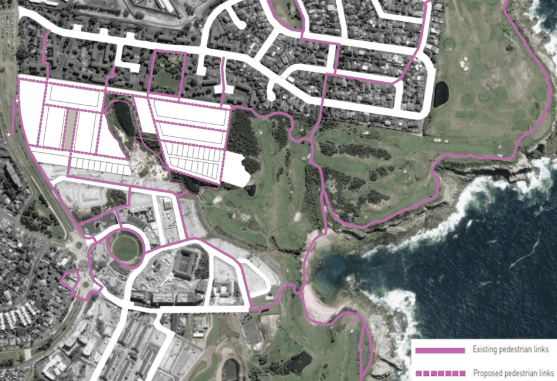

### 3.7. Pedestrian links

Explanation Pedestrian links are keyed into the local system of coastal walks, pedestrian connections and street linkages. The plan aims to make the local area more walkable by linking a series of urban and landscape features by a network of paths - and to stimulate use of newly created public open space and recreation assets. Little Bay Beach, the Coast Golf Course, Prince Henry Oval and future retail facilities, the Urban Lounge, Paleo Valley Park and Brand Park are within walking distance of existing and future local residents, the broader community and visitors. By encouraging residents to walk, car dependence can be reduced which has a range of environmental and health benefits. Local neighbourhoods can also become more convivial and safer. The layout of the public domain adds significant recreational assets for the wider community, encouraging a range of healthy activities and the enjoyment of the broader landscape such as walking, jogging, leisurely cycling, roller blading and the like. Pathways within the site have been carefully placed to allow viewing and enjoyment of the geological and ecological features, while controlling access as required to protect these important elements.

Figure 13: Pedestrian links

> [Picture on page 23: a picture, saved as a picture (images/part-d13-little-bay-cove-page-23-19.gif, 150 dpi).]

Source: Little Bay Cove Masterplan
