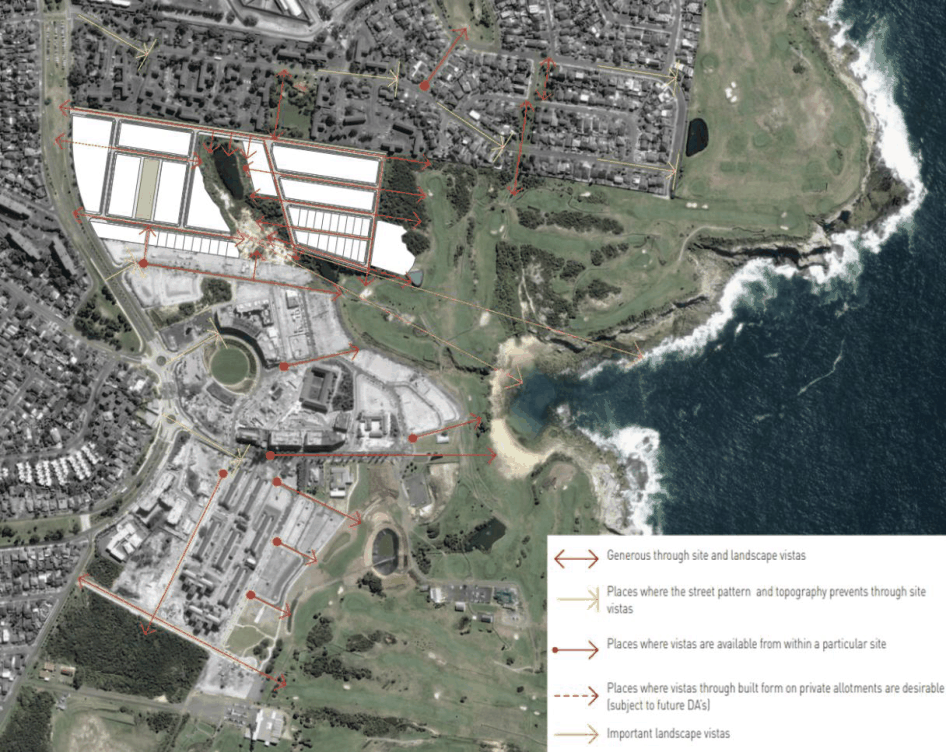

### 3.8. Permeability and vistas

Explanation The Little Bay Stage 1 plan provides a continuous extension of the surrounding urban fabric. The urban grain is designed to allow vistas into and through the site - so that the site is easily negotiable and so that pedestrians have a strong sense of their orientation in the broader landscape. The open-ended street, with views to park and sea is characteristic of the best areas in the Randwick LGA such as Coogee, Malabar, Clovelly and Maroubra. Wherever possible, street vistas are directed to open space corridors within and adjacent to the site and care has been taken to ensure that these views are not enclosed or terminated by built form. This enhances the site’s sense of spaciousness and permeability. More closed arrangements, such as cul-de-sacs, winding streets and off-set intersections are avoided.

Figure 14: Permeability and vistas

> [Picture on page 24: a picture, saved as a picture (images/part-d13-little-bay-cove-page-24-13.gif, 150 dpi).]

Source: Little Bay Cove Masterplan
