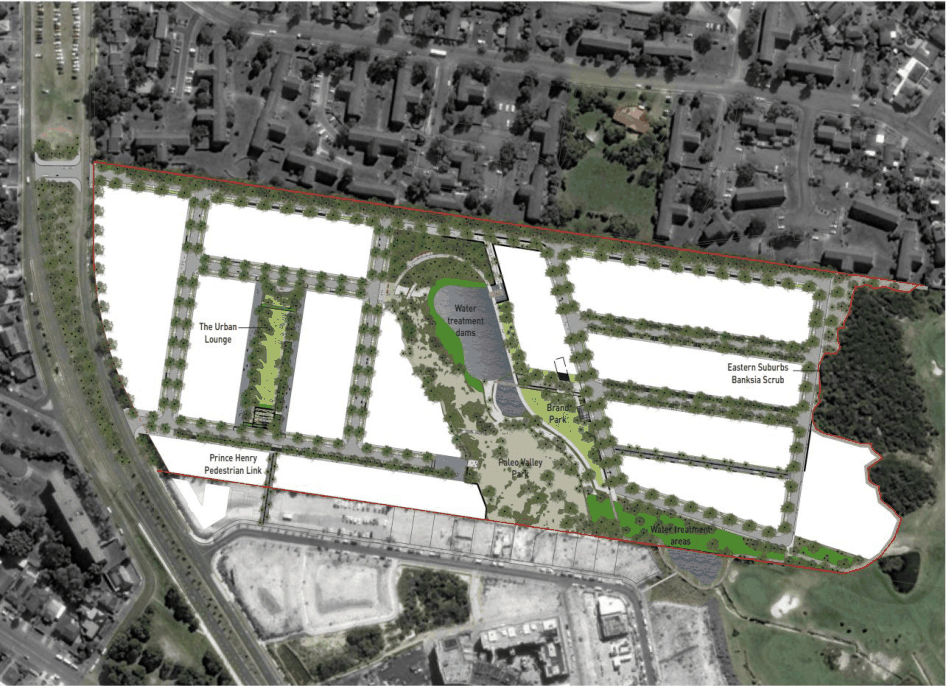

### 3.9. Open space and landscape principles

Explanation The design philosophy for the landscape architecture of the project employs water sensitive design strategies combined with local endemic plant material to develop an ecologically responsible design for the site. The experience of the landscape has been carefully considered to support a diversity of spaces that provide a range of amenity. The public domain comprises vibrant, environmentally innovative public spaces where people will gather, linger and celebrate. A diverse range of open spaces are provided:

• An urban park, called the Urban Lounge, which forms a lively focus for the western part of the site

• Paleo Valley Park - which forms the heart of the project and is defined by the geologically significant miocene cliff face and incorporates biofiltration zones

• Brand Park, which supports active play and community uses. Accessible connections are provided between the public domain, adjoining sites, the coastal walkway and Little Bay Beach. Spaces within the Stage 1 Plan have been designed to satisfy both the new residents and the existing local community, encouraging interaction that maximises recreational opportunities. All parks and open spaces in the site have a public street address and have adjacent on street parking to promote their use and enjoyment by future residents, and existing residents to the north and south of the subject site and beyond. The plan promotes these spaces as being part of a wider local network of open spaces and amenities designed for use by all. They are conceived of being integrated with the local pedestrian network (see Section 3.7 of this DCP).

Figure 15: Permeability and vistas

> [Picture on page 25: a picture, saved as a picture (images/part-d13-little-bay-cove-page-25-24.gif, 150 dpi).]

Source: Little Bay Cove Masterplan
