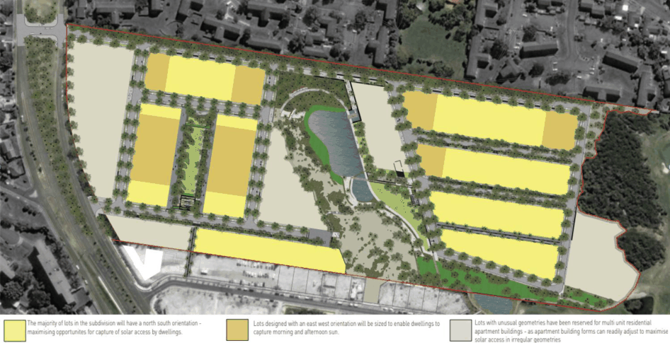

### 3.10. Site wide sustainability initiatives

Explanation Smart design and the incorporation of sustainability initiatives will contribute towards Little Bay achieving a high level of environmental performance which will assist in improving the sustainability of the project.

Water balance and Water Sensitive Urban Design (WSUD) An integrated water cycle will recycle wastewater for reuse in the dwellings, with extra available for use in the public parks as well as the neighbouring golf course. In addition, Water Sensitive Urban Design (WSUD) will ensure all stormwater and rainwater is treated through a series of swales, biofiltration ponds and the central dam before replenishing the natural water cycle. This naturally filtered stormwater is then available for re-use by the adjoining golf course.

Street layout The proposed street layouts optimise solar access to each block and promote a sense of openness with public domain views of the ocean and parks. Ensuring good solar access to the lots is an important aspect of sustainable design.

Renewable energy Opportunities for the use of solar power and wind power are being investigated to provide renewable energy to the public domain in Little Bay.

Transport The street design in Little Bay promotes pedestrian activity. The low speed and low traffic street environment is cycle friendly. Pedestrian connections to the adjoining Prince Henry site further enhance pedestrian permeability providing access to local shopping and retail facilities, reducing car use. Public transport is available to the site via the bus routes along Anzac Parade and Ocean Avenue has been designed to be wide enough to accommodate buses in the case of a future diversion of a bus route through the site.

Figure 16: Solar orientation on the site

> [Picture on page 26: a picture, saved as a picture (images/part-d13-little-bay-cove-page-26-27.gif, 150 dpi).]

Source: Little Bay Cove Masterplan
