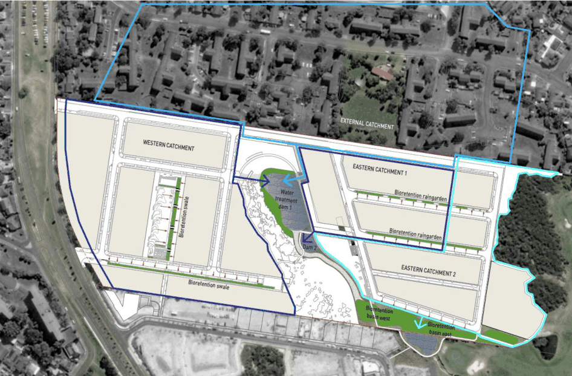

### 3.11. Water sensitive urban design principles

Explanation

The proposed Water Management Strategy has been designed to meet the following objectives through implementing principles of Water Sensitive Urban Design (WSUD) and Stormwater Management.

Objectives The objectives for WSUD are to:

1\. Improve stormwater quality prior to discharge

2\. Manage stormwater quantity via on-site detention

3\. Manage the effects of flooding in the Central Drainage Corridor

4\. Integrate water sensitive urban design elements with the landscape strategy for the site. The proposed stormwater treatment strategy is a treatment train approach, with measures forming natural and visually attractive forms within landscaped areas. The water treatment measures consist of bioretention swales/raingardens at critical locations, two wetlands, two gross pollutant traps and bioretention through the central drainage corridor.

Figure 17: WSUD strategy

> [Picture on page 27: a picture, saved as a picture (images/part-d13-little-bay-cove-page-27-17.gif, 150 dpi).]

Source: Little Bay Cove Masterplan
