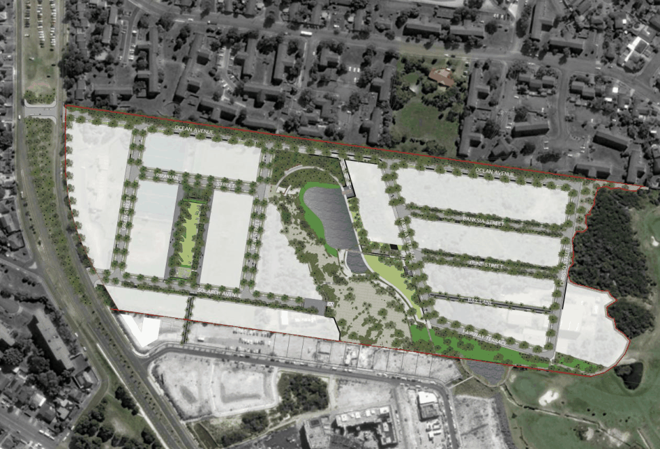

## 4. Public domain elements

### 4.1. Street plan

Explanation Good street design and layout are the foundation of the city and its residential neighbourhoods. Streets provide address for future residents and have great social and amenity attributes when well designed. Detailed street design has been undertaken to articulate the street hierarchy and create differing street characters within a unified palette throughout the site. Streets in Little Bay Cove have been designed to accommodate:

• Dedicated pedestrian footpaths

• Shared cycleways

• Swales

• Carriageways to suit anticipated traffic flows

• On street parking distributed throughout the site

• Street tree planting

• Underground services reticulation

• Future public transport provision

Note New streets and intersections must be set out and constructed in accordance with the drawings and specifications contained in Appendix A of this DCP.

Figure 18: Street plan

> [Picture on page 28: a picture, saved as a picture (images/part-d13-little-bay-cove-page-28-21.gif, 150 dpi).]

Source: Little Bay Cove Masterplan
