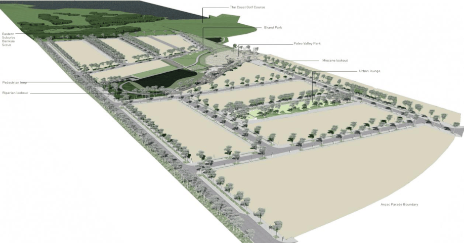

### 4.2. Open space plan

Explanation

is influenced and informed by the discipline of ‘urban

The design of

the site’s open space

ecology’, where the site design components are integral to the location’s social, environmental and ecological systems. It aims to:

• Promote social interaction and a range of recreational opportunities by incorporating a public urban park and a public park at the heart of the project

• Establish a perimeter planting of locally indigenous species to help re-link the site with its original ecological community and to link the site with the remaining patch of ESBS

• Promote accessible connections between the public domain and the adjoining sites, the coastal walkway and Little Bay Beach

• Provide spaces that satisfy both the residents and the local community encouraging neighbourhood interaction

• Create a pedestrian network and shared cycle ways to connect into the existing network

• Provide a wide range of spaces for recreation such as BBQ area, toddler playground, walking / jogging and wide lawn play areas

• Provide viewing platforms with seating at designated viewing locations

• Provide educational signage about the history of the site, the ESBS and the Miocene

• Protect the adjoining ESBS as well as the exposed Miocene and Ochre deposit

• Promote the use of local and regionally native vegetation and sustainable irrigation

• Provide erosion control

• Promote re-generation of the Central Corridor to encourage the return of native ecosystems and promote urban biodiversity

• Encourage the use of salvaged and recycled materials and timber sourced from ecologically responsible forestry operations

• Retain as many existing native trees as possible.

Figure 19: Street plan

> [Picture on page 29: a picture, saved as a picture (images/part-d13-little-bay-cove-page-29-31.gif, 150 dpi).]

Source: Little Bay Cove Masterplan

Note Further information relating to design principles of open space in Little Bay Cove can be found in Appendix B of this DCP.
