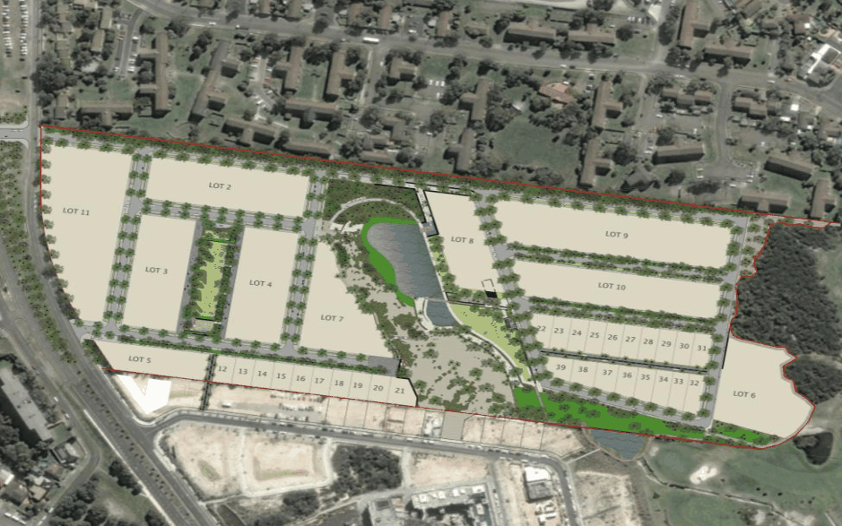

## 5. Private domain controls

### 5.1. Allotment plan

Explanation

The allotment plan for the Little Bay Stage 1 Plan anticipates an appropriate distribution of building types throughout the site. The subdivision and titling of land on the Little Bay Site should reflect the surveyor’s Draft Community Subdivision Plan that formalizes the subdivision plan in Figure 20. Consent is sought for the subdivision of the site into:

• A number of community title lots

• 10 super lots

• 28 individual dwelling lots.

Controls The Community Title lots incorporate the streets, parkland and open spaces. Future subdivision of super lots 2, 3, 4, 9 and 10 must comply with the following controls:

a) Each individual lot and each individual dwelling must have a public street frontage

b) Lots are to be oriented to enable dwellings to take advantage of micro climatic benefits and have dimensions that allow adequate on-site solar access and access to breezes

c) Lots are to be designed to maximise efficiency in house plans and useable external areas by having a regular shape

d) Battle axe lots are not permitted

e) Lots designed for villa housing or other forms of housing where dwellings do not have an address on a public street frontage are prohibited

f) The division of super lots into private allotments should contribute to housing diversity across the site.

Figure 20: Allotment plan

> [Picture on page 32: a picture, saved as a picture (images/part-d13-little-bay-cove-page-32-2.gif, 150 dpi).]

Source: Little Bay Cove Masterplan

Note Since the commencement of the Little Bay Cove Masterplan 2009, lots have been subdivided in accordance with the Allotment Plan.
