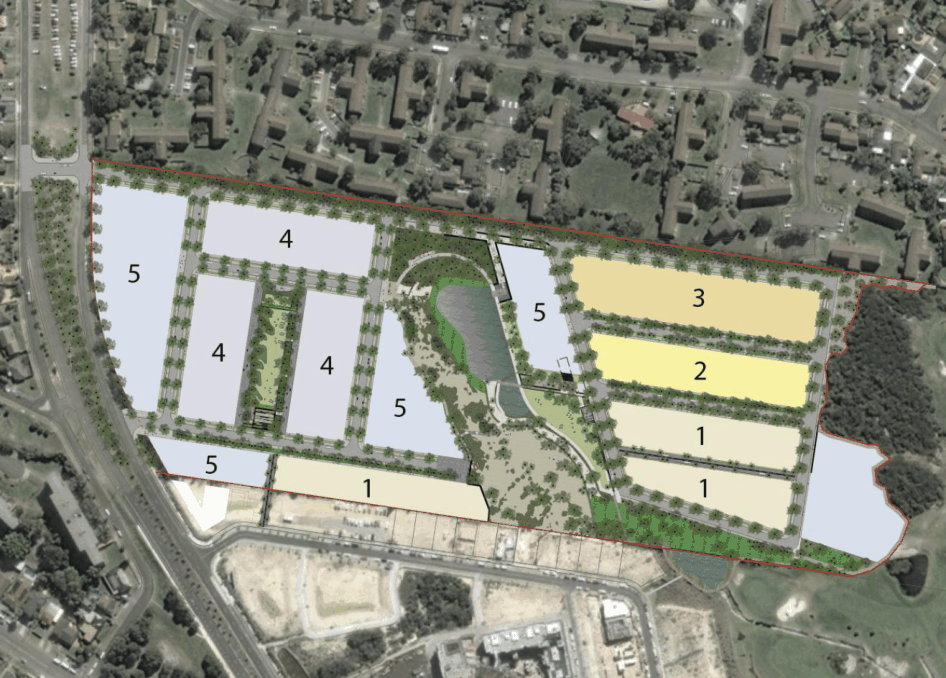

### 5.2. Dwelling types

Objectives Dwelling types in the Little Bay Stage 1 Plan are distributed to:

1\. Reinforce the urban pattern and street hierarchy

2\. Locate the highest densities in areas best served by public transport, outlook and/or public amenity

3\. Locate increased densities in areas adjacent public open spaces to provide the greatest amenity for the maximum number of future residents and to provide highly active and engaging public interfaces

4\. M atch ‘like with like’ along the interface with the Prince Henry site to the south

5\. Maximise the number of regular, efficient and well oriented blocks for small lot, townhouse, courtyard and detached housing

6\. Locate multi unit residential apartments in areas where they can resolve idiosyncratic boundary conditions as they can adapt much more readily to irregular geometries than small lot housing

7\. Locate multi unit residential apartment buildings so that they are dispersed amongst other buildings types, do not dominate any street and do not occupy both sides of a street at any point.

Controls

a) Housing typology must be implemented in accordance with Table 1 and the map located in Figure 21 below

b) Villa housing or any form of housing where the street address to a dwelling is not on a public street is prohibited.

Table 1: Dwelling typology controls

| Map Key | Housing typology Detached residences and/or attached dual occupancy lots residences, semi-detached dwellings, row housing with parking and/or square courtyard housing with individual semi attached housing, row housing with parking and/or apartments with common entry lobby underground parking parking, row housing with shared basement housing types with shared basement parking apartments with common garden and from street frontage |
|---|---|
| 1 |  |
| 2 Detached individual parking |  |
| 3 Detached residences, individual/shared from street frontage and |  |
| 4 Row housing with individual parking and/or maisonette |  |
| 5 Multi-unit apartment buildings, parking facilities. Common entry lobby |  |

Figure 21: Housing typology plan

> [Picture on page 33: a picture, saved as a picture (images/part-d13-little-bay-cove-page-33-9.gif, 150 dpi).]

Source: Little Bay Cove Masterplan
