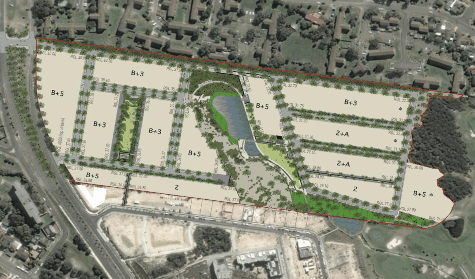

### 5.3. Building height control plan

Objectives Building heights in the Little Bay Stage 1 Plan are distributed to:

1\. Reinforce the urban pattern and street hierarchy

2\. Allow for equitable solar access and outlook to dwellings within each block

3\. Control building heights to prevent overshadowing of Eastern Suburbs Banksia Scrub

4\. Minimise the impact of built form on adjoining and nearby land

5\. Avoid placing higher buildings in areas that would block street vistas to landscaped open spaces

6\. Intersperse higher and lower building forms to minimise large concentrations of higher buildings

7\. Locate height in relation to the expansive scale of major streets and open spaces.

Controls

a. New development must comply with the building heights specified in Table 2 and the map located in Figure 22 below

b. Excavation within the possible extent of the Palaeovalley Area should not be below RL 26 unless endorsed by Randwick City Council and Heritage NSW.

Table 2: Building height controls

| Map Key | Building height controls |
|---|---|
| 2 | Two storeys permitted: - 7m maximum wall height above RGL - 8m maximum roof height above RGL |
| 2 + A | Two storeys + attic room or roof terrace permitted: - 8m maximum wall height above RGL - 9m maximum roof height above RGL |
| B + 3 | Basement + three storeys permitted: - 1.2 maximum protrusion of basement above RGL - 11m maximum wall height above RGL - 12m maximum roof height above RGL |
| B + 5 | Basement + five storeys permitted: - 1.2 maximum protrusion of basement above RGL - 17.2 maximum wall height to fifth storey above RGL - 18m maximum roof height above RGL |
| * | Development Applications for sites adjacent to ESBS must include shadow diagrams that demonstrate that built form on these sites will cause no overshadowing of the mapped area of the ESBS between 9am and 3pm at summer, equinox and mid-winter. Note: the Asset Protection Zone may be overshadowed during these times. |

Figure 22: Building height control plan

> [Picture on page 35: a picture, saved as a picture (images/part-d13-little-bay-cove-page-35-2.gif, 150 dpi).]

Source: Little Bay Cove Masterplan
