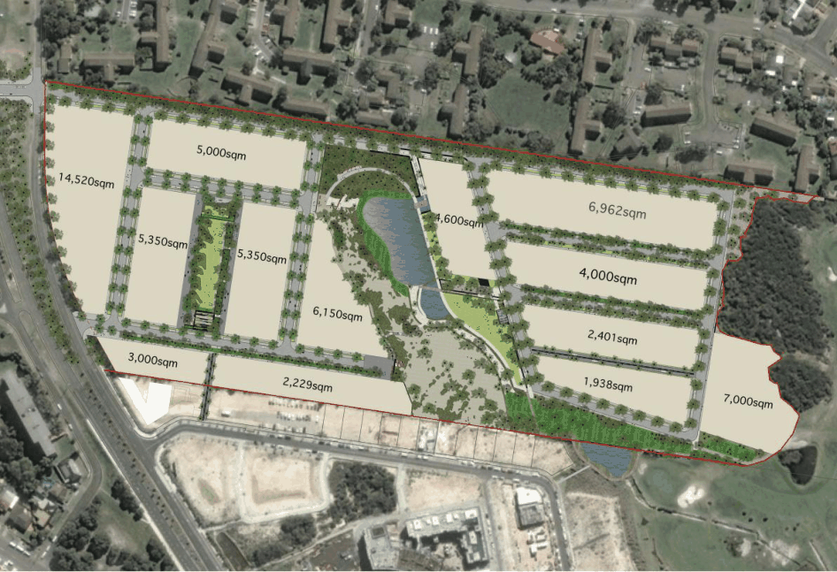
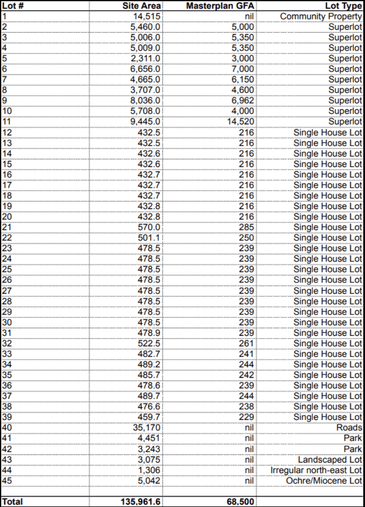

### 5.4. Density control plan

Objectives Density in the Little Bay Stage 1 Plan is disturbed to:

1\. Ensure that built form reinforces the urban pattern and street hierarchy

2\. Encourage a diverse mix of dwelling types and sizes across the site, rather than homogenous zones

3\. Locate the highest densities in areas best serviced by public transport, open prospect and/or public amenity

4\. Locate increased densities in areas adjacent to public open spaces to provide the greatest amenity for the maximum number of future residents and to provide highly active and engaging public interfaces

5\. Control bulk and scale across the site.

Controls

a) The Gross Floor Area (GFA) of each development parcel must not exceed the limits outlined in the Density Control Plan in Figure 23 and specific lot GFA requirements outlined in Figure 24.

Figure 23: Density control plan

> [Picture on page 36: a picture, saved as a picture (images/part-d13-little-bay-cove-page-36-2.gif, 150 dpi).]

Source: Little Bay Cove Masterplan

Figure 24: GFA table (individual lots)

> [Picture on page 37: a picture, saved as a picture (images/part-d13-little-bay-cove-page-37-2.gif, 150 dpi).]
