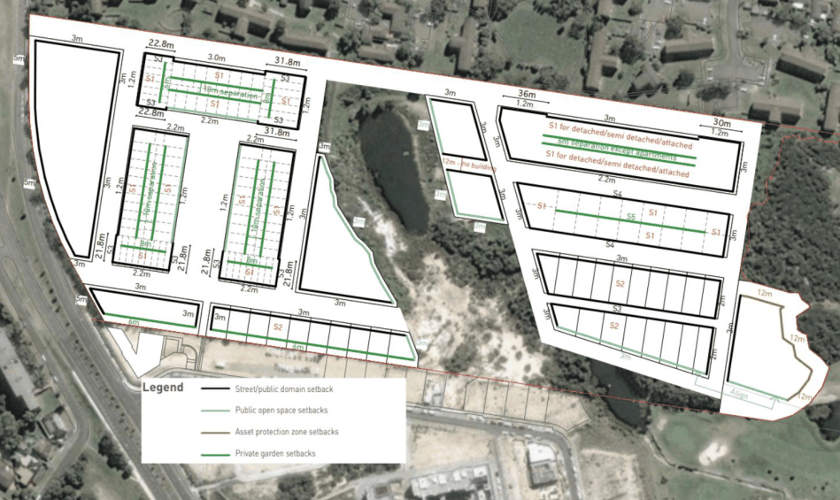

### 5.5. Setback control plan

Objectives Setbacks in the Little Bay Stage 1 Plan are configured to:

1\. Allow built form to reinforce the urban pattern and street hierarchy

2\. Ensure that separation between the rear and side boundaries of allotments enables adequate and equitable levels of privacy and solar access to each dwelling

3\. Allow for the creation of contiguous landscaped areas to contribute to the public domain, provide separation, green aspect and amenity in the private domain and provide necessary separation to the ESBS

4\. Encourage the most efficient use of urban capable land.

Controls

a) Setbacks of development must comply with the setback controls outlined in Table 3 and Figure 25 below.

Table 3: Setback controls

| Map Key | Setback controls Provide a minimum 1.2m, 2.2m, 3m or 5m setback from the allotment boundary to any part of the building as noted on the Setback Control Plan (Figure 25). These areas form the street interface. Provide a minimum 1.2m or 3m setback from an allotment boundary with a public open space to any part of the building as shown on the Setback Control Plan (Figure 25). These areas form the public open space interface. Provide a minimum 6m or 8m setback from the rear allotment boundary to any part of the building as shown on the Setback Control Plan (Figure 25). These areas form private landscape spaces. Provide a minimum 10m separation between buildings as shown on Figure 25. These areas form private landscaped areas. Provide a 12m setback from the mapped boundary of the ESBS. These areas form part of an Asset Protection Zone. Zero lot setback permitted for a maximum of 65% of the length of any side boundary. Provide a minimum of 1m setback on one side of the allotment and a minimum of 2m setback on the opposing side boundary. Zero lot setback permitted for a maximum of 60% of the length of the allotment boundary only. 1.2m minimum setback required for the remainder. Zero lot setback permitted for a maximum of 50% of the length of the allotment boundary. 6m minimum setback required for the remainder. Zero lot setback permitted for a maximum of 33% of the length of the rear allotment boundary. 5m minimum setback required for the remainder of the building. Zero lot zone must be identical for northern and southern lots that share a boundary. |
|---|---|

Map Key

Setback controls

The remainder of the boundary should be a 1.8m high masonry boundary wall.

Figure 25: Setback control plan

> [Picture on page 39: a picture, saved as a picture (images/part-d13-little-bay-cove-page-39-6.gif, 150 dpi).]

Source: Little Bay Cove Masterplan
