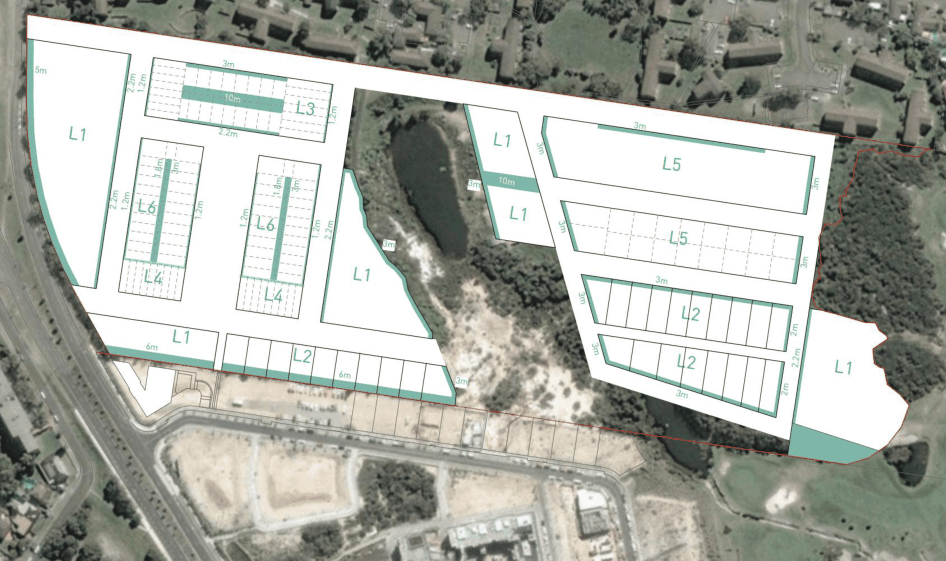

### 5.6. Landscape control plan

Objectives Landscaped areas in the Little Bay Stage 1 Plan are defined to:

1\. Provide adequate on-site infiltration and reduce urban run-off

2\. Provide a variety of usable outdoor spaces to relate to the primary habitable rooms of residential dwellings

3\. Provide a variety of usable common landscape spaces to provide outlook and recreation in multi-unit apartment buildings

4\. Provide landscaped thresholds to articulate the transition between the public and private domains.

Controls

a) Development must comply with the requirements outlined in Table 4 and the landscape control plan in Figure 26.

Table 4: Landscaping controls

| Map Key | Landscaping requirements Mandatory garden zone – 80% of the shaded areas required to be deep soil. Permeable paving is permissible within the deep soil area |
|---|---|
| L1 | Landscaped area – Minimum 50% of the allotment area Deep soil area – Minimum 25% of the allotment area |
| L2 | Landscaped area – Minimum 45% of the allotment area Deep soil area – Minimum 30% of the allotment area |
| L3 | Landscaped area – Minimum 40% of the allotment area Deep soil area – Minimum 35% of the allotment area |
| L4 | Landscaped area – Minimum 40% of the allotment area Deep soil area – Minimum 15% of the allotment area |
| L5 | Landscaped area – Minimum 35% of the allotment area Deep soil area – Minimum 30% of the allotment area |
| L6 | Landscaped area – Minimum 30% of the allotment area Deep soil area – Minimum 7.5% of the allotment area |

Figure 26: Landscape control plan

> [Picture on page 40: a picture, saved as a picture (images/part-d13-little-bay-cove-page-40-4.gif, 150 dpi).]

Source: Little Bay Cove Masterplan
