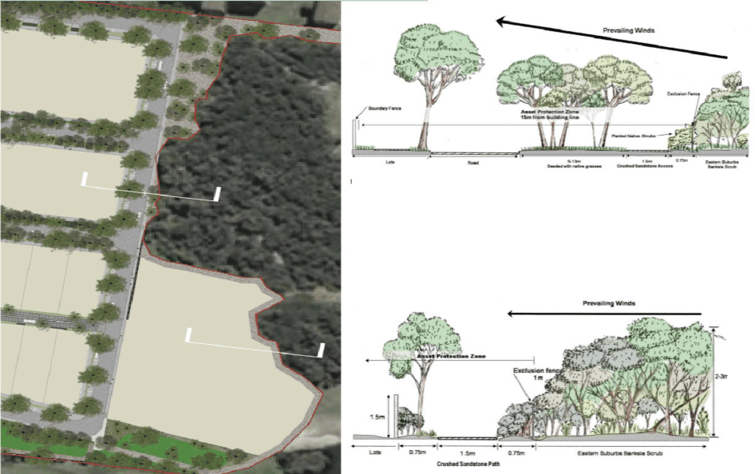

### 5.20. Bushfire risk

Explanation

An area of remnant bushland adjacent to the Little Bay Cove Site, identified in Figure 27 of this Section. They are not classified as Bushfire Prone Land under the Rural Fires Act 1997. To manage potential bushfire risk in areas adjacent the ESBS, an Asset Protection Zone (APZ) has been established along its boundary. The APZ has generally been accommodated within the street reserve and public open space. Lot 6 has an APZ within its allotment boundaries. Guidelines for the management of APZs can be found in Appendix D of this DCP.

Controls

a) All development must comply with the Management of Asset Protection Zones outlined in Appendix D of this DCP.

Figure 27: Bushfire protection map

> [Picture on page 50: a picture, saved as a picture (images/part-d13-little-bay-cove-page-50-21.gif, 150 dpi).]

Source: Little Bay Cove Masterplan
