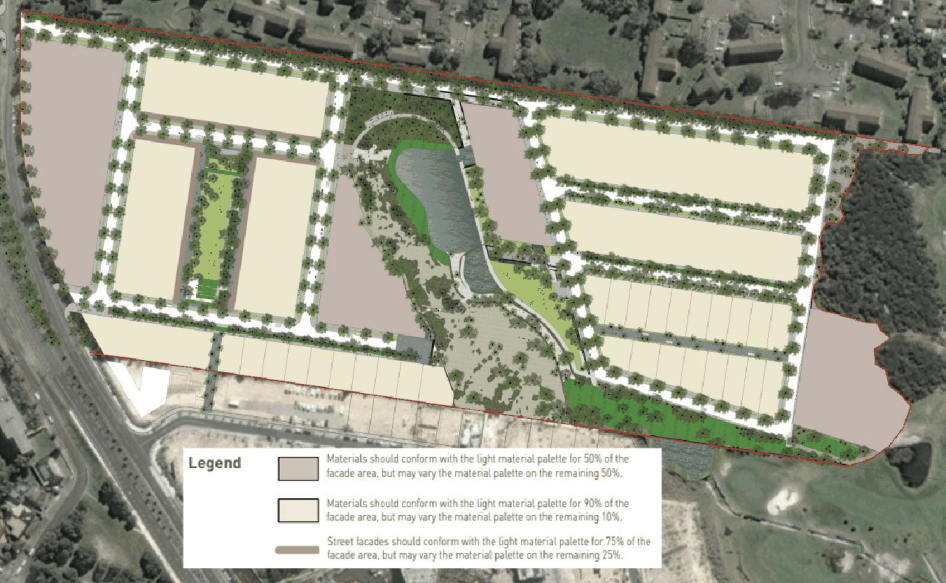

### 5.22. Dwelling design

Controls

a) Provide houses that are specifically designed for this site

b) Design houses of modest architectural scale, formed from compact, thinly proportioned elements and/or pavilions that are arranged to relate to the site topography

c) Large bulky forms with deep, square footprints are not permitted

d) Courtyard houses and pavilion houses are strongly encouraged

e) Avoid references to historicist architectural styles and periods. Use of elements such as complex roofs with multiple hips and gables, dormers, turrets, finials, porticoes, mock Federation, Tudor, Georgian, Tuscan, Manor house references and the like are not permitted.

Figure 28: Map of distinctive architectural patterns

> [Picture on page 52: a picture, saved as a picture (images/part-d13-little-bay-cove-page-52-13.gif, 150 dpi).]

Source: Little Bay Cove Masterplan
