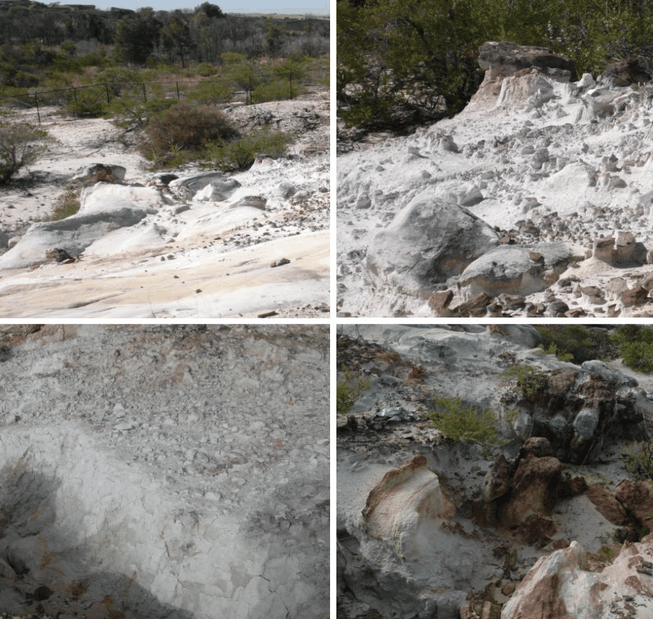
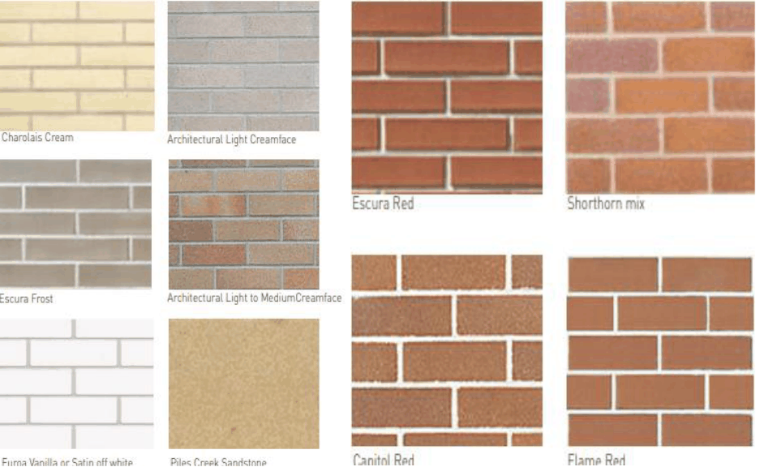
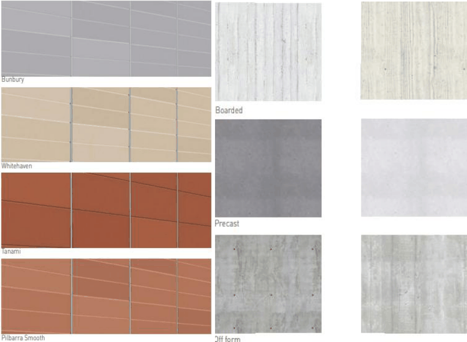
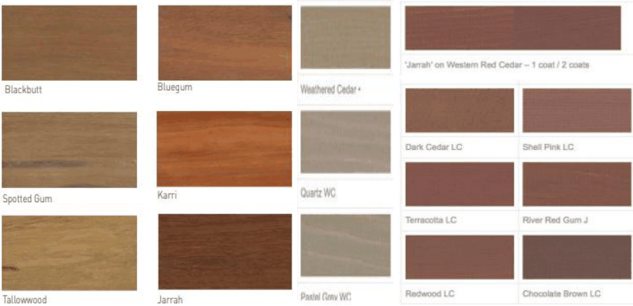
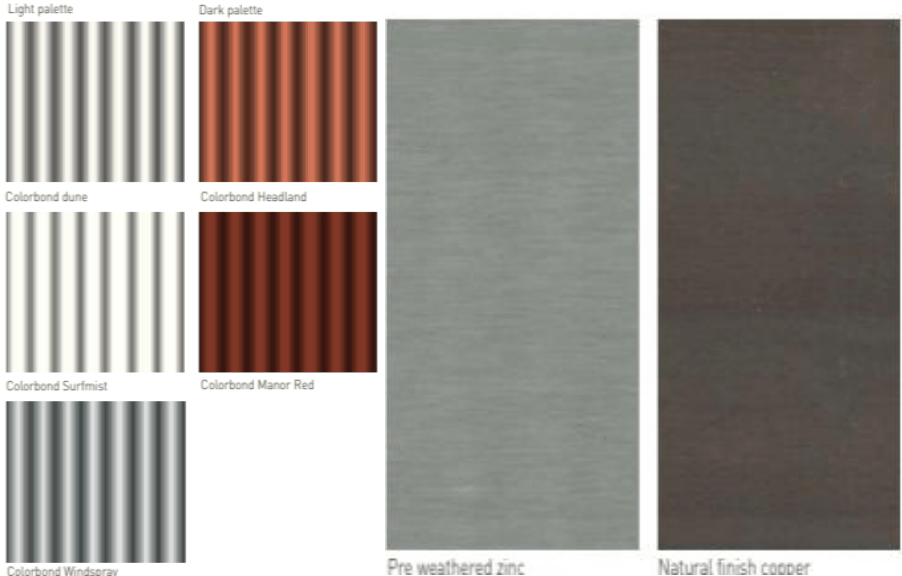
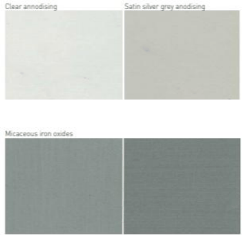
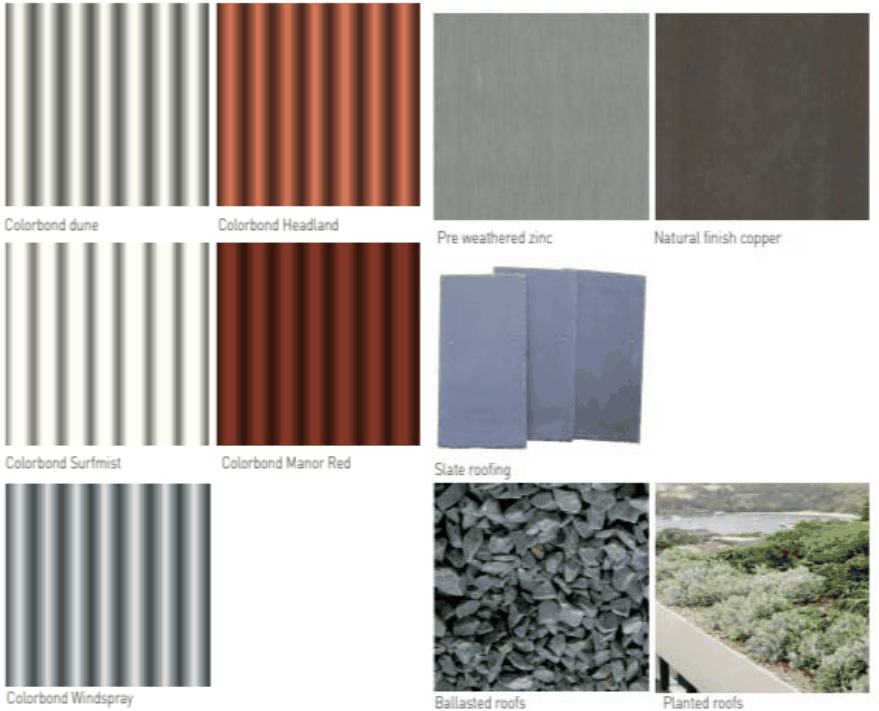

### 5.23. Material palette

Explanation

The exposed Miocene and ochre sources on the subject site are within white, pink through to deep red tonal ranges. Similarly, heritage structures on the Prince Henry site relate to the materials of the site by exhibiting a palette of deeper red dark brickwork, light grey render and also areas of very light brickwork. Accordingly, buildings within the Little Bay plan are required to make reference to the base materials of the site. Buildings will be predominantly formed from a palette of light materials, however each building will also have an allowance for a certain percentage of its facade area to explore the richer colours of the site’s base material. The light and dark palettes a re described in the following sections.

Objectives The objectives for material palette are to:

1\. Ensure that there is a level of consistency between buildings in regard to use of high quality, durable materials, finishes and detailing in the construction of dwellings

2\. Employ current best practice in the fields of Architecture, Landscape Architecture, Engineering and Construction in the design of all dwellings and garden areas

3\. Minimise environmental impact by selecting materials with low embodied energy, recycled renewable, non toxic and non polluting.

Figure 29: ochre and sandstone formations on site

> [Picture on page 53: a picture, saved as a picture (images/part-d13-little-bay-cove-page-53-10.gif, 150 dpi).]

Source: Little Bay Cove Masterplan

Masonry

Controls Masonry finishes should reflect the materials that are of the place. As such the permissible material palette references the sandstone and Miocene found locally. The permissible material palette is as follows: Stone

a) Any solid stone or stone veneer used in building facades that are visible from the public domain must be Piles Creek white sandstone

b) Any substitutions arising from availability constraints must match the tonal range of the above stones as assessed by physical sample compared to project sample held by Randwick City Council.

Brickwork

c) All face brickwork must be Exposure Grade. Permissible specifications include:

i. Bowral bricks Charolais Cream

ii. Boral Escura Frost (Exposure Grade)

iii. Namoi Valley Architectural Light Creamface

iv. Namoi Valley Architectural Light to Medium Creamface

v. Euroa clay products Vanilla or Satin off white

vi. Bowral bricks Capitol Red or Shorthorn Mix

vii. Bowral Escura Red or Flame Red.

Figure 30: Masonry palette examples

> [Picture on page 54: a picture, saved as a picture (images/part-d13-little-bay-cove-page-54-14.gif, 150 dpi).]

Source: Little Bay Cove Masterplan

Rendered masonry

d) Rendered masonry may be finished with paint or sand pigmented render in a tonal range to match the brickwork colours in the Light and Red palettes.

Terra cotta cladding tiles

e) Permissible terra cotta cladding tiles include:

i. Terracade XP Whitehaven Smooth

ii. Terracade XP Bunbury Smooth

iii. Terracade TN Tanami

iv. Terracade XP Pilbarra Smooth

v. Terracade XP Pilbarra Linear

Concrete

f) All off form or precast concrete must be of minimum Class 2 finish with grey, off white or white cement

g) Concrete is permitted in areas designated for both the Light and Dark Palettes

h) Preferably, concrete should not be painted, but if necessary should be painted to match the original substrate colour. These restrictions apply to all concrete elements including projecting slab edges and soffits

i) Diluted Keim paint finishes with salt retardants are also permitted in tones to match the base concrete colour

j) Exposed aggregates in colours that reference the base material palette’s are also permitted.

Figure 31: Terra cotta and concrete palette examples

> [Picture on page 55: a picture, saved as a picture (images/part-d13-little-bay-cove-page-55-13.gif, 150 dpi).]

Source: Little Bay Cove Masterplan

Rammed earth and pise

k) Rammed earth or pise construction should reflect colours in the lighter range of the foundation material of the site in terms of the light and dark palettes on the site

Lightweight materials Timber

a) Permissible timber materials include:

i. Durable Australian hardwoods

ii. Western red cedar

iii. Natural finish weathering to grey (Note: suitable for durable hardwoods only)

iv. Oiled/sealed finish

b) Light coloured olive, honey, cream, grey brown timbers are favoured in the light palette areas

c) For red palette areas use more intense dark brown and rich red coloured timbers

d) Given the natural variability of timber, applicants are required to submit samples with their development applications, but for guidance the following species are recommended:

i. Blackbutt

ii. Spotted Gum

iii. Tallowwood

iv. Bluegum

v. Jarrah

vi. Ironbark

vii. Karri

e) Buildings in lots adjacent asset protection zones may vary these controls to comply with

AS3959 Building in Bushfire Prone areas if necessary, while conforming with the intent of the colour palettes

Marine grade plywood

f) Permissible marine grade plywood includes:

i. Oiled finish

ii. Clear sealed finish

iii. Stained finish in colours to suit the Light and Red Pallettes

Figure 32: Timber and timber stain palette examples

> [Picture on page 56: a picture, saved as a picture (images/part-d13-little-bay-cove-page-56-23.gif, 150 dpi).]

Source: Little Bay Cove Masterplan

Fibre cement sheeting

g) Permissible fibre cement sheeting must be clear sealed

h) PVC joining strips and corner caps are not permitted

i) Joint and corner should be finished with metallic strips or timber battens. Metal wall cladding

j) Colorbond, Colorbond Ultra or Colorbond Stainless Steel profiled walling in Custom Orb, Custom Orb Blue or Longline 305 profiles are permitted in the following colours:

i. Surfmist, Dune or Windspray

ii. Zincalume

iii. Headland or Manor Red (20% of facade area max).

k) Standing seam walling or panels in the following finishes:

i. Pre weathered zinc (grey only)

ii. Copper cladding (Note -Natural copper finish permitted only - pretreatment to accelerate verdigris/green finish is not permitted).

Steel framing Colours for steelwork should be equal to Ferrodor ‘St Enoch Grey” or International Paints

l) ‘Gun Metal Grey’ or painted in colour to match adjacent materials

m) The following lightweight materials are prohibited:

i. Any lightweight finish rendered to mimic masonry

ii. Imported timbers

iii. Timber from old growth forests

iv. Large expanses of reflective surfaces with high gloss, vitrified, enamel finishes and the like

v. Aluminium composite panels.

Figure 33: Lightweight cladding palette examples

> [Picture on page 57: a picture, saved as a picture (images/part-d13-little-bay-cove-page-57-19.gif, 150 dpi).]

Source: Little Bay Cove Masterplan

Windows and glazing

a) Openings to the street should be carefully controlled to provide a predominantly walled character to streets to afford residents appropriate levels of privacy. The area of glazing must not exceed 40% of the area of the front façade

b) The reflectivity of glazed surfaces should be minimised through careful design. Areas of glazing should be recessed within the thickness of external walls and/or protected by sun shading elements appropriate to orientation from one of the following:

i. Fully operable timber shutters

ii. Operable aluminium louvred blinds

iii. Operable fabric awnings

iv. Overhanging eaves or hoods

c) Permitted framing materials include:

i. Steel frame windows - galvanised or micaceous iron oxide in mid through light grey

ii. Commercial grade aluminium windows - 25 micron thickness anodising in clear, satin silver grey, or satin stainless grey - or equal in powdercoat

iii. Timber windows, oiled/sealed

iv. Glass louvres (must be high performance to habitable rooms).

d) Insect screening in bronze or stainless steel, Permitted glazing materials must meet the requirements of BASIX

e) Small areas of colour backed glass are also permitted but should reference the light and dark palettes

f) Prohibited materials include:

i. Domestic/residential grade aluminium window suites (NB All aluminium suites must be commercial grade)

ii. Glazing with applied solar tinting films and/or mirrored surfaces

iii. Large areas of unprotected glazing

iv. Glass blocks

v. Fritted glass surfaces

vi. Solid rolling metal shutters that allow no light transmission or ventilation in the closed position.

Figure 34: window finishes

> [Picture on page 58: a picture, saved as a picture (images/part-d13-little-bay-cove-page-58-24.gif, 150 dpi).]

Source: Little Bay Cove Masterplan

Roofing Roofing may have one of the following architectural expressions:

a) If the roof is visible the roof edge should be finely detailed with min. 600mm overhanging eaves to attenuate the edge of the building when seen against the sky

b) If the roof is intended to be concealed ,the building should have an expressed parapet, capped with either:

i. A flush clear zincalume barge-soaker with maximum visible flashing of 40mm or

ii. Preweathered zinc flashing of maximum 40mm

c) Usable roof terraces are permitted

d) Roof forms should generally have simple pitched, monopitched, flat or simple curved profiles

e) Complex roof geometries with graphic representations of wavelike forms or historicist forms with excessive numbers of hips, gables, finials and turrets are prohibited

f) Permitted roof materials:

i. Colorbond Surfmist, Dune or Windspray

ii. CSR Nullabor flat terra cotta tile in Slate Grey

iii. Pre-weathered standing seam zinc roofing

iv. Slate roofing

v. Timber shingles (weather to grey)

vi. Pebble/gravel ballasted roofs in grey tones

vii. Planted roofs with appropriately hardy coastal species

viii. Colorbond Headland, Manor Red

ix. CSR Nullabor flat terra cotta tile in Earth

x. Standing seam copper roofing

xi. Pebble/gravel ballasted roofs in grey or brown tones

xii. Planted roofs with appropriately hardy coastal species

g) Permitted roof plumbing materials include:

i. Quad or half round gutters in zincalume

ii. quad or half round gutters in zinc

iii. circular or rectangular downpipes to match

Figure 35: Roofing finishes

> [Picture on page 59: a picture, saved as a picture (images/part-d13-little-bay-cove-page-59-25.gif, 150 dpi).]

Source: Little Bay Cove Masterplan

Balustrades and handrails

a) Permitted balustrade materials include:

i. Masonry (as per permissible masonry finishes)

ii. Flat bar or steel rod framing

iii. Timber framing and/or battens

iv. Stainless steel wire and fine steel meshes

v. Glass set within flat bar steel framing only

b) Discouraged materials include:

i. Frameless glass balustrades

ii. Aluminium balustrades
