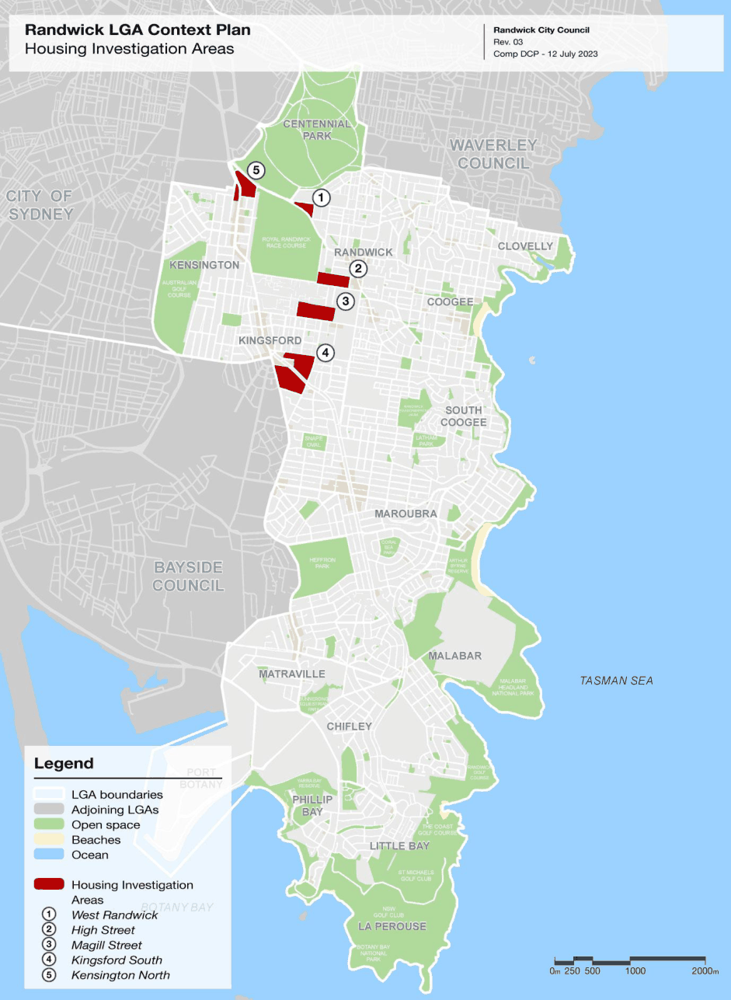

### 1.2. Housing Investigation Areas urban design analysis report

The Objectives and Controls in this section of the DCP are informed by the extensive site and built form analysis, 3D modelling, and feasibility testing completed for the HIA Urban Design Analysis studies prepared in 2022 and exhibited with the CPP.

Figure 1: LGA context plan

> [Picture on page 6: a picture, saved as a picture (images/part-d14-well-located-housing-area-page-6-2.gif, 150 dpi).]

Source: Randwick City Council 2023
