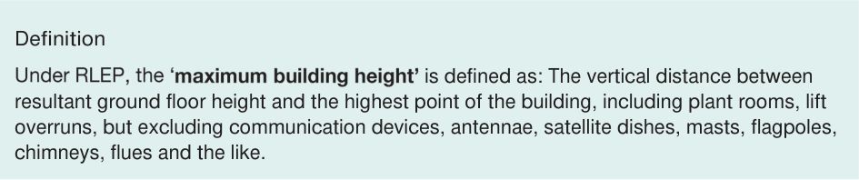

## 5. Built form

Explanation Built form refers to the

‘three dimensional’ appearance or character of the WLHAs

encompassing the aesthetic quality, shape, scale and configuration of individual buildings, and their relationship to other buildings within the WLHA and to streets and the public domain. Objectives and Controls focus on achieving an appropriate scale for new development so that buildings achieve a coherent, harmonious and visually appealing urban environment, that enhances the public realm. For detailed built form requirements, refer to

‘Part B

– Site specific controls ’ which outline

development controls tailored to each WLHA city block. The block control plans provide detailed development controls for new development in the WLHAs informed by an urban design constraints analysis. This analysis identifies buildings that are constrained, including:

• Heritage listed

• Contributory to the character of the area

• Church owned

• Utility infrastructure such as substations

• Recently completed, and

• Residential strata buildings comprising 8-10 apartments or more that are assessed as unlikely change in the medium term.

Where redevelopment proposals vary from these assumptions they will be assessed on merit, with reference to both the overarching and block-specific objectives and development controls established for the WLHA. Objectives The objectives for built form within the WLHAs are to:

1\. Ensure built form is compatible with the desired future character of each WLHA in terms of building bulk, scale and massing

2\. Promote coherent and orderly redevelopment of land, avoiding the isolation of sites

3\. Ensure development reinforces the urban structure and street hierarchy through responsive design

4\. Ensure development respects the existing siting, scale, form and character of adjoining properties

5\. Avoid large, bulky and unarticulated

‘wall-like

’ building form that visually dominate the

public realm

6\. Achieve a scale transition between WLHA buildings and surrounding residential areas to protect residential amenity

7\. Design development to optimise solar access, protect privacy, maintain view corridors and enhance visual amenity for neighbouring properties, public spaces and communal areas in accordance with best practice urban design principles

8\. Ensure that the number of storeys in a development aligns with the maximum permissible building height in metres under the RLEP allowing for ADG compliant floor-to-floor heights, internal amenity, roof top structures (such as plant rooms or lift overruns) and to allow for flexibility for future changes of use (particularly at ground floor level)

9\. Allow sufficient space between floors for building services and acoustic attenuation

10\. Incorporate upper-level building setback controls to reduce the apparent scale of buildings, establish a consistent street wall height, minimise overshadowing of the street and other buildings and create a cohesive streetscape environment.

Controls

Lot amalgamation

a) Demonstrate that the minimum dimensions of an amalgamated redevelopment site

‘Part B

(consolidated from multiple existing individual properties) are consistent with – Site specific controls’

b) Site amalgamation must not compromise the future development potential of adjacent or intervening sites

c) Where a development proposal unavoidably results in an isolated site, the applicant must demonstrate that reasonable efforts have been made to avoid this outcome. The following must be submitted with the DA:

i. Evidence of written offer/s made to the owner of the isolated site and any responses received prior to the lodgement of the DA

ii. Schematic diagrams demonstrating how the isolated site is capable of being redeveloped in accordance with relevant provisions of the RLEP and this DCP to achieve an appropriate urban form and an acceptable level of amenity

iii. Schematic diagrams showing how the isolated site could potentially be integrated into the development site in the future in accordance with relevant provisions of the RLEP and this DCP to achieve a coherent built form outcome for the block

Building heights

d) The maximum Height of Building (HoB) that can be achieved on a site is shown on the RLEP Height of Building Map

e) The maximum number of storeys permitted on a site must comply with the following:

i. on sites with a maximum HoB of 16.5m and 17.5m

– 5 storeys

ii. on sites with a maximum HoB of 19.5m

– 6 storeys

iii. on sites with a maximum HoB of 23m and 24m

– 7 storeys

iv. on sites with a maximum HoB of 26m

– 8 storeys

f) Where a property is identified by Council to be flood affected, this may require a ground floor habitable space to be raised above the existing ground level (above the 1 in 100-year flood level, plus 0.5m freeboard). In such cases, the additional height should be absorbed into the overall height of the building, whilst maintaining ADG floor to ceiling standards and not exceeding the required LEP maximum building height. In this case the full number of storeys stated in e) above may not be able to be achievable.  Council may at its discretion consider a minor exceedance in height where required to meet the Floor Planning Flood Level

> [Picture on page 12: a picture, saved as a picture (images/part-d14-well-located-housing-area-page-12-44.gif, 150 dpi).]
> Words printed on the picture (title and legend, copied from the PDF):
> Definition
> Under RLEP, the ‘ maximum building height’ is defined as: The vertical distance between

resultant ground floor height and the highest point of the building, including plant rooms, lift overruns, but excluding communication devices, antennae, satellite dishes, masts, flagpoles, chimneys, flues and the like.

Street walls

g) In the High Street WLHA and West Randwick WLHA E1 Zone, buildings must be designed with a street wall height of 6 storeys

Building setbacks

h) Developments must comply with the minimum ground floor and upper-level setbacks illustrated in the relevant block diagrams in ‘Part B

– Site specific controls ’ ensuring

appropriate building separation, solar access and streetscape design

i) Where pedestrian link/s or street setback strips are required, landowners must dedicate these areas to Council. This requirement will be included as a condition of consent.  For the purposes of calculating FSR and deep soil zones, the original site area including the required pedestrian link/s and setback strip area/s will be used

j) Where development results in an exposed party wall, the wall must incorporate high quality architectural, vertical landscaping treatments or public art (subject to Council approval) to enhance visual amenity of the wall until the adjoining building is constructed

Building depth

k) The residential component of a development is to have a maximum building depth of 20m, including balconies. A maximum building depth of 22m, may be permitted on merit, subject to ADG compliance for floor to ceiling height, solar access and cross ventilation and where it contributes positively to internal amenity and environmental performance.

Definition Building depth refers to the dimension measured from the front to the back of a building's floorplate. It has a significant influence on internal residential amenity such as access to light and air. For residential development, narrower building depths generally have a greater potential to achieve optimal natural ventilation and solar access than deeper floor plates.
