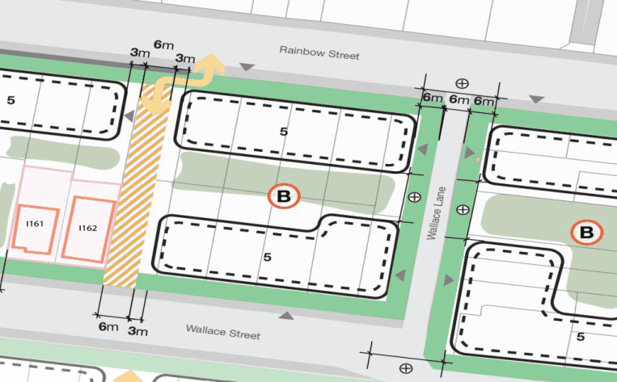
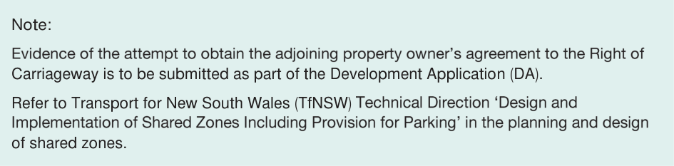

## 7. Laneway / shared way zones

Explanation Laneways and shared zones contribute to the fine grain character of urban areas and help to enhance walkability and connectivity. They also provide an important service function for waste management and car parking access to developments. Laneways / shared zones in certain situations assist in providing an appropriate scale transition and separation from surrounding lower scaled neighbourhoods. Objectives The objectives for laneways/shared way zones are to:

1\. Facilitate vehicular access and servicing away from main road frontages to improve pedestrian and active transport movement and safety

2\. Provide usable, green and leafy laneways

3\. Encourage passive surveillance of any existing or new laneways. Controls

a) Laneways are to be a minimum of 6 metres wide (for larger developments, a carriageway width greater than 6 metres may be required), provide sufficient width for turning and U-turn movements, and shall provide landscaping, lighting and high quality materials and finishes, and opportunities for art to enhance the pedestrian environment

b) All new development that fronts lanes shall be articulated to create visual interest and shall incorporate passive surveillance by orienting windows and balconies onto the lane

c) Ground floor uses fronting lanes shall incorporate openings onto the lane to contribute to the enjoyment and activation of the lane including, where possible, outdoor dining

d) Applicants are to negotiate Rights of Carriageway with adjoining property owners where required for access.

Figure 2: Laneway widths

> [Picture on page 16: a picture, saved as a picture (images/part-d14-well-located-housing-area-page-16-26.gif, 150 dpi).]

Source: Randwick City Council 2023

> [Picture on page 17: a picture, saved as a picture (images/part-d14-well-located-housing-area-page-17-1.gif, 150 dpi).]
> Words printed on the picture (title and legend, copied from the PDF):
> Note:
> Evidence of the attempt to obtain the adjoining property owner’s agreement to the Right of
> Technical Direction ‘Design and
> Implementation of Shared Zones Including Provision for Parking’ in the planning and design
> of shared zones.

Carriageway is to be submitted as part of the Development Application (DA). Refer to Transport for New South Wales (TfNSW)
