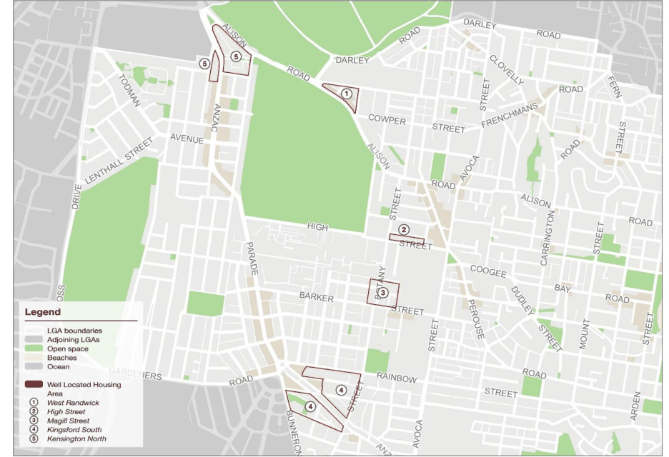

## 9. Well Located Housing Areas (formerly Housing Investigation Areas)

The following section outlines the overarching vision and desired future character for the WLHAs. It establishes the strategic intent for the built form, public domain, landscape and access outcomes across the precincts. Each WLHA section includes a dedicated sub-section that provides:

• Objectives and controls tailored to the

precinct’s context

• Specific design requirements for built form, public domain, landscape and access

• Block-by-block envelope controls to define the maximum extent of a building in height, length and depth.

Alternative design approaches may be considered where it can be clearly demonstrated that the proposal

• Delivers improved urban design, amenity and sustainable outcomes

• Aligns with the desired future character for the relevant WLHA block

• Meets the intent of both the overarching and site - specific controls As site consolidation outcomes are unknown, flexibility in the building length may be permitted in specific circumstances, as indicated on the block plan diagrams. All buildings must be designed to fit within the applicable building envelope. These site specific block-by-block controls should be read in conjunction with the overall controls for the WLHAs in this section of the DCP, and the broader provisions in this DCP. Figure 3: WLHA local context plan

> [Picture on page 21: a picture, saved as a picture (images/part-d14-well-located-housing-area-page-21-23.gif, 150 dpi).]

Source: Randwick City Council 2025
