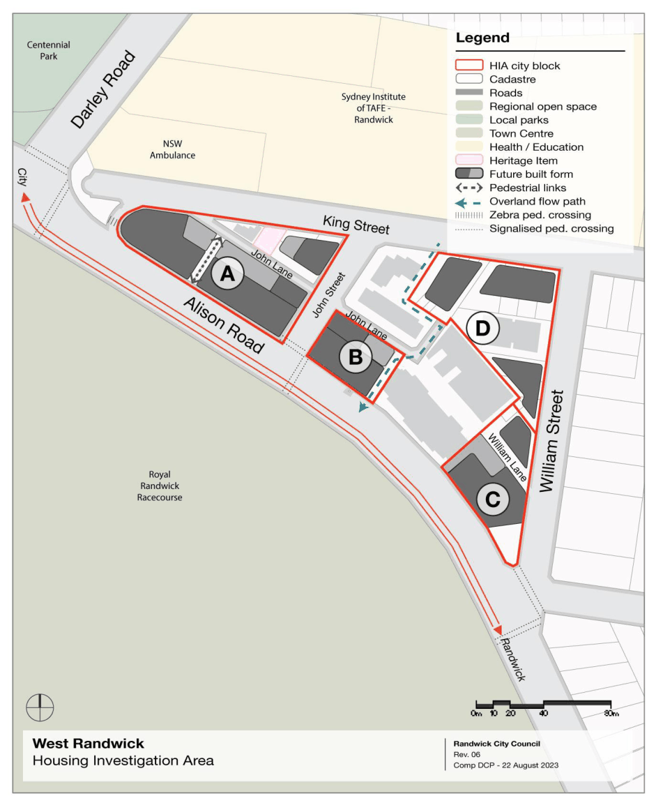

### 9.1. West Randwick HIA

Figure 4: West Randwick WLHA plan

> [Picture on page 23: a picture, saved as a picture (images/part-d14-well-located-housing-area-page-23-2.gif, 150 dpi).]

Source: Randwick City Council 2023 The West Randwick Well Located Housing Area (WLHA) is located in the north of the LGA, in the suburb of Randwick, and the subject city blocks are shown in Figure 4. The WLHA is defined by Alison Road, William Street and King Street.
