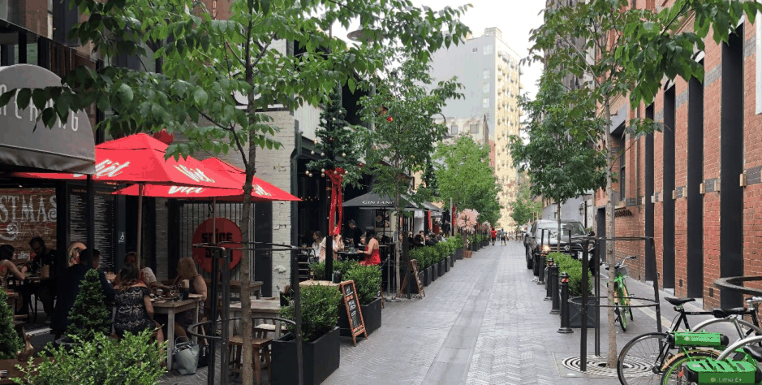

#### 9.1.1. Future character

The West Randwick WLHA will evolve into a vibrant mixed-use precinct that leverages its high visibility along Alison Road.  Ground floor premises will attract businesses seeking high exposure and visibility to passing traffic, pedestrian and public transport users, while upper level apartments will enjoy expansive views across the racecourse. The mid-rise residential building typology, setback from Alison Road, will define and enhance the character of the neighbourhood. This built form will support high quality architectural and design outcomes and contribute to a cohesive streetscape in a location with high amenity – close to public transport, major parklands, entertainment venues and to educational institutions. Access The West Randwick WLHA will prioritise active transport with safe pedestrian and cycling access supported by proximity to two light rail stations (Royal Randwick and Wansey Road) and to public bus services along Alison Road and several shared paths. The fine urban grain of the area will be preserved through the retention of a series of mid-block laneways and pedestrian links which enhance permeability and local connectivity. Private car and service vehicle access for sites fronting Alison Road, William Street and King Street will be provided via John Lane and William Lane, ensuring minimal disruption to the public domain, vehicular and pedestrian movements. Figure 5: Through site links can add urban activity

> [Picture on page 24: a picture, saved as a picture (images/part-d14-well-located-housing-area-page-24-20.gif, 150 dpi).]

Source: Randwick City Council, 2022 Built form The Alison Road frontage will be strengthened through the redevelopment of the two existing service stations and the Malaysia Hall accommodation site, better defining the key corners of the city block, enhancing pedestrian amenity through continuous built frontages and weather protection (such as awnings) and activating the street with increased commercial activity. Existing business uses with active frontages along Alison Road will be complemented by new mixed-use buildings, which will locate commercial uses at ground level and residential apartments above. This will create a more consistent and vibrant streetscape.

Mid-rise buildings up to seven storeys will frame Alison Road, offering residents elevated  views across Royal Randwick Racecourse, building upon the built form character of the existing six storey mixed use building at 34-52 Alison Road. A new mid-rise residential neighbourhood of five storeys will be located behind the proposed mixed-use development fronting Alison Road. This built form will shield the quieter residential area from by the traffic and activity of Alison Road, while allowing them to overlook landscaped mid-block spaces and quieter local streets. Street tree planting will be made consistent along Alison Road and the perpendicular cross streets to reinforce the identity of the city blocks. New street trees will be planted following a consolidated landscape theme, using species of appropriate scale to enhance the streetscape, support biodiversity and improved tree canopy cover. Alison Road A consistent building height along Alison Road will establish a strong street wall that reinforces the urban character of this busy thoroughfare.  The maximum permitted building height of seven storeys will be expressed as a six-storey building form with the upper level set back to reduce visual bulk and improve amenity. Commercial land-uses at ground level fronting Alison Road will provide increased services, activating the area, and contributing to a renewed public realm and enhanced urban amenity. Wider footpaths at the intersection of Alison Road and King Street offer opportunities for ground floor retail and cafes to open out into outdoor seating with a northerly aspect. Street tree planting along Alison Road will be bold and scaled to match the width and prominence of the corridor, creating a green boulevard effect. Interface with R3 zone to north and Heritage Item A sensitive building height transition will be achieved by focusing taller built form along Alison Road and stepping down toward the R3 zoned residential area to the north. This approach to transition will reduce the perceived scale of new development when viewed from adjoining residential streets. The two-storey scale of the heritage listed house at 3 King Street will be respected and integrated into the overall WLHA built form strategy. New development within the WLHA will provide an appropriate backdrop and transition in scale, ensuring the heritage item remains a prominent and valued element of the streetscape.
