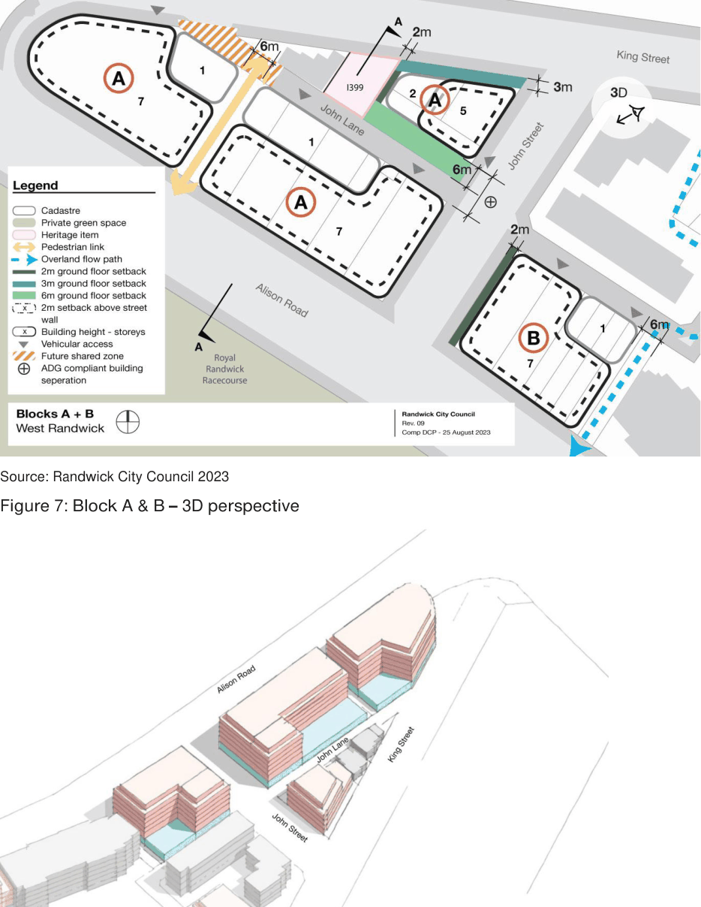
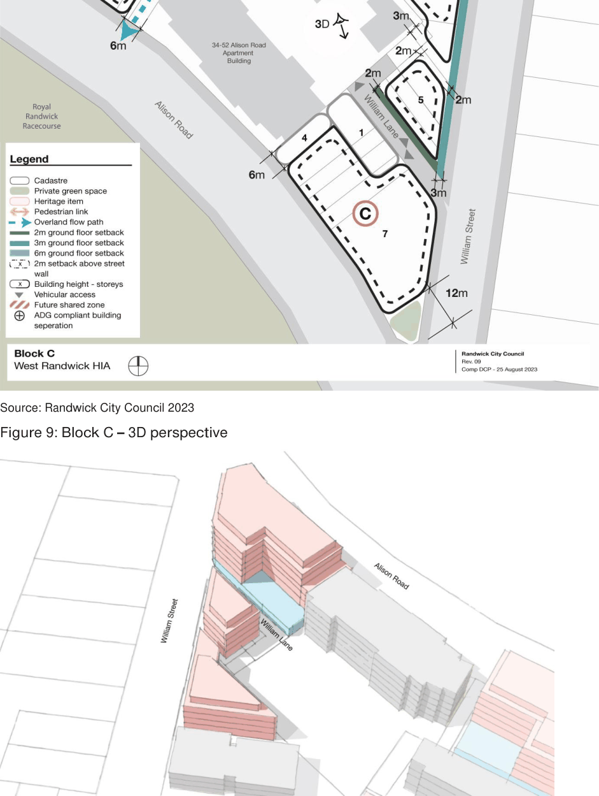
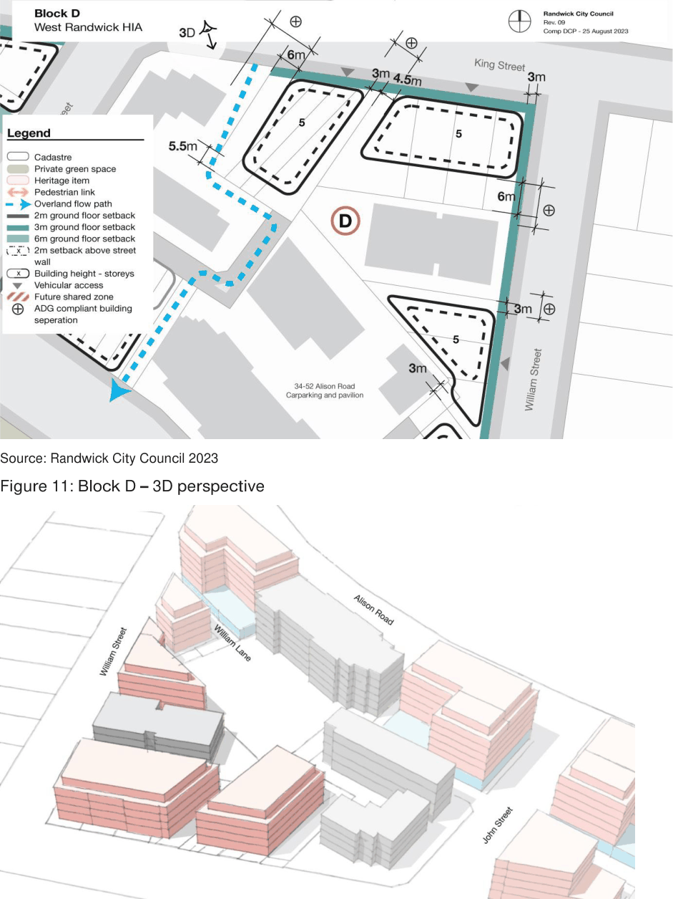
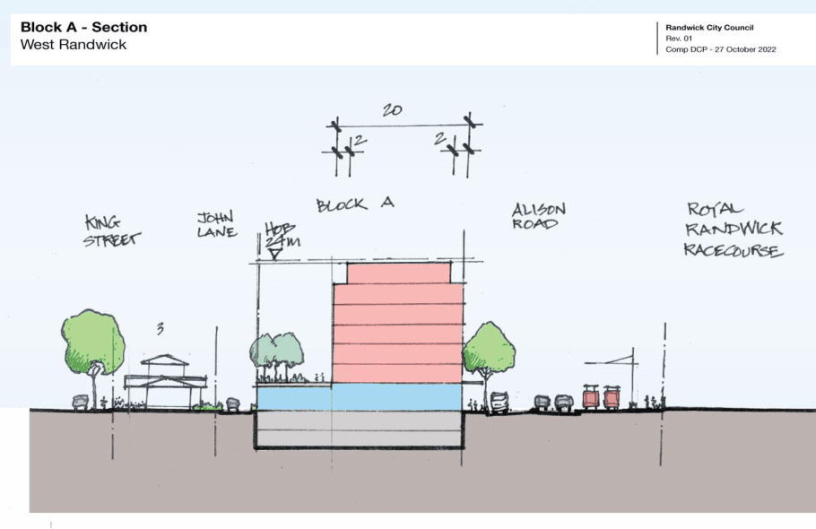

#### 9.1.5. City block plans

Block A and B Figure 6: Block A and B control plan

> [Picture on page 28: a picture, saved as a picture (images/part-d14-well-located-housing-area-page-28-4.gif, 150 dpi).]

Source: Randwick City Council 2023 Figure 7: Block A & B

– 3D perspective

Source: Randwick City Council 2023

Block C Figure 8: Block C control plan

> [Picture on page 29: a picture, saved as a picture (images/part-d14-well-located-housing-area-page-29-3.gif, 150 dpi).]

Source: Randwick City Council 2023 Figure 9: Block C

– 3D perspective

Source: Randwick City Council 2023

Block D Figure 10: Block D control plan

> [Picture on page 30: a picture, saved as a picture (images/part-d14-well-located-housing-area-page-30-3.gif, 150 dpi).]

Source: Randwick City Council 2023 Figure 11: Block D

– 3D perspective

Source: Randwick City Council 2023

Figure 12: Typical cross section A-A

> [Picture on page 31: a picture, saved as a picture (images/part-d14-well-located-housing-area-page-31-2.gif, 150 dpi).]

Source: Randwick City Council 2022

Source: Randwick City Council
