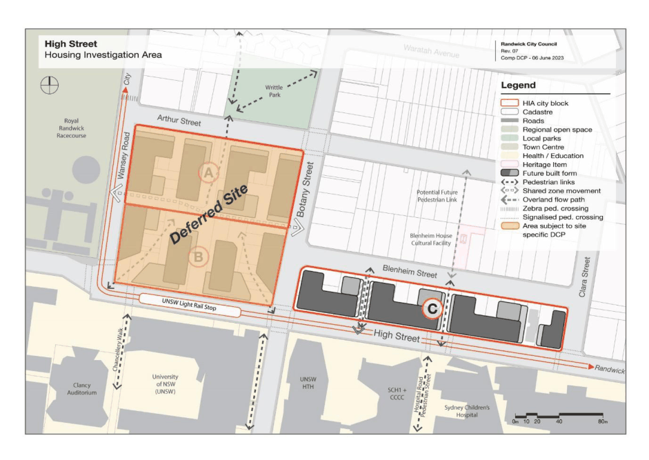

### 9.2. High Street HIA

Figure 13: High Street WLHA plan

> [Picture on page 33: a picture, saved as a picture (images/part-d14-well-located-housing-area-page-33-2.gif, 150 dpi).]

Source: Randwick City Council 2022

The High Street Well Located Housing Area (WLHA) is located in the northern part of the LGA, within the suburb of Randwick. The city blocks are illustrated in Figure 13. The block defined by High Street, Botany Street, Arthur Street and Wansey Road is identified a Deferred Site (not subject to uplift).  Further detailed assessment and will be undertaken by Council, in consultation with stakeholders in accordance with Randwick City Council resolution of 30 August 2022.
