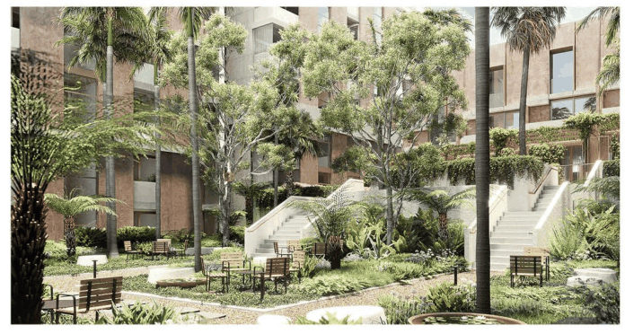
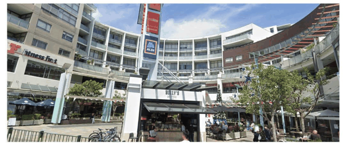

#### 9.2.1. Future character

The High Street WLHA will evolve into a vibrant, mixed use precinct that supports the residents, students visitors and businesses drawn to the

area’s accessibility to major education, health

and retail services and the unique urban qualities of the precinct.  Its strategic location offers convenient access to the Sydney CBD, Bondi Junction, Coogee Beach and to iconic recreational and entertainment destinations enhancing its appeal as a place to live, work, shop, dine and study. The built form will define the surrounding streets and street corners with appropriate scaled buildings, create new courtyard green spaces, and pedestrian links, respond to the various adjoining street and pedestrian thoroughfares and provide an appropriate scale and transition in height to the surrounding urban conditions. Access The precinct will prioritise active transport (pedestrian and bicycle use and access). The precinct will be permeable, providing continuity with adjoining streets, responding to the various

pedestrian desire lines through well designed through block links, so as to create an integrated and connected place. Private car and service vehicle access will be discretely provided at basement level and when through-block vehicular access is required, applying a shared zone approach where necessary. In the long term, Council will explore the potential for a through-block pedestrian link continuing north from Blenheim Street to Arthur Street, aligned with Blenheim House (as part of future redevelopment of the adjoining properties). Built form The built form will reflect a human scale achieved through introducing variations in the heights of buildings along each street (to avoid a large and bulky wall of buildings) limiting the overall length of each building, introducing breaks and articulation of the building facades, stepping back at the upper level and by incorporating steps and recesses along the length of building facades and changes in material and finishes. Buildings will be articulated into base, middle and top components with setbacks and changes in materiality. The roof level/s of buildings should be set back above the six storey street wall to reduce the apparent building height and ensuring they are visually recessive. Roof levels of buildings (above the six storey street wall height) should be expressed in a contemporary mansard roof style, that is visually recessive. Ground floor levels of buildings with a non-residential uses, should be transparent and visually open, with widened footpaths and ground floor frontage should be shaded with contemporary elegant steel awnings that are refined in their expression and detailing to support outdoor dining opportunities. High Street A maximum height of eight storeys applies with a six storey street wall

– the upper two levels

are to be setback from the street wall. Along the High Street frontage occasional breaks in the eight storey buildings and the six storey street wall are required to accommodate the overland flow path, through block pedestrian links and the retention of existing recently completed buildings such as the four storey development at 30 Blenheim Street. Breaks in the High Street elevation, help to mitigate building bulk and allow sunshine through to the High Street streetscape. A break in the High Street frontage will be provided by a through-block pedestrian link aligned with the pedestrianised Hospital Road to the south and with Blenheim House (a cultural facility owned by Council) to the north. A second through-site pedestrian connection is aligned with the existing low point in High Street where there is an existing overland flow flood path, from Blenheim Street to High Street. Blenheim Street Private green, north oriented court gardens with deep soil areas are proposed to alternate along Blenheim Street. This will provide residents with a sunny green common space and break up the scale of the buildings as they will be interspersed with landscaped gardens. Deferred site

– west of Botany Street

The urban block bounded by Arthur Street, Botany Street, High Street and Wansey Road contains a significant number of UNSW owned properties that by Council Resolution has been deferred from Amendment 9 of the Randwick LEP. The potential for site consolidation presents opportunities for coordinated urban planning of the precinct. The future vision includes four integrated

building ‘quarters’ aligned with the surrounding streets and pedestrian connections,

reinforce visual axis and pedestrian desire lines and provide quieter, apartment accommodation oriented around green urban court gardens.

Figure 14: Garden courtyard example

> [Picture on page 35: a picture, saved as a picture (images/part-d14-well-located-housing-area-page-35-2.gif, 150 dpi).]

Source: Google Images 2022

By contrast the southern two quarters will have plazas at their heart with ground level retail / commercial activity opening onto them. Figure 15: Urban courtyard example

> [Picture on page 35: a picture, saved as a picture (images/part-d14-well-located-housing-area-page-35-7.gif, 150 dpi).]

Source: Google Streetview 2022

They will open to High Street with public plaza spaces with commercial/retail ground floor levels that responding to the diagonal pedestrian crossing movements from UNSW Chancellery Walk and Botany Street (and the light rail station) to the south, through the block, north to Arthur Street, Botany Street and Writtle Park to the north. A generous mid-block north-south orientated pedestrian street will open the middle of the urban block with a new sunny landscaped space that visually connects the UNSW High Street light rail stop, north to Writtle Park.
