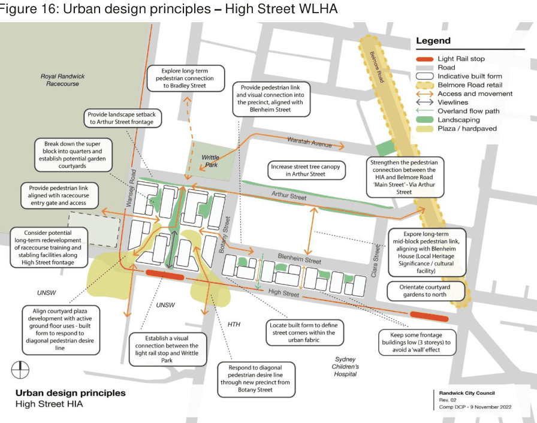

#### 9.2.3. Built form

> [Picture on page 36: a picture, saved as a picture (images/part-d14-well-located-housing-area-page-36-10.gif, 150 dpi).]
> Words printed on the picture (title and legend, copied from the PDF):
> – High Street WLHA

Figure 16: Urban design principles

Source: Randwick City Council 2022 Objectives The built form objectives are to:

1\. Define well-scaled legible streetscapes, laneways, urban plazas and parks to support pedestrian comfort and local identity

2\. Introduce variety and visual interest through articulated buildings forms within the permitted development envelope

3\. Minimise overshadowing the public domain and reduce perceived building height by setting back the upper levels of buildings

4\. Maximise direct sunlight to public spaces and footpath zones by strategically orientating taller built form

5\. Promote courtyard style development with generous central green spaces by positioning built form around perimeter the of city blocks

6\. Support orderly consolidation of sites to realise optimum urban and architectural building design outcomes that comply with the ADG.

Controls

a) Introduce breaks in the High Street frontage to avoid a continuous, bulk (monolithic) wall of buildings and to improve permeability and solar access

b) Establish a consistent six storey street wall height to define the streetscape and maintain a human scale

c) For buildings up to eight storeys, provide a minimum 2m upper-level setback above the six-storey street wall to reduce visual bulk and improve amenity

d) Locate north facing, private courtyard gardens with deep soil zones along Blenheim Street to maximise solar access, provide attractive outlook for residents and support a transition in scale between new development and the existing streetscape

e) Define street corners by including architectural corner elements, weather protection (e.g. awnings) and variations in materials and finishes to enhance legibility and visual interest

f) Ensure that amalgamated redevelopment sites within the High Street WLHA a minimum street frontage less of 30m, except for properties at 32 and 34 Blenheim Street, where a minimum frontage width of 20m applies. For corner sites, both frontages shall achieve this minimum length to support viable and well-scaled development.
