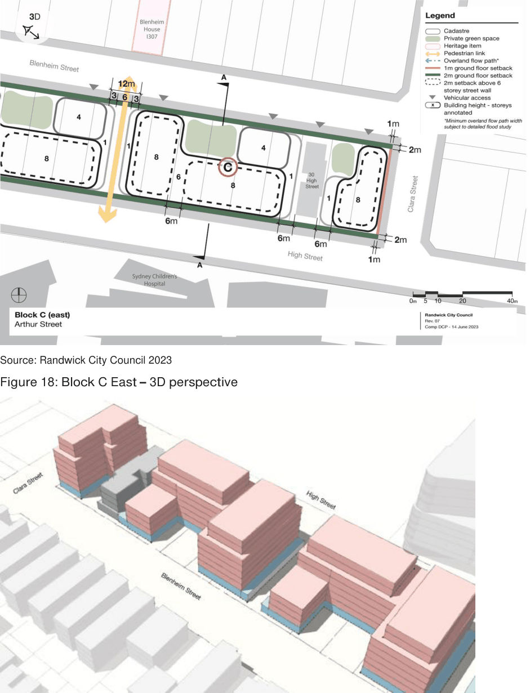
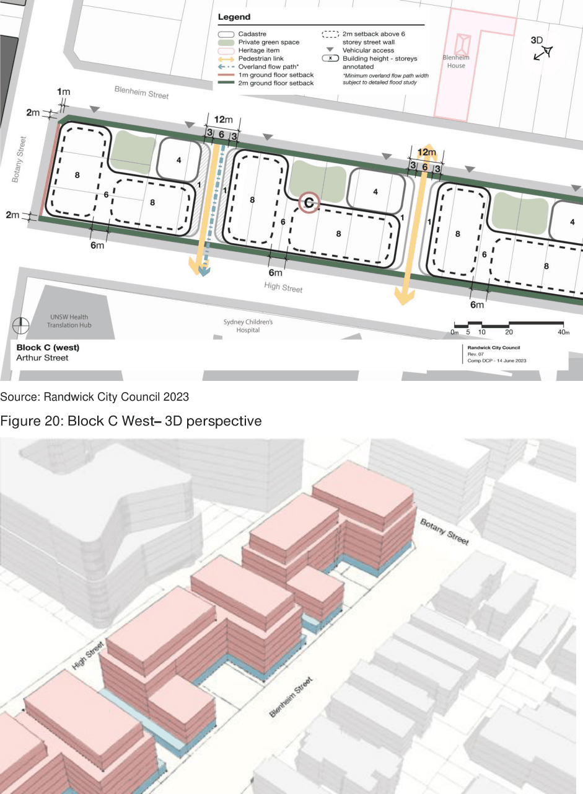
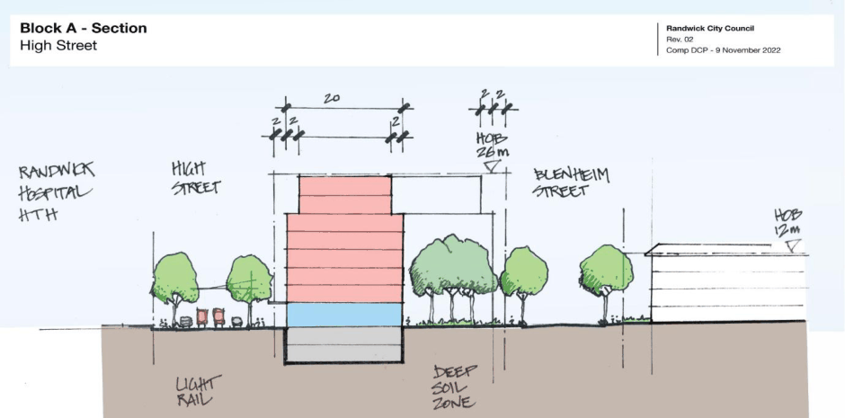

#### 9.2.5. Individual city block plans

Block C Figure 17: Block C control plan east

> [Picture on page 39: a picture, saved as a picture (images/part-d14-well-located-housing-area-page-39-4.gif, 150 dpi).]

Source: Randwick City Council 2023 Figure 18: Block C East

– 3D perspective

Source: Randwick City Council 2023

Figure 19: Block C control plan west

> [Picture on page 40: a picture, saved as a picture (images/part-d14-well-located-housing-area-page-40-2.gif, 150 dpi).]

Source: Randwick City Council 2023 Figure 20: Block C West

– 3D perspective

Source: Randwick City Council 2023

Figure 21: Typical cross section

> [Picture on page 41: a picture, saved as a picture (images/part-d14-well-located-housing-area-page-41-2.gif, 150 dpi).]

Source: Randwick City Council 2023
