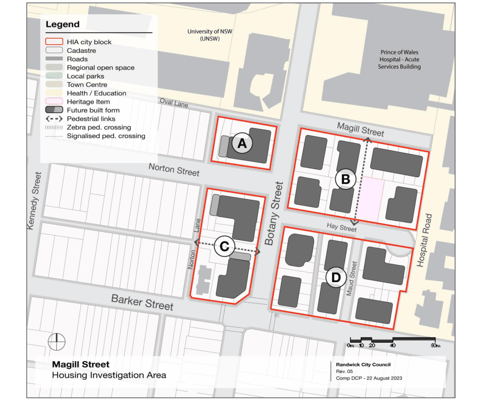

### 9.3. Magill Street HIA

Figure 22: Magill Street WLHA plan

> [Picture on page 43: a picture, saved as a picture (images/part-d14-well-located-housing-area-page-43-2.gif, 150 dpi).]

Source: Randwick City Council 2023 The Magill Street Well Located Housing Area (WLHA) is located in the northern part of the LGA, in the suburb of Randwick. The subject city blocks are illustrated in Figure 22 and are defined by Magill Street / Oval Lane, Hospital Road, Barker Street and Norton Lane.
